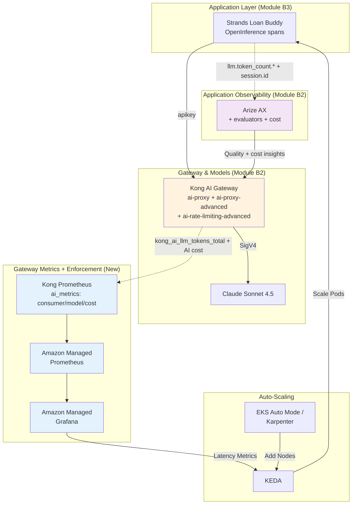

Strands 기반 Loan Buddy 에이전트가 잘 작동하고 있지만, 성공은 새로운 과제를 가져옵니다. 은행의 마케팅 캠페인이 매우 효과적이어서, 이제 시간당 1,000건 이상의 대출 신청을 처리하면서 일관된 품질을 보장하고, 팀별 지출을 어트리뷰션하고, 인프라 상태를 유지해야 합니다 — 모두 **Kong + Arize SaaS 스택** 위에서 말입니다.

::alert[**플랫폼 필요**: 이 모듈은 공유 기반과 모듈 B1-B3(Kong AI Gateway, Arize AX, Strands 기반 Loan Buddy 에이전트) 위에 구축됩니다. SaaS 스택에서 평가, 토큰/비용 어트리뷰션, 라우팅, 모니터링을 추가합니다.]{type="warning"}

::alert[**이것은 [Track A의 모듈 A3](/track-a-opensource/a3-scaling-evaluating/)에 대응하는 SaaS 스택 버전입니다.** 동일한 네 가지 역량 — 평가, 비용 제어, 라우팅, 모니터링 — 을 다루지만, LiteLLM과 Langfuse 대신 Kong과 Arize를 사용합니다. 이 스택에서 어떤 역량이 더 강하거나, 약하거나, 진정으로 다른 경우 각 페이지에서 이를 짚어줍니다.]{type="info"}

## 학습 목표

이 모듈을 마치면 다음을 수행할 수 있습니다:

- 🎯 Arize AX 평가자(OpenInference 트레이스에 대한 LLM-as-a-Judge)를 사용하여 **LLM 품질 평가**
- 💰 Kong의 Prometheus `consumer` 지표와 Arize 세션으로 **테넌트별 토큰 및 비용 어트리뷰션**
- 🚦 `ai-rate-limiting-advanced`로 엣지에서 **테넌트별 토큰/비용 예산 강제 적용**(Track B에서만 가능한 역량)
- 🔀 Kong `ai-proxy-advanced`로 **모델 간 라우팅**(가중치 + 비용 인식 `lowest-usage`)
- 📊 Kong의 AI Prometheus 지표로 **인프라 모니터링** → Amazon Managed Prometheus + Grafana
- ⚡ KEDA 및 EKS Auto Mode / Karpenter를 사용한 **워크로드 오토스케일링**

## 비즈니스 시나리오: 스케일에서의 Loan Buddy 🚀

Strands 기반 Loan Buddy가 몇 주 동안 대출 신청을 성공적으로 처리해왔습니다. 은행 경영진은 깊은 인상을 받았고 AI 기반 즉시 대출 결정을 홍보하는 대규모 마케팅 캠페인을 시작합니다.

**과제:**
- 신청 볼륨이 하룻밤 사이에 시간당 50건에서 1,000건 이상으로 증가
- CFO는 품질을 희생하지 않으면서 비용 최적화와 **팀별 지출 어트리뷰션**을 원함
- 컴플라이언스 팀은 모든 결정에 대한 품질 감사가 필요함
- 플랫폼 팀은 **과도하게 사용하는 테넌트를 제한**하고 신뢰성을 보장해야 함

**당신의 미션:**
Kong + Arize 스택에서 프로덕션급 평가, 비용 어트리뷰션 + 강제 적용, 라우팅, 모니터링을 구축하여 품질을 유지하고 비용을 제어하면서 스케일을 처리합니다.

## 모듈 아키텍처

새로운 역량이 기존 SaaS 스택 플랫폼과 어떻게 통합되는지 살펴봅니다:

## 모듈 섹션

#### 1. [Arize AX를 활용한 LLM 평가](./evaluation/)
에이전트의 OpenInference 트레이스에 대해 LLM-as-a-Judge 평가를 실행합니다. Track A의 Langfuse 평가자에 대응하는 Arize AX 버전입니다.

#### 2. [토큰 모니터링, 추적 및 비용 어트리뷰션](./token-cost-attribution/) ⭐
이 모듈의 핵심: Kong(엣지)과 Arize(트레이스 레벨) 전반에 걸쳐 **테넌트별** 토큰과 비용을 어트리뷰션하고, 게이트웨이에서 테넌트별 예산을 **강제 적용**합니다 — Track A가 할 수 없는 것입니다.

#### 3. [Kong을 활용한 A/B 모델 라우팅](./model-routing/)
`ai-proxy-advanced`로 모델 간 가중치 및 비용 인식(`lowest-usage`) 라우팅을 수행합니다. Track A의 LiteLLM A/B 라우팅에 대응하는 Kong 버전입니다.

#### 4. [인프라 모니터링 및 오토스케일링](./monitoring-scaling/)
Kong의 AI Prometheus 지표를 Amazon Managed Prometheus + Grafana로 스크레이핑하고, KEDA로 오토스케일링합니다. Track A의 AMP/Grafana/KEDA 기반을 Kong의 AI 지표와 함께 재사용합니다.

## 시작하기

Arize AX에서 품질 평가로 시작한 다음, 토큰/비용 어트리뷰션 핵심으로 이동합니다.

---

**[다음: Arize AX를 활용한 LLM 평가 →](./evaluation/)**
