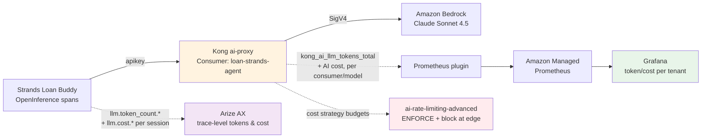

# 💰 Token & Cost Attribution + Budget Enforcement

Once your agent is in production, the questions leadership asks are always the same: **How many tokens are we burning? What is it costing? Which team, app, or tenant is driving the spend — and can we cap the ones that run away?**

In the open-source stack (Track A), LiteLLM answers this with a per–Virtual Key spend ledger. The SaaS stack answers it differently — and in one respect, **more powerfully**: the token/cost story is split across **Kong** (edge attribution + *enforcement*) and **Arize AX** (application-trace depth). This page shows how to solve token monitoring, tracking, and attribution end to end on the Kong + Arize stack.

::alert[**This is a Track-B-only module** — Track A's LiteLLM handles token/cost tracking automatically (built-in per-Virtual-Key spend). Track B requires explicit configuration but gains **edge enforcement** (the ability to *block* a tenant at a budget) which Track A cannot do.]{type="info"}

## 🎯 What You Will Learn

**🔴 Core path (Parts 1–8) — do these; they deliver the full token-economics + budget-enforcement outcome:**

- 🧠 **Part 1** — The Big Picture: how Kong + Arize provide token economics (theory, architecture, correlation)
- 🔧 **Part 2** — Enable AI token & cost metrics on Kong (configuration only)
- 💰 **Part 3** — Configure cost attribution in Arize (granularity levels + custom cost config fix)
- 🚀 **Part 4** — Send traffic (hands-on: send requests to generate traces)
- 📊 **Part 5** — Verify Kong Prometheus metrics (see token/cost/request counts)
- 👁️ **Part 6** — View token economics in Arize AX (traces, spans, sessions, dashboards)
- 🚦 **Part 7** — Enforce per-tenant **token** budgets at the edge (block at limit)
- 💵 **Part 8** — Enforce per-tenant **dollar** budgets (cost-based rate limiting)

**🟡 Optional / advanced (Parts 9–11) — Part 9 (multi-team) is the one to do first if time allows:**

- 👥 **Part 9** — Multi-team attribution (separate consumers + independent budgets) — *recommended optional*
- ⚖️ **Part 10** — Multi-model cost comparison (track Claude + Nova side by side)
- 🌐 **Part 11** — Cross-hosting comparison (Bedrock vs self-managed vLLM on same prompt)

**📎 Reference (Parts 12–13) — read later:**

- 📋 **Part 12** — Token attribution granularity summary (all metrics, labels, PromQL)
- 🧩 **Part 13** — Architecture: why Kong and Arize don't share token data

---

## ✅ Prerequisites

The hands-on Parts (2 onward) build on the Kong gateway + route from **B2** and the Loan Buddy agent from **B3**. Verify they exist before you start:

:::code{language=bash showCopyAction=true}
kubectl get kongroute loan-strands-route -n kong >/dev/null 2>&1 \
  && kubectl get svc loan-buddy-agent -n strands-agents >/dev/null 2>&1 \
  && echo "✅ Prerequisites present: loan-strands-route + loan-buddy-agent found" \
  || echo "❌ PREREQUISITE MISSING — complete B2 (Kong gateway + loan-strands route) and B3 (Loan Buddy Strands agent) first"
:::

::alert[If you see **PREREQUISITE MISSING**, complete **[B2 — Kong AI Gateway](../../b2-ai-gateway-observability/ai-gateway-kong/)** (the `loan-strands-route` KongRoute + `ai-proxy-loan-strands` / `key-auth-loan-strands` plugins) and **[B3 — Running the Application](../../b3-genai-applications-strands/running-application/)** (the `loan-buddy-agent` in the `strands-agents` namespace) before this module — every hands-on Part below depends on them.]{type="warning"}

---

## Part 1 — The Big Picture: Two Vantage Points, One Story

Unlike Track A (where LiteLLM is the single source of token truth), Track B sees tokens from **two complementary vantage points**:



| Vantage point | Tool | Answers | Granularity |
|---|---|---|---|
| **Edge / gateway** | Kong (Prometheus AI metrics + rate limiting) | "Which **Consumer** is spending, and cap them" | per Consumer · model · provider · workspace |
| **Application trace** | Arize AX (OpenInference spans) | "**Why** did this request cost so much — which agent/tool/LLM step" | per session · per span (AGENT/LLM/TOOL) |

::alert[**Why two places?** A gateway sees *requests and identities* but not the agent's internal reasoning; a tracing platform sees the *full span tree* but cannot *enforce* a budget. Track B uses each for what it does best. LiteLLM+Langfuse blur these into one; Kong+Arize keep them separate — which is why per-tenant **enforcement** (below) is something Track B can do that Track A cannot.]{type="info"}

## How Kong and Arize Correlate (The Integration Pattern)

Kong and Arize do **NOT directly integrate** with each other — there's no API call, webhook, or shared database between them. Instead, they observe the **same request from different vantage points**, and the **application code** is the glue that links them:

:::code{language=text showCopyAction=false}
┌─────────────────────────────────────────────────────────────────────────────┐
│                         ONE LOAN APPLICATION REQUEST                         │
├─────────────────────────────────────────────────────────────────────────────┤
│                                                                             │
│  Agent (agent.py)                                                           │
│    ├── Sets: user.id = "loan-strands-agent"  ← SAME as Kong Consumer name  │
│    ├── Sets: session.id = "loan-application-{image_id}"                     │
│    ├── Sends request through Kong with apikey header                        │
│    │     └── Kong sees: consumer="loan-strands-agent", model, tokens        │
│    │         └── Writes: kong_ai_llm_tokens_total{consumer="...", ai_model} │
│    │                                                                        │
│    └── Emits OpenInference spans to Arize via OTLP                          │
│          └── Arize sees: user.id, session.id, llm.token_count.*, model      │
│              └── Computes: cost from token_count × price_map                │
│                                                                             │
├─────────────────────────────────────────────────────────────────────────────┤
│  CORRELATION KEY: user.id in Arize = consumer name in Kong                  │
│  (set by the application — NOT by any Kong↔Arize integration)               │
└─────────────────────────────────────────────────────────────────────────────┘
:::

### Why `user.id` = Kong Consumer Name

The application code intentionally sets `user.id` to the **same value** as the Kong Consumer:

:::code{language=python showCopyAction=false}
# In agent.py:
trace_attributes={
    "user.id": os.environ.get("SERVICE_CONSUMER_ID", "loan-strands-agent"),
    #           ↑ Matches the KongConsumer username: "loan-strands-agent"
}
:::

**Why?** So you can correlate the same team/service across BOTH platforms:

| Question | Where to look | How to find it |
|---|---|---|
| "How many tokens did `loan-strands-agent` consume at the gateway?" | Kong Prometheus | `kong_ai_llm_tokens_total{consumer="loan-strands-agent"}` |
| "What was the cost breakdown PER AGENT STEP for `loan-strands-agent`?" | Arize AX | Filter traces by `user.id = "loan-strands-agent"` → expand spans |
| "Did `loan-strands-agent` hit its rate limit?" | Kong response headers | `X-AI-RateLimit-Remaining-minute-bedrock: 0` |
| "Which tool call consumed the most tokens in that request?" | Arize AX | Same trace → sort spans by `llm.token_count.total` |

**Is `user.id` mandatory?** No — Arize works without it. But without it, you can't filter traces by team/service and you lose the correlation with Kong's Consumer. It's a **best practice**, not a requirement.

### The Two Independent Data Paths

| | Kong (Gateway Path) | Arize (Application Path) |
|---|---|---|
| **Data source** | Bedrock's response `usage` field (prompt/completion tokens) | OpenInference spans from Strands SDK |
| **When data is captured** | At the gateway, after Bedrock responds | Inside the application, when the agent executes |
| **How data flows** | ai-proxy reads `usage` → Prometheus plugin exposes as metrics | OTLP exporter → Arize gRPC endpoint (`otlp.arize.com:443`) |
| **Identity** | `consumer` label (from API key → KongConsumer mapping) | `user.id` trace attribute (set by app code) |
| **Token granularity** | Total per-request (prompt + completion + total) | Per-span (each LLM call within the agent's execution) |
| **Cost** | Computed at gateway from `input_cost`/`output_cost` in plugin config | Computed at Arize ingest from Cost Config price map |
| **Enforcement** | ✅ Can block (429) via `ai-rate-limiting-advanced` | ❌ Observe only — cannot stop a request |
| **Drill-down** | Per-consumer, per-model, per-provider aggregate | Per-span: agent step → tool call → LLM call breakdown |

### How to Cross-Reference the Same Request

For a single loan application processed at 11:07 AM:

**In Kong (gateway view):**
- `kong_ai_llm_tokens_total{consumer="loan-strands-agent", ai_model="global.anthropic.claude-sonnet...", token_type="total_tokens"}` increments by ~2,030
- `kong_ai_llm_cost_total{consumer="loan-strands-agent"}` increments by ~$0.021

**In Arize (trace view) — same request, same time:**
- Trace: `invoke_agent Strands Agents`, latency 14.68s
- Span breakdown: 786 prompt tokens + 1,244 completion tokens = 2,030 total
- `user.id = "loan-strands-agent"` (matches Kong consumer)
- `session.id = "loan-application-{image_id}"` (unique per loan)
- Cost: $0.021 (after User Defined Cost config is set)

::alert[**Kong and Arize never talk to each other.** The correlation happens because the APPLICATION sets the same identity (`loan-strands-agent`) in both places: as the API key's consumer (Kong) and as `user.id` (Arize). If you deploy multiple services, set a different `SERVICE_CONSUMER_ID` env var per deployment — each gets independent tracking in both systems.]{type="info"}

---

## Part 2 — Enable AI Token & Cost Metrics (Kong)

Two plugins work together to emit AI metrics. You must configure **both** — this is the key insight that's easy to miss:

1. **AI Proxy plugin** — must have `logging.log_statistics: true` (tells it to report token/cost data)
2. **Prometheus plugin** — must have `ai_metrics: true` (tells it to expose AI-specific metric series)

Without `log_statistics` on the ai-proxy, the Prometheus plugin has nothing to report — metrics will be empty.

### Step 1: Update the AI Proxy with Logging + Cost Config

Update your existing `ai-proxy-loan-strands` plugin from [Module B2](/track-b-saas/b2-ai-gateway-observability/) to enable statistics logging and set per-token pricing:

:::code{language=yaml showCopyAction=true}
cat <<'EOF' | kubectl apply -f -
apiVersion: configuration.konghq.com/v1
kind: KongPlugin
metadata:
  name: ai-proxy-loan-strands
  namespace: kong
plugin: ai-proxy
config:
  auth:
    param_location: body
    param_name: allow_override
    param_value: "false"
  model:
    name: global.anthropic.claude-sonnet-4-5-20250929-v1:0
    provider: bedrock
    options:
      bedrock:
        aws_region: us-east-1
      input_cost: 3.0
      output_cost: 15.0
  route_type: llm/v1/chat
  logging:
    log_statistics: true
    log_payloads: false
EOF
:::

::alert[**Two critical additions** from the B2 config: (1) `logging.log_statistics: true` — **required** for AI metrics to emit; without it, the Prometheus plugin sees no token/cost data. (2) `input_cost` / `output_cost` (USD per 1M tokens) — enables the cost metric and the `cost` strategy in rate limiting. Set these from the [Amazon Bedrock pricing page](https://aws.amazon.com/bedrock/pricing/).]{type="warning"}

### Step 2: Create the Prometheus Plugin with AI Metrics

Create the Prometheus plugin on the same route (not global — per-route gives you route-scoped metrics):

:::code{language=yaml showCopyAction=true}
cat <<'EOF' | kubectl apply -f -
apiVersion: configuration.konghq.com/v1
kind: KongPlugin
metadata:
  name: prometheus-metrics
  namespace: kong
plugin: prometheus
config:
  ai_metrics: true
  per_consumer: true
  status_code_metrics: true
  latency_metrics: true
EOF
:::

### Step 3: Attach the Prometheus Plugin to the Route

Add `prometheus-metrics` to the route's plugin annotation (alongside the existing `ai-proxy-loan-strands` and `key-auth-loan-strands`):

:::code{language=bash showCopyAction=true}
kubectl annotate kongroute loan-strands-route -n kong \
  konghq.com/plugins="ai-proxy-loan-strands,key-auth-loan-strands,prometheus-metrics" --overwrite
:::

Wait ~10 seconds for Kong Operator to reconcile the config to the DataPlane. That's it — metrics are enabled. You'll verify them in Part 5 after sending traffic.

---

## Part 3 — Configure Cost Attribution in Arize AX

Kong tells you *who* and *how much* at the gateway. Arize tells you *why* — which agent step, tool call, or LLM turn consumed the tokens, and how much each cost. Arize provides **four levels of granularity**:

### Token & Cost Granularity Levels in Arize

| Level | What it shows | Tokens | Cost | Built-in? |
|---|---|---|---|---|
| **Per-span** | Each individual LLM call, tool call, or retriever call | ✅ `llm.token_count.prompt/completion/total` | ✅ `llm.cost.prompt/completion/total` | Yes — automatic per LLM span |
| **Per-trace** | One end-to-end agent invocation (all spans aggregated) | ✅ Auto-sum from child spans | ✅ Auto-sum from child spans | Yes — automatic |
| **Per-session** | All traces sharing the same `session.id` (a conversation) | ✅ Auto-aggregated (built-in column) | ⚠️ Visible per-span; use custom metric for total | Tokens: yes. Cost: custom metric |
| **Per-user** | All traces from the same `user.id` | Filter + custom metrics | Filter + custom metrics | No dedicated tab — use filters |

### Token Attributes (already flowing from your agent)

Every LLM span emitted by the Strands OpenInference processor carries:

| Attribute | Type | Meaning |
|---|---|---|
| `llm.token_count.prompt` | Token | Input tokens for this LLM call |
| `llm.token_count.completion` | Token | Output tokens |
| `llm.token_count.total` | Token | prompt + completion |
| `llm.token_count.prompt_details.cache_read` | Token | Tokens read from prompt cache |
| `llm.token_count.prompt_details.cache_write` | Token | Tokens written to prompt cache |
| `llm.cost.prompt` | Cost ($) | Dollar cost of input tokens (computed at ingest) |
| `llm.cost.completion` | Cost ($) | Dollar cost of output tokens |
| `llm.cost.total` | Cost ($) | Total dollar cost for this span |

::alert[**Cost is computed at ingest time** by Arize matching `llm.model_name` against the Cost Config price map. If cost shows `--`, the model name didn't match any config entry. See "Fix: Add User Defined Cost Config" below (Part 3) for the fix.]{type="warning"}

### How Cost is Computed (Decision Order)

:::code{language=text showCopyAction=false}
For each incoming LLM span:
1. If span already has llm.cost.* attributes → use those (client-provided)
2. Else lookup llm.model_name in Cost Config database:
   - Match on model name (exact or substring)
   - Optionally match on llm.provider
3. Apply: cost = (prompt_tokens / 1M × input_cost) + (completion_tokens / 1M × output_cost)
4. Store llm.cost.prompt, llm.cost.completion, llm.cost.total on the span
5. Aggregate cost up to trace level (sum of all child LLM span costs)
:::

### 🎯 Trace Attributes for Attribution (already configured in agent.py)

The Strands Loan Buddy agent sets `trace_attributes` that enable per-session, per-user, and per-tag filtering:

:::code{language=python showCopyAction=false}
trace_attributes={
    "session.id": f"loan-application-{image_id}",
    "user.id": os.environ.get("SERVICE_CONSUMER_ID", "loan-strands-agent"),
    "tag.tags": ["loan-processing", "credit-underwriting", "strands", "production"],
}
:::

| Attribute | What it enables | Where to see it |
|---|---|---|
| `session.id` | Group traces into conversations; Arize Sessions tab aggregates tokens per session | Arize → **Sessions** tab → sort by token count |
| `user.id` | Filter traces by user/service; build per-user cost metrics | Arize → **Traces** tab → filter `user.id = "loan-strands-agent"` |
| `tag.tags` | Filter by workload type; scope evaluators to tagged traces | Arize → **Filters** → `tag.tags contains "loan-processing"` |

### 🎯 Verify Cost Config (Default Price Map)

Arize ships with a built-in price map for 60+ models. Verify Claude pricing exists:

1. Arize AX → **Settings** → **Cost Configs** → **Default Costs** tab
2. Search for **`claude-sonnet`**
3. Confirm `claude-sonnet-4-5-20250929-v1:0` shows Input = $3.00, Output = $15.00 per 1M tokens


::alert[**The default cost config has `claude-sonnet-4-5-20250929-v1:0` but your traces show `openai/global.anthropic.claude-sonnet-4-5-20250929-v1:0`** — these don't match! Cost will show `--`. Fix below.]{type="warning"}

### 🎯 Fix: Add User Defined Cost Config

The Strands agent's traces show a model name that **doesn't match** any default entry — so you must add a **User Defined Cost** config.

### Why the model name is different *(optional aside)*

The model name in traces comes from the full chain:

:::code{language=text showCopyAction=false}
agent.py → LiteLLMModel → Kong → Bedrock

1. agent.py sets: KONG_MODEL_ID = "openai/global.anthropic.claude-sonnet-4-5-20250929-v1:0"
   ↓ "openai/" prefix tells LiteLLM to use OpenAI-compatible provider (Kong)
2. LiteLLM strips "openai/" → sends model="global.anthropic.claude-sonnet-4-5-20250929-v1:0" to Kong
3. Kong ai-proxy (allow_override=false) validates the model name matches its config → calls Bedrock
4. Strands OpenInference processor logs the FULL model_id (WITH "openai/" prefix) as llm.model_name
   → Trace shows: llm.model_name = "openai/global.anthropic.claude-sonnet-4-5-20250929-v1:0"
:::

**The problem:** Arize's default cost config has `claude-sonnet-4-5-20250929-v1:0` (no prefix). But traces contain `openai/global.anthropic.claude-sonnet-4-5-20250929-v1:0` — no match → cost shows `--`.

**Why can't we just change the app code?**

| Option | Why it doesn't work |
|---|---|
| Remove `openai/` prefix from `KONG_MODEL_ID` | LiteLLM won't know which provider to use — it requires the `openai/` prefix for OpenAI-compatible endpoints |
| Use shorter model name (e.g., `claude-sonnet-4-5`) | Kong's `ai-proxy` with `allow_override=false` enforces **exact match** against the configured model `global.anthropic.claude-sonnet-4-5-20250929-v1:0` — rejects anything else |
| Change Kong to `allow_override=true` | Would allow clients to call any model — security risk in production |

The correct fix: **add a User Defined Cost config in Arize** for the exact model name that appears in traces.

### 🎯 Hands-On: Add Custom Cost Config

1. In Arize AX → **Settings** → **Cost Configs** → **User Defined Costs** tab
2. Click **+ New Model**
3. Fill in the form:

| Field | Value |
|---|---|
| **Model Name** | `openai/global.anthropic.claude-sonnet-4-5-20250929-v1:0` |
| **Applied to** (row 1) | prompt / input |
| **Price per 1M tokens** (row 1) | `3` |
| **Applied to** (row 2) | completion / output |
| **Price per 1M tokens** (row 2) | `15` |
| **LLM Provider** | leave empty |

4. Click **Create**


### Why these values? *(optional aside)*

| Field | Value | Reasoning |
|---|---|---|
| Model Name | `openai/global.anthropic.claude-sonnet-4-5-20250929-v1:0` | Must **exactly match** what appears in trace attribute `llm.model_name` — includes the `openai/` LiteLLM prefix AND the `global.anthropic.` Bedrock cross-region prefix |
| Input: $3.00 | per 1M tokens | Claude Sonnet 4.5 on Bedrock input pricing |
| Output: $15.00 | per 1M tokens | Claude Sonnet 4.5 on Bedrock output pricing |
| LLM Provider | empty | If set, Arize matches against trace's `gen_ai.system` attribute (which shows `strands-agents`, not `bedrock`) — leaving empty avoids mismatch |

::alert[**Cost is NOT retroactive.** Traces ingested before adding this config show `Cost: --`. Only new traces (sent after the config is created) will compute cost. Send a new request through the agent after adding the config to verify.]{type="warning"}

### Verify: cost now appears on new traces

With the cost config in place, cost is computed for every new trace. You'll send fresh requests in **[Part 4](#part-4--send-traffic-through-the-agentic-ai-app-hands-on)** below — when you then view those traces in Arize (Part 6), confirm the cost changed from empty to a dollar value:

- **Before** this fix: `Cost: --`
- **After** this fix: `Cost: $0.006` (for a typical request with ~786 prompt + ~1244 completion tokens)

The cost formula: `(786/1M × $3) + (1244/1M × $15) = $0.00236 + $0.01866 = $0.021`

---

## Part 4 — Send Traffic Through the Agentic AI App (Hands-On)

Now that both Kong (Part 2) and Arize (Part 3) are configured, send requests through the **Loan Buddy Strands agent** to generate end-to-end traces with full token and cost data.

Each request flows: **Agent → Kong `/loan-strands` → Bedrock Claude + MCP Tools → Arize (OTLP trace)**

### Send 3 Credit Applications

Port-forward to the agent and set the image path:

:::code{language=bash showCopyAction=true}
# Idempotent — start the port-forward only if 8890 isn't already forwarding (safe to re-run in any module)
pgrep -f "port-forward.*8890:8080" >/dev/null || kubectl port-forward -n strands-agents svc/loan-buddy-agent 8890:8080 >/tmp/loanbuddy-pf.log 2>&1 &
sleep 3
export LOAN_IMAGE="/workshop/workshops/eks-genai-workshop/static/code/module3/credit-validation/example1.png"
:::

**Request 1:**

:::code{language=bash showCopyAction=true}
curl -s --max-time 180 -X POST \
  http://localhost:8890/api/process_credit_application_with_upload \
  -H "X-Consumer-ID: loan-strands-agent" \
  -H "X-Consumer-ApiKey: loan-strands-key-123" \
  -F "image_file=@${LOAN_IMAGE}" \
  -o /tmp/loan_resp1.json

python3 -c "import json;d=json.load(open('/tmp/loan_resp1.json'));print('Status:',d['status']);print('Image:',d.get('image_id','?')[:20])"
:::

**Request 2:**

:::code{language=bash showCopyAction=true}
curl -s --max-time 180 -X POST \
  http://localhost:8890/api/process_credit_application_with_upload \
  -H "X-Consumer-ID: loan-strands-agent" \
  -H "X-Consumer-ApiKey: loan-strands-key-123" \
  -F "image_file=@${LOAN_IMAGE}" \
  -o /tmp/loan_resp2.json

python3 -c "import json;d=json.load(open('/tmp/loan_resp2.json'));print('Status:',d['status']);print('Image:',d.get('image_id','?')[:20])"
:::

**Request 3:**

:::code{language=bash showCopyAction=true}
curl -s --max-time 180 -X POST \
  http://localhost:8890/api/process_credit_application_with_upload \
  -H "X-Consumer-ID: loan-strands-agent" \
  -H "X-Consumer-ApiKey: loan-strands-key-123" \
  -F "image_file=@${LOAN_IMAGE}" \
  -o /tmp/loan_resp3.json

python3 -c "import json;d=json.load(open('/tmp/loan_resp3.json'));print('Status:',d['status']);print('Image:',d.get('image_id','?')[:20])"
:::

::::expand{header="Check Output — for each request"}

```text
Status: COMPLETED, Image: c5980950ae658c0e...
```

::::

Each request generates:
- A full agentic trace in **Arize** (agent → multiple LLM calls → tool calls → ~2,000+ tokens per request)
- Token/cost metrics in **Kong Prometheus** (per-model, per-consumer aggregates)
- A unique `session.id` per application (allows per-session token tracking in Arize)

Wait ~60 seconds for the Arize `BatchSpanProcessor` to flush all 3 traces.

::alert[**Each request takes ~60-90 seconds** (the agent calls MCP tools + multiple LLM turns). If a request times out, the trace is still emitted — check Arize regardless.]{type="info"}

### Trigger Evaluators on the New Traces

The continuous evaluation tasks (set up in [B4 Evaluation](/track-b-saas/b4-scaling-evaluating/evaluation/)) run on a ~30-60 minute cycle. For **immediate** results on these new traces, trigger each evaluator manually:

1. In Arize AX → **Evaluators** → **Running Eval Tasks** tab
2. For each task (`loan-accuracy`, `loan-helpfulness`, `loan-safety`), click the **`...` menu** → **Run Over Date Range**
3. Set the date range to cover the **last hour**


Each task processes the 3 new traces and scores them (accuracy, helpfulness, safety). Results appear within seconds on the traces.

---

## Part 5 — Verify Kong Prometheus Metrics

After sending traffic (Part 4), verify that Kong's Prometheus endpoint now shows AI metrics:

:::code{language=bash showCopyAction=true}
pkill -f "port-forward.*8100:8100" 2>/dev/null; sleep 1   # free 8100 if an earlier Part's forward is still holding it
# Idempotent — start the Kong metrics port-forward only if 8100 isn't already forwarding
pgrep -f "port-forward.*8100:8100" >/dev/null || kubectl port-forward -n kong $(kubectl get pods -n kong -l app=dataplane -o name | head -1) 8100:8100 >/dev/null 2>&1 &
sleep 3

echo "=== Token metrics ==="
curl -s localhost:8100/metrics | grep "kong_ai_llm_tokens_total" | grep -v "^#"

echo ""
echo "=== Cost metrics ==="
curl -s localhost:8100/metrics | grep "kong_ai_llm_cost_total" | grep -v "^#"

echo ""
echo "=== Request metrics ==="
curl -s localhost:8100/metrics | grep "kong_ai_llm_requests_total" | grep -v "^#" | grep "bedrock"
:::

::::expand{header="Check Output"}

```text
=== Token metrics ===
kong_ai_llm_tokens_total{ai_provider="bedrock",ai_model="global.anthropic.claude-sonnet-4-5-20250929-v1:0",...,token_type="prompt_tokens",...,consumer="loan-strands-agent"} 77
kong_ai_llm_tokens_total{ai_provider="bedrock",ai_model="global.anthropic.claude-sonnet-4-5-20250929-v1:0",...,token_type="completion_tokens",...,consumer="loan-strands-agent"} 43
kong_ai_llm_tokens_total{ai_provider="bedrock",ai_model="global.anthropic.claude-sonnet-4-5-20250929-v1:0",...,token_type="total_tokens",...,consumer="loan-strands-agent"} 120

=== Cost metrics ===
kong_ai_llm_cost_total{ai_provider="bedrock",ai_model="global.anthropic.claude-sonnet-4-5-20250929-v1:0",...,consumer="loan-strands-agent",request_mode="oneshot"} 0.000876

=== Request metrics ===
kong_ai_llm_requests_total{ai_provider="bedrock",ai_model="global.anthropic.claude-sonnet-4-5-20250929-v1:0",...,consumer="loan-strands-agent",request_mode="oneshot"} 9
```

::::

**What you're seeing:**
- **`consumer="loan-strands-agent"`** — per-consumer attribution is working! (enabled by `per_consumer: true` in Part 2)
- **120 total tokens** (77 prompt + 43 completion) attributed to this consumer
- **$0.000876 cost** attributed to this consumer
- **9 requests** from this consumer
- Metrics are dimensioned by: `ai_provider`, `ai_model`, `token_type`, `workspace`, `consumer`, `request_mode`

::alert[**If metrics are empty:** the most common cause is missing `logging.log_statistics: true` on the ai-proxy plugin. Go back to Part 2 Step 1 and confirm it's set. The Prometheus plugin alone is NOT enough — both plugins must work together.]{type="warning"}

::alert[**Port already in use?** Each metrics block above first runs `pkill -f "port-forward.*8100:8100"` to free port 8100 from any forward a previous Part left running, so this should not occur. If you still see "address already in use", a forward is being held elsewhere — either `curl -s localhost:8100/metrics | grep kong_ai_llm` directly (the existing forward still works) or run `pkill -f "port-forward.*8100:8100"` and retry.]{type="info"}

### Latency Metrics (TTFT + TPOT + Provider) *(optional)*

:::code{language=bash showCopyAction=true}
echo "=== TTFT - Time To First Token (avg ms) ==="
curl -s localhost:8100/metrics | grep "kong_ai_llm_ttft_latency_ms_sum\|kong_ai_llm_ttft_latency_ms_count" | grep -v "^#" | grep "bedrock" | grep -v "cache_status=\"hit\"\|cache_status=\"miss\""

echo ""
echo "=== TPOT - Time Per Output Token (avg ms) ==="
curl -s localhost:8100/metrics | grep "kong_ai_llm_tpot_latency_ms_sum\|kong_ai_llm_tpot_latency_ms_count" | grep -v "^#" | grep "bedrock" | grep -v "cache_status=\"hit\"\|cache_status=\"miss\""

echo ""
echo "=== Provider Latency - Total response time (avg ms) ==="
curl -s localhost:8100/metrics | grep "kong_ai_llm_provider_latency_ms_sum\|kong_ai_llm_provider_latency_ms_count" | grep -v "^#" | grep "bedrock" | grep -v "cache_status=\"hit\"\|cache_status=\"miss\""
:::

**What these measure:**

| Metric | Meaning | Use case |
|---|---|---|
| `kong_ai_llm_ttft_latency_ms` | Time from request sent to first token received | User-perceived responsiveness |
| `kong_ai_llm_tpot_latency_ms` | Time per output token (total time / completion tokens) | Model generation speed |
| `kong_ai_llm_provider_latency_ms` | Total response time from Bedrock | End-to-end provider performance |

Compute average latency: `sum / count`. For example, if `_sum = 45000` and `_count = 21`, avg = 2,142ms per streaming request.

### Cache Metrics (Semantic Cache) *(optional)*

If you used the `ai-semantic-cache` plugin (Module B5), cache metrics also appear.

::alert[**In B4 these return empty — that is expected.** Semantic caching (the `ai-semantic-cache` plugin) is not deployed until the **[Model Routing & Semantic Caching](../model-routing/)** (B4, Part 9). Until then `kong_ai_cache_*` metrics have no series and the two commands below print nothing. Run them again after deploying semantic caching to see hits/misses.]{type="info"}

Once semantic caching is deployed (B5), these populate:

:::code{language=bash showCopyAction=true}
echo "=== Cache Embeddings Latency (time to embed the prompt) ==="
curl -s localhost:8100/metrics | grep "kong_ai_cache_embeddings_latency_ms" | grep "_sum\|_count" | grep -v "^#"

echo ""
echo "=== Cache Fetch Latency (time to search Redis) ==="
curl -s localhost:8100/metrics | grep "kong_ai_cache_fetch_latency_ms" | grep "_sum\|_count" | grep -v "^#"
:::

**Expected (if semantic cache was used):**

:::code{language=text showCopyAction=false}
kong_ai_cache_embeddings_latency_ms_count{...cache_status="hit"...} 4
kong_ai_cache_embeddings_latency_ms_sum{...cache_status="hit"...} 432
kong_ai_cache_embeddings_latency_ms_count{...cache_status="miss"...} 5
kong_ai_cache_embeddings_latency_ms_sum{...cache_status="miss"...} 588
:::

This tells you: 4 cache hits (avg 108ms embedding time), 5 cache misses (avg 118ms) — the embedding cost is similar for hits and misses (the savings come from skipping the Bedrock LLM call on hits).

### View Per-Consumer Attribution in Kong Konnect UI

The Kong Konnect control plane **Overview** page shows per-consumer and per-route traffic attribution that is NOT available in the local Prometheus (due to the empty `consumer=""` label issue):

1. Open **Kong Konnect** → `kong-aws` control plane → **Overview**
2. The **Analytics** section on the Overview page shows:
   - **Requests** total (e.g., 6.3K) with week-over-week trend
   - **Error rate** and **Average latency**
   - **Top 5 gateway services by traffic** (e.g., `loan-strands-bedrock: 471`, `loan-strands-nova: 9`)
   - **Top 5 routes by traffic** (e.g., `loan-strands-route: 471`)
   - **Top 5 consumers by traffic** (e.g., `loan-strands-agent: 467`) ← **per-consumer attribution works here!**


::alert[**Per-consumer attribution works in Konnect UI** even though the local Prometheus `consumer` label is empty. The Konnect cloud tracks consumer identity internally. For token/cost breakdowns per model, use the local Prometheus metrics (Part 5 commands above). For per-consumer request counts, use the Konnect UI.]{type="info"}

::alert[**Token-level AI metrics (TTFT, TPOT, cost per token) are NOT shown in the Konnect Overview** — the Konnect UI shows request-level analytics (count, latency, error rate) but not AI-specific token/cost breakdowns. For token economics, use the **local Prometheus endpoint** (commands above) or export to **Grafana** (see Part 11 PromQL queries).]{type="warning"}

### Complete Kong AI Metrics Reference *(optional — see also Part 12)*

All 6 metric families exposed by the Prometheus plugin with `ai_metrics: true`:

| Metric | Type | What it tracks |
|---|---|---|
| `kong_ai_llm_tokens_total` | Counter | Token consumption (prompt/completion/total) per model |
| `kong_ai_llm_cost_total` | Counter | Dollar cost per model (requires `input_cost`/`output_cost` in ai-proxy) |
| `kong_ai_llm_requests_total` | Counter | Request count per model |
| `kong_ai_llm_provider_latency_ms` | Histogram | Total response time from the LLM provider |
| `kong_ai_llm_ttft_latency_ms` | Histogram | Time to first token (streaming responsiveness) |
| `kong_ai_llm_tpot_latency_ms` | Histogram | Time per output token (generation speed) |
| `kong_ai_cache_embeddings_latency_ms` | Histogram | Time to generate embedding for cache lookup |
| `kong_ai_cache_fetch_latency_ms` | Histogram | Time to search the vector DB (Redis) for cache match |

### The `consumer` label — per-tenant attribution

As of **Kong 3.11+**, the AI metrics support a **`consumer`** label — designed to "attribute AI usage and token counts to individual Consumers." This is enabled by `per_consumer: true` in the Prometheus plugin config (Part 2 Step 2).

After sending requests with the correct config, you'll see metrics split by consumer:

:::code{language=text showCopyAction=false}
kong_ai_llm_tokens_total{...consumer="loan-strands-agent"} 50
kong_ai_llm_cost_total{...consumer="loan-strands-agent",request_mode="oneshot"} 0.000366
kong_ai_llm_requests_total{...consumer="loan-strands-agent",request_mode="oneshot"} 4
:::

::alert[**`per_consumer: true` is required** in the Prometheus plugin config for the consumer label to populate. Without it, the label exists but is always empty. This was added in Part 2 Step 2.]{type="warning"}

---

## Part 6 — View Token Economics in Arize AX

After sending traffic (Part 4), check Arize to see the token and cost data across all granularity levels:

### 1. Traces list (per-trace tokens + cost)

Open Arize AX → **Tracing Projects** → `loan-strands` → **Traces** tab. The header bar shows aggregate stats: **Traces 4**, **P50 57.24s**, **P99 1m 4s**, **Tokens 45.29k**, **Cost $0.26025**. Each trace row shows:
- Status (✅), Kind (AGENT), Name (`invoke_...`), Input, Output, Start Time
- **Latency** (29.69s, 1m 4s, 53.68s, 57.24s)
- **Trace Evaluations** (`loan-accuracy: accurate` + 2 more)
- **Total Cost** ($0.031413, $0.082632, $0.07305, $0.073155)


### 2. Trace detail (click into a trace)

Click any trace to open the detail view. The header bar shows:
- **Trace ID**: `6b76f9a1...6d4e1957`
- **Session**: `loan-application-20316...` (links to Sessions tab)
- **Status ✅ OK** · **Latency 29.69s** · **Cost $0.031413** · **Start Time** 4/8/2026, 10:32:04 am
- **Trace Evals**: `loan-accuracy: accurate` · `loan-helpfulness: helpful` · `loan-safety: safe`

The **Trace Tree** (3 spans) shows the agent's execution hierarchy:
- **`invoke_agent Strands Agents`** — root AGENT span (3 evals, 29.69s, 2,351 tk, $0.031413)
  - **`execute_event_loop_cycle`** — the agent's reasoning loop (29.69s)
    - **`chat`** — the LLM call to Bedrock via Kong (29.69s, 2,351 tk, $0.031413)

The right panel shows **Input / Output**:
- **Input**: "Please process this credit application and provide a comprehensive credit assessment. Image_Id: 20316a2ab..."
- **Output**: The agent's response with tool calls (`mcp-server_extract_credit_application`, `validate_income`, `validate_employment`, `validate_address`) and the final credit assessment


### 3. Sessions (per-session token & cost)

Arize → **Sessions** tab shows all sessions grouped by `session.id`. The header shows aggregate stats:
- **Total Sessions**: 4
- **Total Tokens**: 45.29k (across all sessions)
- **Total Cost**: $0.26025 (across all sessions)


Each session row shows:

| Column | Example | Meaning |
|---|---|---|
| Session ID | `loan-app...fe7ed678` | The `session.id` set in agent.py (`loan-application-{image_id}`) |
| Input | "Please process this credit application..." | First user message |
| Output | "I'll process this credit application..." | Agent's response |
| Latency | 29.69s | Total session duration |
| User | `loan-strands-agent` | The `user.id` attribute |
| Traces | 1 | Number of traces in this session |
| Tokens | 4,702 | Total tokens consumed in this session |
| Cost | $0.062826 | Total cost for this session |
| Start Time | 4/8/2026, 05:02 am | When the session started |

::alert[**In this workshop, each session has exactly 1 trace** because we create a new `session.id` per agent invocation (`loan-application-{image_id}` — unique per request). In production, a session typically groups MULTIPLE traces (e.g., a multi-turn conversation where the user asks follow-up questions). The Sessions tab aggregates tokens/cost across all traces in that session — useful for tracking total cost of a complete customer interaction.]{type="info"}

### 4. Per-User view (filter by `user.id`)

The `user.id` attribute (set to `loan-strands-agent` in Part 1's correlation pattern) enables filtering all sessions/traces by team/service:

1. Arize → **Sessions** tab → click **Add Filter**
2. Add filter: `attributes.user.id = 'loan-strands-agent'`
3. The header updates to show aggregate stats for this user only: **Total Sessions 7**, **Total Tokens 88.18k**, **Total Cost $0.333945**

All sessions from this consumer/team are shown with their per-session tokens and cost. The filter confirms the correlation between Kong's consumer and Arize's `user.id` — both set to `loan-strands-agent` by the application.


::alert[**Per-user aggregation uses the Sessions tab + filter.** Filter by `attributes.user.id = 'loan-strands-agent'` to see all sessions/tokens/cost for that team. In production with multiple teams (each with a different `SERVICE_CONSUMER_ID`), you can compare costs across teams by switching the filter value.]{type="info"}

### 5. Token Tracking & Latency Dashboard (project-level aggregate) *(optional)*

Create a custom dashboard: Arize → **Dashboards** → **+ New Dashboard** → name it "Token Tracking and Latency Dashboard" → select `loan-strands` project. Add widgets for the metrics below.

**Panel 1 — Token Totals + Daily Trend:**


Key metrics:
- **Total Prompt Token Count**: 82,642 (`Sum of attributes.llm.token_count.prompt`)
- **Total Response Token Count**: 24,684 (`Sum of attributes.llm.token_count.completion`)
- **Total Token Count**: 107,326 (`Sum of attributes.llm.token_count.total`)
- **Average per request**: Prompt 2,361 / Response 705 / Total 3,066
- **Total Token Count per day**: time series showing Total, Prompt, and Response token trends

**Panel 2 — Average Tokens + Request Volume + Latency:**


Key metrics:
- **Average Token Count per day**: time series (Average Total Tokens / Prompt Average / Response Average)
- **Request Count**: 14 total spans (`Count of attributes.openinference.span.kind`)
- **Average LLM Latency**: 38,443ms (`Average of latency_ms`)
- **Daily Request Count**: time series showing request volume over time

**Panel 3 — Distributions (Latency + Token Histograms):**


Key metrics:
- **Latency Distribution**: histogram showing most requests in 0-165ms range (cached) or 18-38s range (full agent execution)
- **Daily Average Response Latency**: trend line showing latency increasing as agent complexity grows
- **LLM Prompt Token Distribution**: histogram showing prompt sizes (most 1.6k-3.8k tokens per LLM call)
- **LLM Response Token Distribution**: histogram showing response sizes (most 0-300 or 1.5k-2.5k tokens)

### 6. Project Overview Dashboard (tokens + cost by model) *(optional)*

The **Tracing Project Overview Dashboard** is a built-in dashboard providing a single-pane view of project health, token economics, and evaluation quality.


Key metrics on this dashboard:

| Widget | What it shows |
|---|---|
| **Traces Over Time** | Daily trace count (Total Traces vs Error Traces) — request volume trend |
| **Average Span Latency** | Latency trend (8k-16k ms for full agent processing) |
| **Latency Distribution** | Histogram — cached requests (0-165ms) vs full agent (18-38s) |
| **Token Count and Cost by Model** | Per-model table: `openai/global.anthropic.claude-sonnet-4-5-20250929-v1:0` — 2,15,269 tokens, **$0.6679 total cost** |
| **Token Usage Breakdown** | Time series: Total / Prompt / Completion tokens per day |
| **Average Eval Scores** | Evaluation score trends (loan-safety, loan-accuracy, loan-helpfulness) |

::alert[**"Token Count and Cost by Model"** is the key cost attribution widget. It shows each model's cumulative token usage and dollar cost. With multiple models (Claude + Nova), each appears as a separate row for cost comparison.]{type="info"}

### 7. Project Signal (auto-detected issues in your traces) *(optional)*

If you enabled **Signal** on the `loan-strands` project (in [B3 — Running the Application](../../b3-genai-applications-strands/running-application/#step-5-explore-the-complete-workflow-in-arize-ax)), open the project's **Signal** tab to see what its scheduled sweeps found. Instead of you scanning traces one by one, Signal's agent reviews them automatically and surfaces **ranked issues with evidence**:

- **Issues Found** — a breakdown of detected issues by entity (e.g. `invoke_agent Strands Agents`, `execute_tool validate…`) and **Issues Over Time** — when they appeared
- **Detected Issues** — each issue ranked by **severity** (High / Medium) with a matching-trace count, e.g. *"OpenAI connection error causes full credit assessment pipeline failure"* or *"Credit application agent consistently exceeds 50 s end-to-end"*
- **Issue detail** — an **Overview** explaining the root cause across the affected spans, plus **Next Steps**: **Add to Dataset**, **Create Evaluator**, **Mute**, or **Mark as fixed**

This turns raw token/cost/latency traces into an actionable quality-and-reliability backlog — the "so what do I fix?" layer on top of the metrics you viewed above.


### 8. Organization Summary Dashboard (org-wide token economics) *(optional)*

Everything above is scoped to the **`loan-strands` project**. Arize AX also has an **Organization Summary Dashboard** that rolls the same token/cost/eval signals up across **every project and Space in your org** — the single-pane view for platform owners. Open it from **Settings → Summary Dashboard** (`ORG SETTINGS` in the left nav); the time range (top-right) defaults to **Last 7 Days**. It has three panel groups:

**a) Volume / Usage** — throughput and scale: **Trace Count Over Time**, **Errors Over Time**, **LLM Spans Over Time**, and **Count Models By Type** (per Space, with % share).


**b) Performance & Cost** — the money view: **Average Latency Over Time**, **Total Cost Over Time**, **Model Cost By Space Over Time**, and **Cost By Model Over Time** (e.g. `claude-sonnet-4` 59% vs the Bedrock Sonnet route 41%). This is the org-level equivalent of the per-project cost attribution you configured in Part 3.


**c) Evaluations** — quality across the org: **Average Eval Score Over Time** and **Distribution of Eval Labels** (selectable per evaluator, e.g. `loan-accuracy`), plus an **Alerts & Monitoring** row (Monitors Triggered / Models That Triggered Alerts).


::alert[**Project view vs org view.** Use the project **Evals & Metrics** / **Signal** tabs (above) while building and debugging one app; use the **Organization Summary Dashboard** for the platform-wide roll-up — total spend, per-model cost share, and eval quality across every team's Space in one place.]{type="info"}

---

## Part 7 — Enforce Per-Tenant Token Budgets at the Edge (Kong) ⭐

This is the capability **Track A does not have**. Langfuse and Arize *observe* spend; they cannot *stop* it. Kong's **`ai-rate-limiting-advanced`** plugin enforces a budget — and can **block requests at the edge** once a Consumer exceeds it:

1. **`ai-rate-limiting-advanced` plugin** — reads the `usage` field from the LLM provider's response (prompt_tokens + completion_tokens) and tracks cumulative consumption per Consumer per window
2. **Enforcement at the edge** — once the budget is exhausted, Kong returns **HTTP 429** immediately, **before the request reaches Bedrock** — no tokens consumed, no cost incurred

### 🎯 Hands-On: Cap the Consumer's Token Budget

Create a plugin with a **small budget for testing** (50 tokens per 60 seconds — enough for 1-2 short requests before it blocks):

:::code{language=yaml showCopyAction=true}
cat <<'EOF' | kubectl apply -f -
apiVersion: configuration.konghq.com/v1
kind: KongPlugin
metadata:
  name: ai-ratelimit-loan-strands
  namespace: kong
plugin: ai-rate-limiting-advanced
config:
  llm_providers:
    - name: bedrock
      window_size: [60]
      limit: [50]
  tokens_count_strategy: total_tokens
  strategy: local
EOF
:::

#### Plugin config explained

| Field | Value | Meaning |
|---|---|---|
| `llm_providers[].name` | `bedrock` | Track the budget per LLM provider (matches the ai-proxy's provider) |
| `llm_providers[].window_size` | `[60]` | Rolling window of 60 seconds — budget resets after this period |
| `llm_providers[].limit` | `[50]` | Allow a maximum of **50 tokens** within the window (intentionally low for testing) |
| `tokens_count_strategy` | `total_tokens` | Count **prompt + completion** tokens combined (alternatives: `prompt_tokens`, `completion_tokens`, or `cost`) |
| `strategy` | `local` | Each DataPlane node tracks its own counter (use `cluster` for shared Redis-backed counting in multi-node production) |

#### Response headers

The plugin adds these headers to every response:

| Header | Meaning |
|---|---|
| `X-AI-RateLimit-Limit-minute-bedrock` | Max tokens allowed per window (`50`) |
| `X-AI-RateLimit-Remaining-minute-bedrock` | Tokens remaining in current window |
| `X-AI-RateLimit-Reset-minute-bedrock` | Seconds until the window resets (budget refills) |
| `X-AI-RateLimit-Retry-After-minute-bedrock` | How long the client should wait before retrying |

The header naming pattern is: `X-AI-RateLimit-{metric}-{window}-{provider}` — so `minute` = our 60s window, `bedrock` = the LLM provider.

#### Attach it to the route

:::code{language=bash showCopyAction=true}
kubectl annotate kongroute loan-strands-route -n kong \
  konghq.com/plugins=ai-proxy-loan-strands,key-auth-loan-strands,prometheus-metrics,ai-ratelimit-loan-strands --overwrite
:::

#### ✅ Verify the plugin exists AND is attached (do not skip)

::alert[**Critical check.** If the route's annotation references a plugin name that doesn't exist as a `KongPlugin`, Kong **silently skips it** — the route keeps working, so every test request returns **`200` with no `X-AI-RateLimit-*` headers** and it looks like rate limiting "isn't working." Run this gate before testing; both commands must succeed.]{type="warning"}

:::code{language=bash showCopyAction=true}
kubectl get kongplugin ai-ratelimit-loan-strands -n kong
kubectl get kongroute loan-strands-route -n kong \
  -o jsonpath='{.metadata.annotations.konghq\.com/plugins}{"\n"}' | grep -q ai-ratelimit-loan-strands \
  && echo "OK: route references ai-ratelimit-loan-strands" \
  || echo "MISSING: re-run the KongPlugin apply above"
:::

If the first command returns `NotFound`, the plugin was never created (or a prior **cleanup** deleted it) — **re-apply the `KongPlugin` block above**, then continue.

### 🚀 Test: Send Requests Until 429

Set the Kong proxy URL:

:::code{language=bash showCopyAction=true}
export KONG_PROXY="http://$(kubectl get svc -n kong proxy1 -o jsonpath='{.status.loadBalancer.ingress[0].hostname}')"
echo "KONG_PROXY=$KONG_PROXY"   # verify this prints a real hostname before continuing
:::

#### Request 1 — First request (should succeed)

:::code{language=bash showCopyAction=true}
curl -s -D - -X POST "$KONG_PROXY/loan-strands/v1/chat/completions" \
  -H "Content-Type: application/json" -H "apikey: loan-strands-key-123" \
  -d '{"model":"global.anthropic.claude-sonnet-4-5-20250929-v1:0","messages":[{"role":"user","content":"Say hello"}],"max_tokens":5}' \
  | grep -iE "HTTP/|X-AI-RateLimit"
:::

::::expand{header="Show Output"}

```text
HTTP/1.1 200 OK
X-AI-RateLimit-Limit-minute-bedrock: 50
X-AI-RateLimit-Remaining-minute-bedrock: 50
```

::::

**Why `Remaining: 50` (not less)?** The `ai-rate-limiting-advanced` plugin counts tokens **after the response is received from Bedrock** — but it reports the remaining budget as of **before** the current request's tokens are subtracted in the response headers. So the first request's headers show the full budget (50). The tokens consumed by this request (~13 total: 8 prompt + 5 completion) will be reflected in the *next* request's `Remaining` value. Think of it as: "you had 50 tokens available when this request started."

#### Request 2 — Second request (succeeds, budget decreasing)

:::code{language=bash showCopyAction=true}
curl -s -D - -X POST "$KONG_PROXY/loan-strands/v1/chat/completions" \
  -H "Content-Type: application/json" -H "apikey: loan-strands-key-123" \
  -d '{"model":"global.anthropic.claude-sonnet-4-5-20250929-v1:0","messages":[{"role":"user","content":"Explain Kubernetes"}],"max_tokens":50}' \
  | grep -iE "HTTP/|X-AI-RateLimit"
:::

::::expand{header="Show Output"}

```text
HTTP/1.1 200 OK
X-AI-RateLimit-Limit-minute-bedrock: 50
X-AI-RateLimit-Remaining-minute-bedrock: 34
```

::::

**Why `Remaining: 34`?** Request 1 consumed ~16 tokens (prompt + completion). The budget started at 50, minus 16 = 34 remaining when request 2 started. (The exact number varies slightly with tokenization — you'll typically see ~34-40; what matters is that it dropped below 50.) This request will consume another ~61 tokens (11 prompt + 50 completion with `max_tokens:50`), pushing the total well past 50. But since the request was allowed to start (34 > 0), it completes — the overage is tracked and the *next* request will be blocked.

#### Request 3 — Third request (BLOCKED — 429)

:::code{language=bash showCopyAction=true}
curl -s -D - -X POST "$KONG_PROXY/loan-strands/v1/chat/completions" \
  -H "Content-Type: application/json" -H "apikey: loan-strands-key-123" \
  -d '{"model":"global.anthropic.claude-sonnet-4-5-20250929-v1:0","messages":[{"role":"user","content":"Write about AWS EKS"}],"max_tokens":100}' \
  | grep -iE "HTTP/|X-AI-RateLimit|rate limit exceeded"
:::

::::expand{header="Show Output"}

```text
HTTP/1.1 429 Too Many Requests
X-AI-RateLimit-Limit-minute-bedrock: 50
X-AI-RateLimit-Remaining-minute-bedrock: 0
X-AI-RateLimit-Reset-minute-bedrock: 36
X-AI-RateLimit-Retry-After-minute-bedrock: 36

{"message":"AI token rate limit exceeded for provider(s): bedrock"}
```

::::

**Why 429?** The accumulated token consumption from requests 1+2 exceeded the 50-token budget. Kong immediately rejects request 3 **before it reaches Bedrock** — no tokens are consumed, no Bedrock call is made, no cost incurred. The `Reset: 36` means the 60-second window resets in 36 seconds — after that, the budget refills to 50 and requests flow again.

#### Summary: Budget progression

| Request | Status | Remaining | Why |
|---|---|---|---|
| 1 | 200 OK | 50 | Full budget at start; tokens deducted after response |
| 2 | 200 OK | 34 | Request 1 used ~16 tokens (50-16=34) |
| 3 | 429 | 0 | Budget exhausted; blocked before reaching Bedrock |

::alert[**The 429 fires BEFORE the request reaches Bedrock.** This is the key difference from Track A — the gateway enforces the budget at the edge. The application never sees the blocked request, and you're never billed for it. Once the window resets (60 seconds), requests flow again.]{type="success"}

::alert[**For production:** increase the budget to realistic values (e.g. `limit: [100000]`, `window_size: [3600]` = 100k tokens/hour per consumer). See Part 8 below for a **dollar cap** instead of raw tokens.]{type="info"}

::alert[**Multi-tenant pattern:** give each team its own `KongConsumer` + key + `ai-rate-limiting-advanced` policy. Each tenant gets an independent budget enforced at the edge — a complete per-tenant FinOps story with zero application code.]{type="info"}

#### Cleanup: Remove the token rate limit before proceeding

Delete the Part 7 rate-limit plugin and restore the route to its baseline so the next Part starts clean (idempotent — safe to re-run). `--wait=false` returns immediately: Kong CRs finalize via the Konnect control plane, so a default `kubectl delete` would block your shell until that remote delete completes — the annotate below already removes the plugin from the route, so enforcement stops regardless:

:::code{language=bash showCopyAction=true}
kubectl delete kongplugin ai-ratelimit-loan-strands -n kong --ignore-not-found --wait=false
kubectl annotate kongroute loan-strands-route -n kong \
  konghq.com/plugins=ai-proxy-loan-strands,key-auth-loan-strands,prometheus-metrics --overwrite
:::

---

## Part 8 — Enforce Per-Tenant Dollar Budgets (Cost-Based Rate Limiting) ⭐

For a **dollar cap** instead of raw tokens, change `tokens_count_strategy` to **`cost`**. Kong computes cost using `input_cost`/`output_cost` from the ai-proxy plugin config and blocks when the dollar budget is reached.

1. **`tokens_count_strategy: cost`** — the plugin multiplies prompt tokens by `input_cost` and completion tokens by `output_cost` (both from your ai-proxy config, in USD per 1M tokens), tracks cumulative dollar spend per Consumer
2. **Same enforcement** — once spend exceeds the budget, Kong returns HTTP 429 before reaching Bedrock

### 🎯 Hands-On: Set a Dollar-Based Budget

::alert[**Prerequisite:** Part 7's cleanup already removed the token rate limit and restored the route to baseline, so the route carries only `ai-proxy-loan-strands,key-auth-loan-strands,prometheus-metrics` here. Also, your ai-proxy plugin must have `input_cost` and `output_cost` set (already configured in Part 2). The cost strategy reads these values to compute spend per request. For Claude Sonnet 4.5 on Bedrock: `input_cost: 3.0` (= $3/1M input tokens), `output_cost: 15.0` (= $15/1M output tokens).]{type="warning"}

Create the cost-based rate limit plugin with a **tiny budget for testing** ($0.0005 per 60 seconds — enough for 2 short requests before it blocks):

:::code{language=yaml showCopyAction=true}
cat <<'EOF' | kubectl apply -f -
apiVersion: configuration.konghq.com/v1
kind: KongPlugin
metadata:
  name: ai-cost-ratelimit-loan-strands
  namespace: kong
plugin: ai-rate-limiting-advanced
config:
  llm_providers:
    - name: bedrock
      window_size: [60]
      limit: [0.0005]
  tokens_count_strategy: cost
  strategy: local
EOF
:::

#### Plugin config explained

| Field | Value | Meaning |
|---|---|---|
| `llm_providers[].limit` | `[0.0005]` | Allow a maximum of **$0.0005** spend within the window (~5 short Claude requests) |
| `tokens_count_strategy` | `cost` | Track **dollar spend** (input_cost * prompt_tokens + output_cost * completion_tokens) instead of raw token count |
| Everything else | Same as Part 7 | 60-second window, local strategy, bedrock provider |

The cost per request is computed as: `(prompt_tokens / 1M * input_cost) + (completion_tokens / 1M * output_cost)`. For a typical short request (8 prompt + 5 completion tokens): `(8/1M * $3) + (5/1M * $15) = $0.000024 + $0.000075 = $0.000099`.

#### Attach it to the route

:::code{language=bash showCopyAction=true}
kubectl annotate kongroute loan-strands-route -n kong \
  konghq.com/plugins=ai-proxy-loan-strands,key-auth-loan-strands,prometheus-metrics,ai-cost-ratelimit-loan-strands --overwrite
:::

### 🚀 Test: Send Requests Until 429 (Cost Budget)

Set the Kong proxy URL:

:::code{language=bash showCopyAction=true}
export KONG_PROXY="http://$(kubectl get svc -n kong proxy1 -o jsonpath='{.status.loadBalancer.ingress[0].hostname}')"
echo "KONG_PROXY=$KONG_PROXY"   # verify this prints a real hostname before continuing
:::

#### Request 1 — First request (should succeed)

:::code{language=bash showCopyAction=true}
curl -s -D - -X POST "$KONG_PROXY/loan-strands/v1/chat/completions" \
  -H "Content-Type: application/json" -H "apikey: loan-strands-key-123" \
  -d '{"model":"global.anthropic.claude-sonnet-4-5-20250929-v1:0","messages":[{"role":"user","content":"Say hello"}],"max_tokens":5}' \
  | grep -iE "HTTP/|X-AI-RateLimit"
:::

::::expand{header="Show Output"}

```text
HTTP/1.1 200 OK
X-AI-RateLimit-Limit-minute-bedrock: 0.0005
X-AI-RateLimit-Remaining-minute-bedrock: 0.0005
```

::::

**Why `Remaining: 0.0005`?** Same behavior as Part 7 — the plugin reports the budget as of *before* the current request's cost is subtracted. This request cost ~$0.000102 (8 prompt + 5 completion tokens at Claude's rates). The cost will be deducted for the next request's check.

#### Request 2 — Second request (succeeds, budget decreasing)

:::code{language=bash showCopyAction=true}
curl -s -D - -X POST "$KONG_PROXY/loan-strands/v1/chat/completions" \
  -H "Content-Type: application/json" -H "apikey: loan-strands-key-123" \
  -d '{"model":"global.anthropic.claude-sonnet-4-5-20250929-v1:0","messages":[{"role":"user","content":"Explain Kubernetes"}],"max_tokens":50}' \
  | grep -iE "HTTP/|X-AI-RateLimit"
:::

::::expand{header="Show Output"}

```text
HTTP/1.1 200 OK
X-AI-RateLimit-Limit-minute-bedrock: 0.0005
X-AI-RateLimit-Remaining-minute-bedrock: 0.000398
```

::::

**Why `Remaining: 0.000398`?** Request 1 cost ~$0.000102, deducted from the $0.0005 budget (0.0005 - 0.000102 = 0.000398). This request will cost significantly more (~$0.000783 for 11 prompt + 50 completion tokens), pushing cumulative spend well past $0.0005.

#### Request 3 — Third request (BLOCKED — 429)

:::code{language=bash showCopyAction=true}
curl -s -D - -X POST "$KONG_PROXY/loan-strands/v1/chat/completions" \
  -H "Content-Type: application/json" -H "apikey: loan-strands-key-123" \
  -d '{"model":"global.anthropic.claude-sonnet-4-5-20250929-v1:0","messages":[{"role":"user","content":"Write about AWS EKS"}],"max_tokens":100}' \
  | grep -iE "HTTP/|X-AI-RateLimit|rate limit exceeded"
:::

::::expand{header="Show Output"}

```text
HTTP/1.1 429 Too Many Requests
X-AI-RateLimit-Limit-minute-bedrock: 0.0005
X-AI-RateLimit-Remaining-minute-bedrock: 0
X-AI-RateLimit-Reset-minute-bedrock: 42
X-AI-RateLimit-Retry-After-minute-bedrock: 42

{"message":"AI token rate limit exceeded for provider(s): bedrock"}
```

::::

**Why 429?** Accumulated cost from requests 1+2 exceeded the $0.0005 budget. Kong blocks before reaching Bedrock — no additional cost incurred.

::alert[**Production dollar budget example:** `limit: [10.0]`, `window_size: [3600]` = $10/hour per consumer. With Claude Sonnet at $3/$15 per 1M tokens, that allows roughly 500k input tokens or 660k output tokens per hour — a generous allocation that catches only runaway consumers.]{type="info"}

#### Cleanup: Remove rate limit plugins before proceeding

:::code{language=bash showCopyAction=true}
kubectl delete kongplugin ai-cost-ratelimit-loan-strands -n kong --ignore-not-found --wait=false
kubectl annotate kongroute loan-strands-route -n kong \
  konghq.com/plugins=ai-proxy-loan-strands,key-auth-loan-strands,prometheus-metrics --overwrite
:::

---

::alert[**✅ Core module complete — you have finished the required path (Parts 1–8).** You now understand token economics from both vantage points (Kong + Arize), have both metrics pipelines emitting, and can enforce **both token and dollar budgets** at the edge. **Everything below (Parts 9–13) is optional / advanced.** If you are short on time, do them in this priority: **Part 9 (Multi-Team Attribution) first** — it is the most workshop-relevant extension — then Part 10 (multi-model) and Part 11 (cross-hosting). Parts 12–13 are reference material you can read later.]{type="success"}

## Part 9 — Multi-Team Attribution (Multiple Consumers) *(Optional — do this one first)*

To track token/cost **per team**, create a separate `KongConsumer` + API key per team. Each team's requests are independently tracked and can have independent budgets.

### 🎯 Create a Second Consumer (Team: Fraud-Detection)

:::code{language=yaml showCopyAction=true}
cat <<'EOF' | kubectl apply -f -
apiVersion: configuration.konghq.com/v1
kind: KongConsumer
metadata:
  name: fraud-detection-team
  namespace: kong
  annotations:
    kubernetes.io/ingress.class: kong
spec:
  controlPlaneRef:
    type: konnectNamespacedRef
    konnectNamespacedRef:
      name: kong-aws
username: fraud-detection-team
---
apiVersion: configuration.konghq.com/v1alpha1
kind: KongCredentialAPIKey
metadata:
  name: fraud-detection-key
  namespace: kong
spec:
  consumerRef:
    name: fraud-detection-team
  key: fraud-team-key-456
EOF
:::

### How Multi-Team Works (Kong + Arize — Per-Request Identity via Headers)

The agent reads **two optional HTTP headers** that override the consumer identity per-request:

| Header | What it controls | Example |
|---|---|---|
| `X-Consumer-ID` | `user.id` in Arize traces | `fraud-detection-team` |
| `X-Consumer-ApiKey` | `apikey` sent to Kong | `fraud-team-key-456` |

:::code{language=python showCopyAction=false}
# In agent.py — headers override env vars per-request:
resolved_consumer = (
    request.headers.get("x-consumer-id")          # ← from caller's header
    or os.environ.get("SERVICE_CONSUMER_ID", "loan-strands-agent")  # ← fallback
)
resolved_apikey = (
    request.headers.get("x-consumer-apikey")      # ← from caller's header
    or KONG_API_KEY                                # ← fallback
)
:::

- If headers are provided → agent uses caller's identity for BOTH Kong (API key) and Arize (`user.id`)
- If no headers → falls back to deployment-level env vars (backward compatible)

This means a **single agent deployment serves multiple consumers** — each caller identifies itself per-request via standard HTTP headers.

### 🚀 Test: End-to-End Multi-Consumer (Kong + Arize)

Send requests as different consumers through the **same agent app**:

::alert[**First ensure the agent port-forward is running.** These requests hit the Loan Buddy agent on `localhost:8890`. If that port-forward isn't up (it may have been closed after an earlier Part, or killed to resolve an "address already in use"), `curl -o` writes **no** output file when the connection fails — and the next line then errors with a confusing `FileNotFoundError: /tmp/test_default.json`. Run this guard first; it's idempotent.]{type="warning"}

:::code{language=bash showCopyAction=true}
pkill -f "port-forward.*8890:8080" 2>/dev/null || true
# Idempotent — start the port-forward only if 8890 isn't already forwarding (safe to re-run in any module)
pgrep -f "port-forward.*8890:8080" >/dev/null || kubectl port-forward -n strands-agents svc/loan-buddy-agent 8890:8080 > /tmp/pf8890.log 2>&1 &
sleep 5
curl -s -o /dev/null -w "agent on 8890: HTTP %{http_code}\n" --max-time 10 http://localhost:8890/health || echo "port-forward not ready — re-run this block"
:::

:::code{language=bash showCopyAction=true}
export LOAN_IMAGE="/workshop/workshops/eks-genai-workshop/static/code/module3/credit-validation/example1.png"

echo "=== Request as loan-strands-agent (via X-Consumer-ID + X-Consumer-ApiKey headers) ==="
curl -s --max-time 180 -X POST \
  http://localhost:8890/api/process_credit_application_with_upload \
  -H "X-Consumer-ID: loan-strands-agent" \
  -H "X-Consumer-ApiKey: loan-strands-key-123" \
  -F "image_file=@${LOAN_IMAGE}" \
  -o /tmp/test_default.json

python3 -c "import json;d=json.load(open('/tmp/test_default.json'));print(f'Status: {d[\"status\"]}, Consumer: {d[\"consumer\"]}')"
:::

:::code{language=bash showCopyAction=true}
echo "=== Request as fraud-detection-team (via X-Consumer-ID + X-Consumer-ApiKey headers) ==="
curl -s --max-time 180 -X POST \
  http://localhost:8890/api/process_credit_application_with_upload \
  -H "X-Consumer-ID: fraud-detection-team" \
  -H "X-Consumer-ApiKey: fraud-team-key-456" \
  -F "image_file=@${LOAN_IMAGE}" \
  -o /tmp/test_fraud.json

python3 -c "import json;d=json.load(open('/tmp/test_fraud.json'));print(f'Status: {d[\"status\"]}, Consumer: {d[\"consumer\"]}')"
:::

::::expand{header="Check Output"}

```text
=== Request as loan-strands-agent (via X-Consumer-ID + X-Consumer-ApiKey headers) ===
Status: COMPLETED, Consumer: loan-strands-agent

=== Request as fraud-detection-team (via X-Consumer-ID + X-Consumer-ApiKey headers) ===
Status: COMPLETED, Consumer: fraud-detection-team
```

::::

Both requests go through the **same agent app** but are attributed to different consumers in BOTH Kong and Arize.

### Verify: Per-Consumer Metrics in Prometheus

:::code{language=bash showCopyAction=true}
pkill -f "port-forward.*8100:8100" 2>/dev/null; sleep 1   # free 8100 if an earlier Part's forward is still holding it
# Idempotent — start the Kong metrics port-forward only if 8100 isn't already forwarding
pgrep -f "port-forward.*8100:8100" >/dev/null || kubectl port-forward -n kong $(kubectl get pods -n kong -l app=dataplane -o name | head -1) 8100:8100 >/dev/null 2>&1 &
sleep 3
curl -s localhost:8100/metrics | grep "kong_ai_llm_cost_total" | grep 'consumer="loan-strands-agent"\|consumer="fraud-detection-team"' | grep -v "^#"
:::

Per-consumer cost breakdown — both Kong oneshot AND streaming from the agent:

::::expand{header="Check Output"}

```text
kong_ai_llm_cost_total{...consumer="fraud-detection-team",request_mode="oneshot"} 0.000183
kong_ai_llm_cost_total{...consumer="fraud-detection-team",request_mode="stream"} 0.07515
kong_ai_llm_cost_total{...consumer="loan-strands-agent",request_mode="oneshot"} 0.002046
kong_ai_llm_cost_total{...consumer="loan-strands-agent",request_mode="stream"} 0.077499
```

::::

Each consumer's cost is tracked independently across BOTH request modes. The `stream` cost comes from the agent (Strands uses streaming), while `oneshot` comes from direct curl tests. You can now build per-team Grafana dashboards with `sum by (consumer) (kong_ai_llm_cost_total)`.

### Where to See Per-Team Attribution

| Platform | How to check | What you'll see |
|---|---|---|
| **Prometheus** | `kong_ai_llm_cost_total{consumer="fraud-detection-team"}` | Per-consumer token/cost breakdown (requires `per_consumer: true` in Part 2) |
| **Konnect UI** | Kong Konnect → Control Plane → Overview → "Top 5 consumers by traffic" | Separate request counts per team |
| **Arize AX** | Change `user.id` in agent config per team deployment | Filter traces by `user.id = "fraud-detection-team"` |

::alert[**Independent per-team budgets** are a natural next step: attach an `ai-rate-limiting-advanced` plugin to each team's `KongConsumer` (instead of the route) using the exact patterns from **Part 7** (token budget) or **Part 8** (dollar budget). Each tenant then gets an isolated budget enforced at the edge — one team exhausting its budget doesn't affect another. Not configured here to avoid re-testing what Parts 7/8 already covered.]{type="info"}

---

## Part 10 — Multi-Model Cost Comparison (Enable Tracking on All Routes) *(Optional)*

To compare token/cost across models (Claude vs Nova), **every route** needs `logging.log_statistics: true` and the `prometheus` plugin. The Nova route is currently missing both — let's fix it.

### 🎯 Fix Nova Route: Add logging + Prometheus + Cost Config

:::code{language=yaml showCopyAction=true}
cat <<'EOF' | kubectl apply -f -
apiVersion: configuration.konghq.com/v1
kind: KongPlugin
metadata:
  name: ai-proxy-nova
  namespace: kong
plugin: ai-proxy
config:
  auth:
    param_location: body
    param_name: allow_override
    param_value: "false"
  model:
    name: amazon.nova-micro-v1:0
    provider: bedrock
    options:
      bedrock:
        aws_region: us-east-1
      input_cost: 0.035
      output_cost: 0.14
  route_type: llm/v1/chat
  logging:
    log_statistics: true
    log_payloads: false
EOF
:::

Attach Prometheus plugin to the Nova route:

:::code{language=bash showCopyAction=true}
kubectl annotate kongroute loan-strands-nova-route -n kong \
  konghq.com/plugins=ai-proxy-nova,prometheus-metrics --overwrite
:::

### 🚀 Test: Send Requests to Both Models

:::code{language=bash showCopyAction=true}
export KONG_PROXY="http://$(kubectl get svc -n kong proxy1 -o jsonpath='{.status.loadBalancer.ingress[0].hostname}')"
echo "KONG_PROXY=$KONG_PROXY"   # verify this prints a real hostname before continuing

echo "=== Claude request ==="
curl -s --max-time 10 -X POST "$KONG_PROXY/loan-strands/v1/chat/completions" \
  -H "Content-Type: application/json" -H "apikey: loan-strands-key-123" \
  -d '{"model":"global.anthropic.claude-sonnet-4-5-20250929-v1:0","messages":[{"role":"user","content":"Say hi"}],"max_tokens":5}' \
  | python3 -c "import sys,json; r=json.load(sys.stdin); print(f'Model: {r[\"model\"]}, Tokens: {r[\"usage\"][\"total_tokens\"]}')"

echo ""
echo "=== Nova request ==="
curl -s --max-time 10 -X POST "$KONG_PROXY/loan-strands-nova/v1/chat/completions" \
  -H "Content-Type: application/json" \
  -d '{"model":"amazon.nova-micro-v1:0","messages":[{"role":"user","content":"Say hi"}],"max_tokens":5}' \
  | python3 -c "import sys,json; r=json.load(sys.stdin); print(f'Model: {r[\"model\"]}, Tokens: {r[\"usage\"][\"total_tokens\"]}')"
:::

### Verify: Both Models in Prometheus

:::code{language=bash showCopyAction=true}
pkill -f "port-forward.*8100:8100" 2>/dev/null; sleep 1   # free 8100 if an earlier Part's forward is still holding it
# Idempotent — start the Kong metrics port-forward only if 8100 isn't already forwarding
pgrep -f "port-forward.*8100:8100" >/dev/null || kubectl port-forward -n kong $(kubectl get pods -n kong -l app=dataplane -o name | head -1) 8100:8100 >/dev/null 2>&1 &
sleep 3

echo "=== Tokens per model ==="
curl -s localhost:8100/metrics | grep "kong_ai_llm_tokens_total" | grep "total_tokens" | grep -v "^#"

echo ""
echo "=== Cost per model ==="
curl -s localhost:8100/metrics | grep "kong_ai_llm_cost_total" | grep -v "^#"

kill %1 2>/dev/null
:::

::::expand{header="Check Output — both models tracked side by side"}

```text
=== Tokens per model ===
kong_ai_llm_tokens_total{ai_provider="bedrock",ai_model="amazon.nova-micro-v1:0",...,token_type="total_tokens",...,consumer=""} 7
kong_ai_llm_tokens_total{ai_provider="bedrock",ai_model="global.anthropic.claude-sonnet-4-5-20250929-v1:0",...,token_type="total_tokens",...,consumer=""} 76810
kong_ai_llm_tokens_total{ai_provider="bedrock",ai_model="global.anthropic.claude-sonnet-4-5-20250929-v1:0",...,token_type="total_tokens",...,consumer="loan-strands-agent"} 134

=== Cost per model ===
kong_ai_llm_cost_total{...ai_model="amazon.nova-micro-v1:0",...,consumer="",request_mode="oneshot"} 7.7e-07
kong_ai_llm_cost_total{...ai_model="global.anthropic.claude-sonnet-4-5-20250929-v1:0",...,consumer="",request_mode="oneshot"} 0.030915
kong_ai_llm_cost_total{...ai_model="global.anthropic.claude-sonnet-4-5-20250929-v1:0",...,consumer="",request_mode="stream"} 0.411207
kong_ai_llm_cost_total{...ai_model="global.anthropic.claude-sonnet-4-5-20250929-v1:0",...,consumer="loan-strands-agent",request_mode="oneshot"} 0.000978
```

::::

**What you're seeing:**
- **Nova Micro**: 7 tokens, $0.00000077 cost (ultra-cheap — ~100x less than Claude)
- **Claude Sonnet 4.5**: 76,810 tokens (historical) + 134 tokens (consumer-attributed), $0.44 total cost
- Both models tracked independently with separate `ai_model` labels
- `consumer="loan-strands-agent"` shows per-consumer attribution (enabled by `per_consumer: true`)

Now you can see both models' token counts and costs in the same Prometheus endpoint — ready for Grafana dashboards with `sum by (ai_model)` queries.

| Metric label | What it gives you |
|---|---|
| `ai_model` | Which model (Claude vs Nova) |
| `ai_provider` | Which provider (bedrock) |
| `token_type` | prompt/completion/total breakdown |
| `cache_status` | hit/miss (for semantic cache) |
| `request_mode` | oneshot vs stream |

---

## Part 11 — Cross-Hosting Token Comparison (Bedrock vs Self-Managed vLLM) *(Optional — Advanced)*

Compare token/cost across **different inference hosting types** on the same prompt — Bedrock (managed) vs self-managed vLLM (Qwen 3 8B on AWS Neuron — Inferentia/Trainium).

### 🎯 Deploy vLLM Route on Kong

The Qwen 3 8B model is already running in the `vllm` namespace. Create a Kong route pointing to it:

:::code{language=yaml showCopyAction=true}
cat <<'EOF' | kubectl apply -f -
apiVersion: configuration.konghq.com/v1alpha1
kind: KongService
metadata:
  name: loan-strands-vllm
  namespace: kong
spec:
  name: loan-strands-vllm
  host: qwen3-8b-neuron.vllm.svc.cluster.local
  port: 8000
  controlPlaneRef:
    type: konnectNamespacedRef
    konnectNamespacedRef:
      name: kong-aws
---
apiVersion: configuration.konghq.com/v1alpha1
kind: KongRoute
metadata:
  name: loan-strands-vllm-route
  namespace: kong
  annotations:
    konghq.com/plugins: ai-proxy-vllm,key-auth-loan-strands,prometheus-metrics
spec:
  name: loan-strands-vllm-route
  paths:
  - /loan-strands-vllm
  protocols:
  - http
  - https
  serviceRef:
    type: namespacedRef
    namespacedRef:
      name: loan-strands-vllm
---
apiVersion: configuration.konghq.com/v1
kind: KongPlugin
metadata:
  name: ai-proxy-vllm
  namespace: kong
plugin: ai-proxy
config:
  route_type: llm/v1/chat
  model:
    name: qwen3-8b-neuron
    provider: openai
    options:
      upstream_url: http://qwen3-8b-neuron.vllm.svc.cluster.local:8000/v1/chat/completions
      input_cost: 0.001
      output_cost: 0.002
  auth:
    header_name: Authorization
    header_value: Bearer unused
  logging:
    log_statistics: true
    log_payloads: false
EOF
:::

::alert[**Self-hosted cost calculation — an approximation.** Neither Kong nor Arize supports time-based cost models ($/hr compute). The entire ecosystem uses per-token pricing. For self-hosted vLLM, you must manually calculate an amortized per-token equivalent. See the formula below.]{type="warning"}

### How to Calculate `input_cost` / `output_cost` for Self-Hosted Models

The industry standard approach:

:::code{language=text showCopyAction=false}
per_token_cost_per_1M = (hourly_instance_cost / tokens_per_second / 3600) × 1,000,000

Illustrative example — a GPU instance such as g6e.16xlarge (~$3.67/hr):
  - Measured throughput: ~500 tokens/second (output generation)
  - Per-token cost: $3.67 / (500 × 3600) = $0.00000204/token
  - Per 1M tokens: $2.04

So: input_cost = 2.04, output_cost = 2.04 (blended rate)
:::

**For this workshop**, we use placeholder values (`0.001` / `0.002`) to demonstrate the mechanism. In production, measure your actual throughput via vLLM metrics (`vllm:num_generation_tokens_total` rate) and calculate the real amortized cost.

::alert[**Gap: Self-hosted vs managed cost comparison is inherently approximate.** Managed services (Bedrock) charge per-token with zero idle cost. Self-hosted (vLLM on EC2) has a fixed hourly cost regardless of utilization. The per-token equivalent changes with load — higher utilization = lower per-token cost. This comparison is useful for order-of-magnitude decisions but not for exact FinOps accounting.]{type="info"}

### 🚀 Test: Same Prompt Across All 3 Hosting Types

:::code{language=bash showCopyAction=true}
export KONG_PROXY="http://$(kubectl get svc -n kong proxy1 -o jsonpath='{.status.loadBalancer.ingress[0].hostname}')"
echo "KONG_PROXY=$KONG_PROXY"   # verify this prints a real hostname before continuing

echo "=== Bedrock Claude (managed, premium) ==="
curl -s --max-time 15 -X POST "$KONG_PROXY/loan-strands/v1/chat/completions" \
  -H "Content-Type: application/json" -H "apikey: loan-strands-key-123" \
  -d '{"model":"global.anthropic.claude-sonnet-4-5-20250929-v1:0","messages":[{"role":"user","content":"What is 2+2? Answer in one word."}],"max_tokens":10}' \
  | python3 -c "import sys,json; r=json.load(sys.stdin); print(f'Model: {r[\"model\"]}, Tokens: {r[\"usage\"][\"total_tokens\"]}')"

echo ""
echo "=== Self-managed vLLM Qwen 3 8B (on AWS Neuron) ==="
curl -s --max-time 30 -X POST "$KONG_PROXY/loan-strands-vllm/v1/chat/completions" \
  -H "Content-Type: application/json" -H "apikey: loan-strands-key-123" \
  -d '{"model":"qwen3-8b-neuron","messages":[{"role":"user","content":"What is 2+2? Answer in one word."}],"max_tokens":10}' \
  | python3 -c "import sys,json; r=json.load(sys.stdin); print(f'Model: {r[\"model\"]}, Tokens: {r[\"usage\"][\"total_tokens\"]}')"

echo ""
echo "=== Bedrock Nova Micro (managed, cheap) ==="
curl -s --max-time 15 -X POST "$KONG_PROXY/loan-strands-nova/v1/chat/completions" \
  -H "Content-Type: application/json" \
  -d '{"model":"amazon.nova-micro-v1:0","messages":[{"role":"user","content":"What is 2+2? Answer in one word."}],"max_tokens":10}' \
  | python3 -c "import sys,json; r=json.load(sys.stdin); print(f'Model: {r[\"model\"]}, Tokens: {r[\"usage\"][\"total_tokens\"]}')"
:::

::::expand{header="Check Output"}

```text
=== Bedrock Claude (managed, premium) ===
Model: global.anthropic.claude-sonnet-4-5-20250929-v1:0, Tokens: 24

=== Self-managed vLLM Qwen 3 8B (on AWS Neuron) ===
Model: qwen3-8b-neuron, Tokens: 24

=== Bedrock Nova Micro (managed, cheap) ===
Model: amazon.nova-micro-v1:0, Tokens: 17
```

::::

### Verify: All 3 Hosting Types in Prometheus

:::code{language=bash showCopyAction=true}
pkill -f "port-forward.*8100:8100" 2>/dev/null; sleep 1   # free 8100 if an earlier Part's forward is still holding it
# Idempotent — start the Kong metrics port-forward only if 8100 isn't already forwarding
pgrep -f "port-forward.*8100:8100" >/dev/null || kubectl port-forward -n kong $(kubectl get pods -n kong -l app=dataplane -o name | head -1) 8100:8100 >/dev/null 2>&1 &
sleep 3
curl -s localhost:8100/metrics | grep "kong_ai_llm_tokens_total" | grep "total_tokens" | grep -v "^#" | sort
:::

::::expand{header="Check Output — 3 distinct ai_provider + ai_model combinations"}

```text
kong_ai_llm_tokens_total{ai_provider="bedrock",ai_model="amazon.nova-micro-v1:0",...,token_type="total_tokens",...} 24
kong_ai_llm_tokens_total{ai_provider="bedrock",ai_model="global.anthropic.claude-sonnet-4-5-20250929-v1:0",...,token_type="total_tokens",...,consumer="loan-strands-agent"} 44401
kong_ai_llm_tokens_total{ai_provider="openai",ai_model="qwen3-8b-neuron",...,token_type="total_tokens",...,consumer="loan-strands-agent"} 46
```

::::

**What you're seeing — 3 hosting types tracked independently:**

| Route | Provider Label | Model | Hosting Type | Cost Model |
|---|---|---|---|---|
| `/loan-strands` | `ai_provider="bedrock"` | Claude Sonnet 4.5 | AWS Bedrock (managed) | $3.00/$15.00 per 1M tokens |
| `/loan-strands-nova` | `ai_provider="bedrock"` | Nova Micro | AWS Bedrock (managed, cheap) | $0.035/$0.14 per 1M tokens |
| `/loan-strands-vllm` | `ai_provider="openai"` | Qwen 3 8B | Self-managed vLLM on AWS Neuron | ~$0.001/$0.002 (amortized compute) |

The `ai_provider` label distinguishes managed (`bedrock`) from self-managed (`openai` — Kong's label for OpenAI-compatible endpoints). The `ai_model` label distinguishes individual models within each provider.

::alert[**For external GCP/Azure:** Add another Kong route with `provider: gemini` or `provider: azure` pointing to the external endpoint. Each gets its own `ai_provider` label in Prometheus — enabling cross-cloud cost comparison in Grafana with `sum by (ai_provider) (kong_ai_llm_cost_total)`.]{type="info"}

---

## Part 12 — Token Attribution Granularity Summary (Kong + Arize Combined) *(Reference)*

The full picture of what's tracked, where, and how to query it. Kong provides **gateway-level aggregates + enforcement**; Arize provides **trace-level drill-down + analytics**.

### Kong AI Prometheus Metrics Reference

Kong exposes 6 core AI metric families via the Prometheus plugin (access via `kubectl port-forward <dp-pod> 8100:8100`, then `curl localhost:8100/metrics`):

| Metric | Type | Description | Verified value from this workshop | Requires |
|---|---|---|---|---|
| `kong_ai_llm_tokens_total` | Counter | Token consumption by type | `{...consumer="loan-strands-agent",token_type="total_tokens"} 134` | `log_statistics: true` |
| `kong_ai_llm_cost_total` | Counter | Dollar cost per provider/model | `{...consumer="loan-strands-agent",request_mode="stream"} 0.077499` | `log_statistics: true` + `input_cost`/`output_cost` |
| `kong_ai_llm_requests_total` | Counter | Request count per provider/model | `{...consumer="loan-strands-agent",request_mode="oneshot"} 10` | `log_statistics: true` |
| `kong_ai_llm_provider_latency_ms` | Histogram | Total LLM response time | `{...ai_model="global.anthropic.claude-sonnet-4-5...",le="5000"} 1` | `log_statistics: true` |
| `kong_ai_llm_ttft_latency_ms` | Histogram | Time to first token | `{...request_mode="stream",le="2000"} 21` | `log_statistics: true` |
| `kong_ai_llm_tpot_latency_ms` | Histogram | Time per output token | `{...request_mode="stream",le="500"} 21` | `log_statistics: true` |
| `kong_ai_cache_embeddings_latency_ms` | Histogram | Embeddings generation time for cache | `{...cache_status="hit",...} count=4, sum=432` | Semantic cache plugin |
| `kong_ai_cache_fetch_latency_ms` | Histogram | Redis vector search time | (present when semantic cache is active) | Semantic cache plugin |

### Labels on Every AI Metric (verified from live cluster)

| Label | Verified value from testing | What it tracks |
|---|---|---|
| `ai_provider` | `bedrock`, `openai` | LLM provider — `bedrock` for managed, `openai` for self-managed vLLM (verified: Part 11) |
| `ai_model` | `global.anthropic.claude-sonnet-4-5-20250929-v1:0`, `amazon.nova-micro-v1:0`, `qwen3-8b-neuron` | Model (verified: all 3 tracked — Parts 9 + 11) |
| `cache_status` | `hit`, `miss`, `` | Semantic cache hit/miss (verified: 4 hits, 5 misses in testing) |
| `vector_db` | `` (empty — Redis not labeled in our config) | Vector DB for cache |
| `embeddings_provider` | `bedrock` (when cache active) | Embeddings model provider |
| `embeddings_model` | `amazon.titan-embed-text-v2:0` (when cache active) | Embeddings model |
| `token_type` | `prompt_tokens`, `completion_tokens`, `total_tokens` | Token breakdown (on `tokens_total` only) |
| `request_mode` | `oneshot`, `stream` | Verified: agent uses `stream`, direct curl uses `oneshot` |
| `workspace` | `default` | Kong workspace |
| `consumer` | `loan-strands-agent`, `fraud-detection-team` | ✅ Verified working with `per_consumer: true` (Part 2) |

### Combined Granularity Table

| Granularity | Source | Metric / Attribute | Verified value | Status |
|---|---|---|---|---|
| **Per model (tokens)** | Kong | `kong_ai_llm_tokens_total{ai_model="..."}` | Claude: 76,810 / Nova: 7 | ✅ Verified |
| **Per model (cost)** | Kong | `kong_ai_llm_cost_total{ai_model="..."}` | Claude: $0.44 / Nova: $7.7e-07 | ✅ Verified |
| **Per consumer (team)** | Kong | `kong_ai_llm_cost_total{consumer="..."}` | loan-strands-agent: $0.077 / fraud-detection-team: $0.075 | ✅ Verified (requires `per_consumer: true`) |
| **Per provider (hosting type)** | Kong | `kong_ai_llm_tokens_total{ai_provider="..."}` | `bedrock`: 76,834 / `openai` (vLLM): 46 | ✅ Verified (Part 11) |
| **Per workspace** | Kong | `{workspace="default"}` | All in `default` workspace | ✅ Verified |
| **Cache hit/miss** | Kong | `kong_ai_llm_requests_total{cache_status="hit"}` | 4 hits / 5 misses | ✅ Verified |
| **Stream vs oneshot** | Kong | `{request_mode="stream"/"oneshot"}` | stream: 21 req / oneshot: 38 req | ✅ Verified |
| **TTFT latency** | Kong | `kong_ai_llm_ttft_latency_ms_bucket` | Histogram data present | ✅ Verified |
| **TPOT latency** | Kong | `kong_ai_llm_tpot_latency_ms_bucket` | Histogram data present | ✅ Verified |
| **Per user** | Arize | `user.id = "loan-strands-agent"` | 7 sessions, 88.18k tokens, $0.33 | ✅ Verified (screenshot) |
| **Per session** | Arize | `session.id = "loan-application-{id}"` | 4 sessions, 45.29k tokens, $0.26 | ✅ Verified (screenshot) |
| **Per request cost** | Arize | Trace Cost column | $0.031 - $0.165 per trace | ✅ Verified (screenshot) |
| **Per span (LLM/Tool/Agent)** | Arize | `llm.token_count.total` per span | 2,351 tokens on root `chat` span | ✅ Verified (screenshot) |
| **Per tags** | Arize | `tag.tags = ["loan-processing", ...]` | Filterable in UI | ✅ Verified |
| **Token budget remaining** | Kong headers | `X-AI-RateLimit-Remaining-minute-bedrock` | 50 → 36 → 0 (429) | ✅ Verified (Part 7) |
| **Per route** | Kong | Separate metrics per route (each route has own ai-proxy) | `/loan-strands` vs `/loan-strands-nova` vs `/loan-strands-vllm` | ✅ Verified (Parts 9 + 11) |
| **Cross-hosting (Bedrock vs vLLM)** | Kong | `ai_provider="bedrock"` vs `ai_provider="openai"` | bedrock: 76,834 tokens / openai: 46 tokens | ✅ Verified (Part 11) |
| **Self-hosted cost (amortized)** | Kong | `kong_ai_llm_cost_total{ai_provider="openai"}` | Uses amortized per-token rate (not exact — see Part 11 gap note) | ⚠️ Approximation |

### PromQL Queries for Grafana Dashboards

:::code{language=text showCopyAction=false}
# Total tokens per model (last 1 hour)
sum by (ai_model) (increase(kong_ai_llm_tokens_total{token_type="total_tokens"}[1h]))

# Cost per model (last 1 hour)
sum by (ai_model) (increase(kong_ai_llm_cost_total[1h]))

# Cost per provider (Bedrock vs OpenAI vs self-managed)
sum by (ai_provider) (increase(kong_ai_llm_cost_total[1h]))

# Request count per model
sum by (ai_model) (increase(kong_ai_llm_requests_total[1h]))

# Token breakdown: prompt vs completion per model
sum by (ai_model, token_type) (increase(kong_ai_llm_tokens_total[1h]))

# Per consumer/team (requires per_consumer: true in prometheus plugin):
sum by (consumer) (increase(kong_ai_llm_tokens_total{token_type="total_tokens"}[1h]))

# Cost per consumer/team:
sum by (consumer) (increase(kong_ai_llm_cost_total[1h]))

# Cache hit rate (semantic cache effectiveness)
sum(kong_ai_llm_requests_total{cache_status="hit"}) / sum(kong_ai_llm_requests_total) * 100

# Tokens by streaming mode
sum by (request_mode) (increase(kong_ai_llm_tokens_total{token_type="total_tokens"}[1h]))

# P95 latency per model (from histogram)
histogram_quantile(0.95, sum by (le, ai_model) (rate(kong_ai_llm_provider_latency_ms_bucket[5m])))
:::

::alert[**Grafana Dashboard:** Kong provides an official AI Grafana dashboard that shows AI Total Requests, Token Consumption (prompt/completion/total), Cost per request, Vector DB metrics, and AI Request timeline. Import it from the Kong Grafana dashboard gallery or build a custom one using the PromQL queries above.]{type="info"}

### Arize AX Token/Cost Attributes (Trace-Level)

| Attribute | Description | Set by |
|---|---|---|
| `llm.token_count.prompt` | Input tokens per LLM call | OpenInference processor (auto) |
| `llm.token_count.completion` | Output tokens | OpenInference processor (auto) |
| `llm.token_count.total` | Total tokens | OpenInference processor (auto) |
| `llm.cost.prompt` | Input cost (USD) | Arize cost config (at ingest) |
| `llm.cost.completion` | Output cost (USD) | Arize cost config (at ingest) |
| `llm.cost.total` | Total cost (USD) | Arize cost config (at ingest) |
| `llm.model_name` | Model identifier | OpenInference processor (auto) |
| `user.id` | User/team identifier | `trace_attributes` in agent.py |
| `session.id` | Session identifier | `trace_attributes` in agent.py |
| `tag.tags` | Workload labels | `trace_attributes` in agent.py |

---

## Part 13 — Architecture: Why Kong and Arize Don't Share Token Data *(Reference)*

Kong and Arize both track tokens — but they use **different naming conventions** and serve different purposes. Don't try to merge them:

| Component | Token attribute names | Purpose |
|---|---|---|
| **Kong** (Prometheus metrics) | `kong_ai_llm_tokens_total` (prompt/completion/total) | Gateway-level: per-consumer, per-model aggregation + enforcement |
| **Arize** (OpenInference spans) | `llm.token_count.prompt` / `.completion` / `.total` | Trace-level: per-request, per-tool-call, per-session drill-down |

::alert[**Do NOT try to pipe Kong's OTel spans into Arize for token/cost** — Kong uses `gen_ai.usage.input_tokens` (OTel GenAI convention) while Arize expects `llm.token_count.prompt` (OpenInference convention). The names don't match and Arize won't populate tokens/cost from them.]{type="warning"}

**The clean design (already in place in this workshop):**

| Data path | Source | Destination | What it gives you |
|---|---|---|---|
| App → Arize | Strands `OpenInferenceProcessor` emits `llm.token_count.*` | Arize AX | Per-trace, per-session token/cost with full call tree |
| Kong → Prometheus | `ai-proxy` (log_statistics) + `prometheus` (ai_metrics + per_consumer) | AMP/Grafana | Per-consumer, per-model, per-provider aggregated metrics + rate limiting |

Each tool stays in its lane — no fragile span translation needed.

### Known Limitations

| Limitation | Impact | Workaround |
|---|---|---|
| **Self-hosted cost is approximated** | `input_cost`/`output_cost` for vLLM are amortized estimates, not exact per-token charges | Measure throughput via vLLM metrics, recalculate periodically |
| **No time-based cost model** | Kong/Arize only support per-token pricing | Convert hourly instance cost to per-token equivalent |
| **External GCP/Azure not tested** | Only Bedrock + self-managed vLLM verified | Same pattern — add a route with `provider: gemini` or `provider: azure` |
| **Arize cost for self-hosted** | Arize also uses per-token pricing (same limitation as Kong) | Set `llm.cost.*` attributes in app code for custom cost models |

---

## 📊 How It Maps to Track A

| Capability | Track A (LiteLLM + Langfuse) | Track B (Kong + Arize) |
|---|---|---|
| Per-identity token/cost | Per Virtual Key (built-in spend DB, automatic) | Per **Consumer** via Prometheus `consumer` label (requires `log_statistics` + `ai_metrics` + `per_consumer: true`) |
| Trace-level token/cost | Langfuse per-trace | Arize per-session + built-in price map (`llm.cost.*`) |
| **Enforce a budget (block)** | ⚠️ observe only | ✅ **`ai-rate-limiting-advanced` — blocks at edge** (token or dollar) |
| **Cross-hosting comparison** | LiteLLM tracks all models in one ledger (Bedrock + vLLM) | Kong `ai_provider` label distinguishes `bedrock` vs `openai` (vLLM) — Grafana `sum by (ai_provider)` |
| **Self-hosted cost** | LiteLLM supports custom pricing per model | Kong + Arize: amortized per-token rate (approximation — no time-based model) |
| Infra dashboards | AMP + Grafana | Kong Prometheus AI metrics → AMP + Grafana *(next page)* |
| Cost computation timing | Langfuse computes cost at ingest time (same as Arize) | Arize computes cost at ingest time using its price map — ensure model pricing is configured **before** sending traces |

## ✅ What You Accomplished

- ✅ Understood the **Big Picture** — two vantage points, how they correlate via `user.id` = Consumer name — Part 1
- ✅ Enabled Kong AI metrics: `log_statistics: true` + `ai_metrics: true` (config only) — Part 2
- ✅ Configured Arize cost attribution: granularity levels + User Defined Cost config fix — Part 3
- ✅ Sent traffic to generate traces — Part 4
- ✅ Verified **Kong Prometheus metrics** (tokens, cost, requests per model) — Part 5
- ✅ Viewed **Arize token economics**: traces, spans, sessions, dashboards with screenshots — Part 6
- ✅ **Enforced** per-tenant **token** budget at the edge — Part 7
- ✅ **Enforced** per-tenant **dollar** budget — Part 8
- ✅ Created **multi-team attribution** with separate consumers + independent budgets — Part 9
- ✅ Enabled **multi-model cost comparison** (Claude + Nova side by side) — Part 10
- ✅ Compared **cross-hosting token economics** (Bedrock vs self-managed vLLM) on same prompt — Part 11
- ✅ Full **granularity summary** with PromQL queries for Grafana dashboards — Part 12
- ✅ Learned the Kong-vs-Arize architecture and clean two-path design — Part 13

---

**[Next: Model Routing & Semantic Caching →](../model-routing/)**
