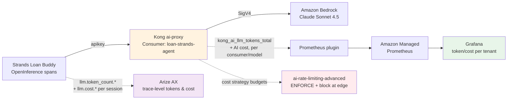

# 💰 토큰 모니터링, 추적 및 비용 어트리뷰션

에이전트가 프로덕션에 들어가면 리더십이 던지는 질문은 늘 동일합니다: **토큰을 얼마나 소비하고 있는가? 비용은 얼마인가? 어느 팀, 앱, 테넌트가 지출을 주도하는가 — 그리고 폭주하는 대상을 제한할 수 있는가?**

오픈소스 스택(Track A)에서는 LiteLLM이 Virtual Key별 지출 원장으로 이에 답합니다. SaaS 스택은 이를 다른 방식으로 답하며, 한 가지 측면에서는 **더 강력합니다**: 토큰/비용 스토리가 **Kong**(엣지 어트리뷰션 + *강제 적용*)과 **Arize AX**(애플리케이션 트레이스 심층 분석)로 나뉩니다. 이 페이지에서는 Kong + Arize 스택에서 토큰 모니터링, 추적, 어트리뷰션을 처음부터 끝까지 해결하는 방법을 보여줍니다.

::alert[**이것은 Track B 전용 모듈입니다** — Track A의 LiteLLM은 토큰/비용 추적을 자동으로 처리합니다(Virtual Key별 지출 내장). Track B는 명시적인 설정이 필요하지만 Track A가 할 수 없는 **엣지 강제 적용**(예산에서 테넌트를 *차단*하는 능력)을 얻습니다.]{type="info"}

## 🎯 배울 내용

- 🧠 **Part 1** — 큰 그림: Kong + Arize가 토큰 경제학을 제공하는 방식(이론, 아키텍처, 상관관계)
- 🔧 **Part 2** — Kong에서 AI 토큰 & 비용 지표 활성화(설정만)
- 💰 **Part 3** — Arize에서 비용 어트리뷰션 설정(세분화 수준 + 커스텀 비용 설정 수정)
- 🚀 **Part 4** — 트래픽 전송(실습: 트레이스를 생성하기 위해 요청 전송)
- 📊 **Part 5** — Kong Prometheus 지표 확인(토큰/비용/요청 수 확인)
- 👁️ **Part 6** — Arize AX에서 토큰 경제학 확인(트레이스, 스팬, 세션, 대시보드)
- 🚦 **Part 7** — 엣지에서 테넌트별 토큰 예산 강제 적용(한도에서 차단)
- 💵 **Part 8** — 테넌트별 달러 예산 강제 적용(비용 기반 속도 제한)
- ⚖️ **Part 9** — 멀티모델 비용 비교(Claude + Nova 나란히 추적)
- 👥 **Part 10** — 멀티팀 어트리뷰션(별도의 consumer + 독립 예산)
- 🌐 **Part 11** — 크로스 호스팅 비교(동일 프롬프트에서 Bedrock vs 자체 관리 vLLM)
- 📋 **Part 12** — 토큰 어트리뷰션 세분화 요약(모든 지표, 레이블, PromQL)
- 🧩 **Part 13** — 아키텍처: Kong과 Arize가 토큰 데이터를 공유하지 않는 이유

---

## Part 1 — 큰 그림: 두 개의 관측 지점, 하나의 스토리

Track A(LiteLLM이 토큰 진실의 단일 원천)와 달리, Track B는 토큰을 **두 개의 상호 보완적인 관측 지점**에서 봅니다:

| 관측 지점 | 도구 | 답하는 질문 | 세분화 |
|---|---|---|---|
| **엣지 / 게이트웨이** | Kong (Prometheus AI 지표 + 속도 제한) | "어느 **Consumer**가 지출하고 있는가, 그리고 그들을 제한하라" | Consumer · 모델 · provider · 워크스페이스별 |
| **애플리케이션 트레이스** | Arize AX (OpenInference 스팬) | "**왜** 이 요청이 그렇게 많은 비용이 들었는가 — 어느 agent/tool/LLM 단계" | 세션별 · 스팬별(AGENT/LLM/TOOL) |

::alert[**왜 두 곳인가?** 게이트웨이는 *요청과 신원*을 보지만 에이전트의 내부 추론은 보지 못합니다; 트레이싱 플랫폼은 *전체 스팬 트리*를 보지만 예산을 *강제 적용*할 수는 없습니다. Track B는 각각을 가장 잘하는 용도로 사용합니다. LiteLLM+Langfuse는 이 둘을 하나로 흐릿하게 만들지만, Kong+Arize는 이를 분리해 둡니다 — 그래서 테넌트별 **강제 적용**(아래)은 Track B가 할 수 있고 Track A가 할 수 없는 것입니다.]{type="info"}

## Kong과 Arize의 상관관계 방식 (통합 패턴)

Kong과 Arize는 서로 **직접 통합되지 않습니다** — 둘 사이에 API 호출, 웹훅, 공유 데이터베이스가 없습니다. 대신 이 둘은 **동일한 요청을 서로 다른 관측 지점에서** 관찰하며, **애플리케이션 코드**가 이 둘을 연결하는 접착제 역할을 합니다:

:::code{language=text showCopyAction=false}
┌─────────────────────────────────────────────────────────────────────────────┐
│                         ONE LOAN APPLICATION REQUEST                         │
├─────────────────────────────────────────────────────────────────────────────┤
│                                                                             │
│  Agent (agent.py)                                                           │
│    ├── Sets: user.id = "loan-strands-agent"  ← SAME as Kong Consumer name  │
│    ├── Sets: session.id = "loan-application-{image_id}"                     │
│    ├── Sends request through Kong with apikey header                        │
│    │     └── Kong sees: consumer="loan-strands-agent", model, tokens        │
│    │         └── Writes: kong_ai_llm_tokens_total{consumer="...", ai_model} │
│    │                                                                        │
│    └── Emits OpenInference spans to Arize via OTLP                          │
│          └── Arize sees: user.id, session.id, llm.token_count.*, model      │
│              └── Computes: cost from token_count × price_map                │
│                                                                             │
├─────────────────────────────────────────────────────────────────────────────┤
│  CORRELATION KEY: user.id in Arize = consumer name in Kong                  │
│  (set by the application — NOT by any Kong↔Arize integration)               │
└─────────────────────────────────────────────────────────────────────────────┘
:::

### `user.id` = Kong Consumer 이름인 이유

애플리케이션 코드는 의도적으로 `user.id`를 Kong Consumer와 **동일한 값**으로 설정합니다:

:::code{language=python showCopyAction=false}
# In agent.py:
trace_attributes={
    "user.id": os.environ.get("SERVICE_CONSUMER_ID", "loan-strands-agent"),
    #           ↑ Matches the KongConsumer username: "loan-strands-agent"
}
:::

**왜 그럴까요?** 양쪽 플랫폼에서 동일한 팀/서비스를 상관 지을 수 있도록 하기 위해서입니다:

| 질문 | 확인할 곳 | 찾는 방법 |
|---|---|---|
| "`loan-strands-agent`가 게이트웨이에서 소비한 토큰은 몇 개인가?" | Kong Prometheus | `kong_ai_llm_tokens_total{consumer="loan-strands-agent"}` |
| "`loan-strands-agent`의 AGENT 단계별 비용 분해는 무엇이었나?" | Arize AX | `user.id = "loan-strands-agent"`로 트레이스 필터링 → 스팬 확장 |
| "`loan-strands-agent`가 속도 제한에 도달했는가?" | Kong 응답 헤더 | `X-AI-RateLimit-Remaining-minute-bedrock: 0` |
| "그 요청에서 가장 많은 토큰을 소비한 tool 호출은 무엇인가?" | Arize AX | 동일 트레이스 → `llm.token_count.total`로 스팬 정렬 |

**`user.id`는 필수인가요?** 아닙니다 — Arize는 이것 없이도 작동합니다. 하지만 이것이 없으면 팀/서비스별로 트레이스를 필터링할 수 없고 Kong Consumer와의 상관관계를 잃게 됩니다. 이것은 **모범 사례**이지 요구 사항은 아닙니다.

### 두 개의 독립적인 데이터 경로

| | Kong (게이트웨이 경로) | Arize (애플리케이션 경로) |
|---|---|---|
| **데이터 소스** | Bedrock 응답의 `usage` 필드(prompt/completion 토큰) | Strands SDK의 OpenInference 스팬 |
| **데이터 캡처 시점** | 게이트웨이에서, Bedrock이 응답한 후 | 애플리케이션 내부에서, 에이전트가 실행될 때 |
| **데이터 흐름 방식** | ai-proxy가 `usage`를 읽음 → Prometheus plugin이 지표로 노출 | OTLP 익스포터 → Arize gRPC 엔드포인트(`otlp.arize.com:443`) |
| **신원** | `consumer` 레이블(API key → KongConsumer 매핑에서) | `user.id` 트레이스 속성(앱 코드에서 설정) |
| **토큰 세분화** | 요청별 총계(prompt + completion + total) | 스팬별(에이전트 실행 내 각 LLM 호출) |
| **비용** | plugin 설정의 `input_cost`/`output_cost`로 게이트웨이에서 계산 | Cost Config price map으로 Arize 수집 시 계산 |
| **강제 적용** | ✅ `ai-rate-limiting-advanced`를 통해 차단(429) 가능 | ❌ 관찰만 — 요청을 멈출 수 없음 |
| **드릴다운** | consumer별, 모델별, provider별 집계 | 스팬별: agent 단계 → tool 호출 → LLM 호출 분해 |

### 동일한 요청을 교차 참조하는 방법

오전 11시 07분에 처리된 단일 대출 신청에 대해:

**Kong에서 (게이트웨이 뷰):**
- `kong_ai_llm_tokens_total{consumer="loan-strands-agent", ai_model="global.anthropic.claude-sonnet...", token_type="total_tokens"}`가 약 2,030만큼 증가
- `kong_ai_llm_cost_total{consumer="loan-strands-agent"}`가 약 $0.021만큼 증가

**Arize에서 (트레이스 뷰) — 동일한 요청, 동일한 시각:**
- 트레이스: `invoke_agent Strands Agents`, 지연시간 14.68s
- 스팬 분해: 786 prompt 토큰 + 1,244 completion 토큰 = 2,030 total
- `user.id = "loan-strands-agent"` (Kong consumer와 일치)
- `session.id = "loan-application-{image_id}"` (대출마다 고유)
- 비용: $0.021 (User Defined Cost 설정이 지정된 후)

[Screenshot needed: Side-by-side showing (1) Kong Prometheus metric for the same request and (2) Arize trace detail with matching token count and user.id]

::alert[**Kong과 Arize는 서로 절대 대화하지 않습니다.** 상관관계가 발생하는 이유는 애플리케이션이 양쪽에 동일한 신원(`loan-strands-agent`)을 설정하기 때문입니다: API key의 consumer(Kong)로서 그리고 `user.id`(Arize)로서. 여러 서비스를 배포하는 경우 배포마다 다른 `SERVICE_CONSUMER_ID` 환경 변수를 설정하십시오 — 각각 양쪽 시스템에서 독립적인 추적을 받습니다.]{type="info"}

---

## Part 2 — AI 토큰 & 비용 지표 활성화 (Kong)

두 개의 plugin이 함께 작동하여 AI 지표를 방출합니다. **둘 다** 설정해야 합니다 — 이것이 놓치기 쉬운 핵심 통찰입니다:

1. **AI Proxy plugin** — `logging.log_statistics: true`가 있어야 합니다(토큰/비용 데이터를 보고하도록 지시)
2. **Prometheus plugin** — `ai_metrics: true`가 있어야 합니다(AI 전용 지표 시리즈를 노출하도록 지시)

ai-proxy에 `log_statistics`가 없으면 Prometheus plugin은 보고할 것이 없습니다 — 지표가 비어 있게 됩니다.

### 1단계: 로깅 + 비용 설정으로 AI Proxy 업데이트

[모듈 B2](/track-b-saas/b2-ai-gateway-observability/)의 기존 `ai-proxy-loan-strands` plugin을 업데이트하여 통계 로깅을 활성화하고 토큰당 가격을 설정합니다:

:::code{language=yaml showCopyAction=true}
cat <<'EOF' | kubectl apply -f -
apiVersion: configuration.konghq.com/v1
kind: KongPlugin
metadata:
  name: ai-proxy-loan-strands
  namespace: kong
plugin: ai-proxy
config:
  auth:
    param_location: body
    param_name: allow_override
    param_value: "false"
  model:
    name: global.anthropic.claude-sonnet-4-5-20250929-v1:0
    provider: bedrock
    options:
      bedrock:
        aws_region: us-east-1
      input_cost: 3.0
      output_cost: 15.0
  route_type: llm/v1/chat
  logging:
    log_statistics: true
    log_payloads: false
EOF
:::

::alert[B2 설정에서 **두 가지 중요한 추가 사항**: (1) `logging.log_statistics: true` — AI 지표 방출에 **필수**; 이것 없이는 Prometheus plugin이 토큰/비용 데이터를 보지 못합니다. (2) `input_cost` / `output_cost`(1M 토큰당 USD) — 비용 지표와 속도 제한의 `cost` 전략을 활성화합니다. 이 값들은 [Amazon Bedrock 요금 페이지](https://aws.amazon.com/bedrock/pricing/)에서 설정하십시오.]{type="warning"}

### 2단계: AI 지표로 Prometheus Plugin 생성

동일한 route에 Prometheus plugin을 생성합니다(글로벌이 아님 — route별로 하면 route 범위 지표를 얻습니다):

:::code{language=yaml showCopyAction=true}
cat <<'EOF' | kubectl apply -f -
apiVersion: configuration.konghq.com/v1
kind: KongPlugin
metadata:
  name: prometheus-metrics
  namespace: kong
plugin: prometheus
config:
  ai_metrics: true
  per_consumer: true
  status_code_metrics: true
  latency_metrics: true
EOF
:::

### 3단계: Prometheus Plugin을 Route에 연결

route의 plugin 어노테이션에 `prometheus-metrics`를 추가합니다(기존 `ai-proxy-loan-strands` 및 `key-auth-loan-strands`와 함께):

:::code{language=bash showCopyAction=true}
kubectl annotate kongroute loan-strands-route -n kong \
  konghq.com/plugins="ai-proxy-loan-strands,key-auth-loan-strands,prometheus-metrics" --overwrite
:::

Kong Operator가 설정을 DataPlane에 조정할 때까지 약 10초 기다립니다. 이것으로 끝입니다 — 지표가 활성화되었습니다. 트래픽을 전송한 후 Part 5에서 이를 확인합니다.

---

## Part 3 — Arize AX에서 비용 어트리뷰션 설정

Kong은 게이트웨이에서 *누가* 그리고 *얼마나* 지출하는지 알려줍니다. Arize는 *왜*인지 알려줍니다 — 어느 agent 단계, tool 호출, 또는 LLM 턴이 토큰을 소비했으며 각각 얼마의 비용이 들었는지. Arize는 **네 가지 세분화 수준**을 제공합니다:

### Arize의 토큰 & 비용 세분화 수준

| 수준 | 보여주는 것 | 토큰 | 비용 | 내장? |
|---|---|---|---|---|
| **스팬별** | 각 개별 LLM 호출, tool 호출, 또는 retriever 호출 | ✅ `llm.token_count.prompt/completion/total` | ✅ `llm.cost.prompt/completion/total` | 예 — LLM 스팬별 자동 |
| **트레이스별** | 하나의 엔드투엔드 에이전트 호출(모든 스팬 집계) | ✅ 자식 스팬에서 자동 합산 | ✅ 자식 스팬에서 자동 합산 | 예 — 자동 |
| **세션별** | 동일한 `session.id`를 공유하는 모든 트레이스(대화) | ✅ 자동 집계(내장 컬럼) | ⚠️ 스팬별로 표시; total은 커스텀 지표 사용 | 토큰: 예. 비용: 커스텀 지표 |
| **사용자별** | 동일한 `user.id`의 모든 트레이스 | 필터 + 커스텀 지표 | 필터 + 커스텀 지표 | 전용 탭 없음 — 필터 사용 |

### 토큰 속성 (이미 에이전트에서 흐르고 있음)

Strands OpenInference 프로세서가 방출하는 모든 LLM 스팬은 다음을 담고 있습니다:

| 속성 | 유형 | 의미 |
|---|---|---|
| `llm.token_count.prompt` | Token | 이 LLM 호출의 입력 토큰 |
| `llm.token_count.completion` | Token | 출력 토큰 |
| `llm.token_count.total` | Token | prompt + completion |
| `llm.token_count.prompt_details.cache_read` | Token | prompt 캐시에서 읽은 토큰 |
| `llm.token_count.prompt_details.cache_write` | Token | prompt 캐시에 쓴 토큰 |
| `llm.cost.prompt` | Cost ($) | 입력 토큰의 달러 비용(수집 시 계산) |
| `llm.cost.completion` | Cost ($) | 출력 토큰의 달러 비용 |
| `llm.cost.total` | Cost ($) | 이 스팬의 총 달러 비용 |

::alert[**비용은 수집 시점에 계산됩니다** — Arize가 `llm.model_name`을 Cost Config price map과 대조하여 계산합니다. 비용이 `--`로 표시되면 모델 이름이 어떤 config 항목과도 일치하지 않은 것입니다. 수정 방법은 Part 4를 참고하십시오.]{type="warning"}

### 비용 계산 방식 (결정 순서)

:::code{language=text showCopyAction=false}
For each incoming LLM span:
1. If span already has llm.cost.* attributes → use those (client-provided)
2. Else lookup llm.model_name in Cost Config database:
   - Match on model name (exact or substring)
   - Optionally match on llm.provider
3. Apply: cost = (prompt_tokens / 1M × input_cost) + (completion_tokens / 1M × output_cost)
4. Store llm.cost.prompt, llm.cost.completion, llm.cost.total on the span
5. Aggregate cost up to trace level (sum of all child LLM span costs)
:::

### 🎯 어트리뷰션을 위한 트레이스 속성 (이미 agent.py에 설정됨)

Strands Loan Buddy 에이전트는 세션별, 사용자별, 태그별 필터링을 가능하게 하는 `trace_attributes`를 설정합니다:

:::code{language=python showCopyAction=false}
trace_attributes={
    "session.id": f"loan-application-{image_id}",
    "user.id": os.environ.get("SERVICE_CONSUMER_ID", "loan-strands-agent"),
    "tag.tags": ["loan-processing", "credit-underwriting", "strands", "production"],
}
:::

| 속성 | 가능하게 하는 것 | 확인 위치 |
|---|---|---|
| `session.id` | 트레이스를 대화로 그룹화; Arize Sessions 탭이 세션별 토큰을 집계 | Arize → **Sessions** 탭 → 토큰 수로 정렬 |
| `user.id` | 사용자/서비스별 트레이스 필터링; 사용자별 비용 지표 구축 | Arize → **Traces** 탭 → `user.id = "loan-strands-agent"` 필터 |
| `tag.tags` | 워크로드 유형별 필터링; 태그된 트레이스로 평가기 범위 지정 | Arize → **Filters** → `tag.tags contains "loan-processing"` |

### 🎯 Cost Config 확인 (기본 Price Map)

Arize는 60개 이상의 모델에 대한 내장 price map을 제공합니다. Claude 가격이 존재하는지 확인합니다:

1. Arize AX → **Settings** → **Cost Configs** → **Default Costs** 탭
2. **`claude-sonnet`** 검색
3. `claude-sonnet-4-5-20250929-v1:0`이 Input = $3.00, Output = $15.00 (1M 토큰당)으로 표시되는지 확인

::alert[**기본 cost config에는 `claude-sonnet-4-5-20250929-v1:0`이 있지만 당신의 트레이스는 `openai/global.anthropic.claude-sonnet-4-5-20250929-v1:0`을 보여줍니다** — 이 둘은 일치하지 않습니다! 비용이 `--`로 표시됩니다. 아래에서 수정합니다.]{type="warning"}

### 🎯 수정: User Defined Cost Config 추가

Strands 에이전트의 트레이스는 어떤 기본 항목과도 **일치하지 않는** 모델 이름을 보여줍니다 — 따라서 **User Defined Cost** config를 추가해야 합니다.

### 모델 이름이 다른 이유

트레이스의 모델 이름은 전체 체인에서 나옵니다:

:::code{language=text showCopyAction=false}
agent.py → LiteLLMModel → Kong → Bedrock

1. agent.py sets: KONG_MODEL_ID = "openai/global.anthropic.claude-sonnet-4-5-20250929-v1:0"
   ↓ "openai/" prefix tells LiteLLM to use OpenAI-compatible provider (Kong)
2. LiteLLM strips "openai/" → sends model="global.anthropic.claude-sonnet-4-5-20250929-v1:0" to Kong
3. Kong ai-proxy (allow_override=false) validates the model name matches its config → calls Bedrock
4. Strands OpenInference processor logs the FULL model_id (WITH "openai/" prefix) as llm.model_name
   → Trace shows: llm.model_name = "openai/global.anthropic.claude-sonnet-4-5-20250929-v1:0"
:::

**문제점:** Arize의 기본 cost config에는 `claude-sonnet-4-5-20250929-v1:0`(접두사 없음)이 있습니다. 하지만 트레이스는 `openai/global.anthropic.claude-sonnet-4-5-20250929-v1:0`을 담고 있습니다 — 불일치 → 비용이 `--`로 표시됩니다.

**왜 앱 코드를 그냥 바꿀 수 없나요?**

| 옵션 | 작동하지 않는 이유 |
|---|---|
| `KONG_MODEL_ID`에서 `openai/` 접두사 제거 | LiteLLM이 어느 provider를 사용할지 알 수 없습니다 — OpenAI 호환 엔드포인트에는 `openai/` 접두사가 필요합니다 |
| 더 짧은 모델 이름 사용 (예: `claude-sonnet-4-5`) | `allow_override=false`인 Kong의 `ai-proxy`는 설정된 모델 `global.anthropic.claude-sonnet-4-5-20250929-v1:0`에 대해 **정확한 일치**를 강제합니다 — 그 외 모든 것을 거부합니다 |
| Kong을 `allow_override=true`로 변경 | 클라이언트가 모든 모델을 호출할 수 있게 됩니다 — 프로덕션에서 보안 위험 |

올바른 수정: 트레이스에 나타나는 정확한 모델 이름에 대해 **Arize에 User Defined Cost config를 추가**합니다.

### 🎯 실습: 커스텀 Cost Config 추가

1. Arize AX → **Settings** → **Cost Configs** → **User Defined Costs** 탭
2. **+ New Model** 클릭
3. 양식 작성:

| 필드 | 값 |
|---|---|
| **Model Name** | `openai/global.anthropic.claude-sonnet-4-5-20250929-v1:0` |
| **Applied to** (행 1) | prompt / input |
| **Price per 1M tokens** (행 1) | `3` |
| **Applied to** (행 2) | completion / output |
| **Price per 1M tokens** (행 2) | `15` |
| **LLM Provider** | 비워둠 |

4. **Create** 클릭

### 이 값들을 사용하는 이유는?

| 필드 | 값 | 근거 |
|---|---|---|
| Model Name | `openai/global.anthropic.claude-sonnet-4-5-20250929-v1:0` | 트레이스 속성 `llm.model_name`에 나타나는 것과 **정확히 일치**해야 합니다 — `openai/` LiteLLM 접두사 AND `global.anthropic.` Bedrock 크로스 리전 접두사 포함 |
| Input: $3.00 | 1M 토큰당 | Bedrock의 Claude Sonnet 4.5 입력 가격 |
| Output: $15.00 | 1M 토큰당 | Bedrock의 Claude Sonnet 4.5 출력 가격 |
| LLM Provider | 비움 | 설정하면 Arize가 트레이스의 `gen_ai.system` 속성(`bedrock`이 아닌 `strands-agents`로 표시됨)과 대조합니다 — 비워두면 불일치를 피합니다 |

::alert[**비용은 소급 적용되지 않습니다.** 이 config를 추가하기 전에 수집된 트레이스는 `Cost: --`를 보여줍니다. 새 트레이스(config 생성 후 전송된 것)만 비용을 계산합니다. 확인하려면 config를 추가한 후 에이전트를 통해 새 요청을 전송하십시오.]{type="warning"}

### 확인: 새 요청 전송 후 비용 확인

cost config를 추가한 후 에이전트를 통해 요청을 전송하고([모듈 B3 — 애플리케이션 실행](/track-b-saas/b3-genai-applications-strands/running-application/) 참고) Arize에서 새 트레이스를 확인합니다:

- 이 수정 **전**: `Cost: --`
- 이 수정 **후**: `Cost: $0.006` (약 786 prompt + 약 1244 completion 토큰의 일반적인 요청에 대해)

비용 공식: `(786/1M × $3) + (1244/1M × $15) = $0.00236 + $0.01866 = $0.021`

---

## Part 4 — 에이전틱 AI 앱을 통한 트래픽 전송 (실습)

이제 Kong(Part 2)과 Arize(Part 3)가 모두 설정되었으므로, **Loan Buddy Strands 에이전트**를 통해 요청을 전송하여 전체 토큰 및 비용 데이터가 담긴 엔드투엔드 트레이스를 생성합니다.

각 요청 흐름: **Agent → Kong `/loan-strands` → Bedrock Claude + MCP Tools → Arize (OTLP trace)**

### 3건의 신용 신청 전송

에이전트로 port-forward하고 이미지 경로를 설정합니다:

:::code{language=bash showCopyAction=true}
kubectl port-forward -n strands-agents svc/loan-buddy-agent 8890:8080 &
sleep 3
export LOAN_IMAGE="/workshop/static/images/shared/example1.png"
:::

**요청 1:**

:::code{language=bash showCopyAction=true}
curl -s --max-time 180 -X POST \
  http://localhost:8890/api/process_credit_application_with_upload \
  -H "X-Consumer-ID: loan-strands-agent" \
  -H "X-Consumer-ApiKey: loan-strands-key-123" \
  -F "image_file=@${LOAN_IMAGE}" \
  -o /tmp/loan_resp1.json

python3 -c "import json;d=json.load(open('/tmp/loan_resp1.json'));print('Status:',d['status']);print('Image:',d.get('image_id','?')[:20])"
:::

**요청 2:**

:::code{language=bash showCopyAction=true}
curl -s --max-time 180 -X POST \
  http://localhost:8890/api/process_credit_application_with_upload \
  -H "X-Consumer-ID: loan-strands-agent" \
  -H "X-Consumer-ApiKey: loan-strands-key-123" \
  -F "image_file=@${LOAN_IMAGE}" \
  -o /tmp/loan_resp2.json

python3 -c "import json;d=json.load(open('/tmp/loan_resp2.json'));print('Status:',d['status']);print('Image:',d.get('image_id','?')[:20])"
:::

**요청 3:**

:::code{language=bash showCopyAction=true}
curl -s --max-time 180 -X POST \
  http://localhost:8890/api/process_credit_application_with_upload \
  -H "X-Consumer-ID: loan-strands-agent" \
  -H "X-Consumer-ApiKey: loan-strands-key-123" \
  -F "image_file=@${LOAN_IMAGE}" \
  -o /tmp/loan_resp3.json

python3 -c "import json;d=json.load(open('/tmp/loan_resp3.json'));print('Status:',d['status']);print('Image:',d.get('image_id','?')[:20])"
:::

각 요청에 대한 **예상 출력**:

:::code{language=text showCopyAction=false}
Status: COMPLETED, Image: c5980950ae658c0e...
:::

각 요청은 다음을 생성합니다:
- **Arize**의 전체 에이전틱 트레이스(agent → 여러 LLM 호출 → tool 호출 → 요청당 약 2,000개 이상의 토큰)
- **Kong Prometheus**의 토큰/비용 지표(모델별, consumer별 집계)
- 신청당 고유한 `session.id`(Arize에서 세션별 토큰 추적 가능)

Arize `BatchSpanProcessor`가 3개 트레이스를 모두 플러시할 때까지 약 60초 기다립니다.

::alert[**각 요청은 약 60-90초 걸립니다**(에이전트가 MCP tool + 여러 LLM 턴을 호출합니다). 요청이 타임아웃되더라도 트레이스는 여전히 방출됩니다 — 관계없이 Arize를 확인하십시오.]{type="info"}

### 새 트레이스에 대해 평가기 트리거

지속적 평가 태스크([B4 평가](/track-b-saas/b4-scaling-evaluating/evaluation/)에서 설정)는 약 30-60분 주기로 실행됩니다. 이 새 트레이스에 대한 **즉각적인** 결과를 위해 각 평가기를 수동으로 트리거합니다:

1. Arize AX → **Evaluators** → **Running Eval Tasks** 탭
2. 각 태스크(`loan-accuracy`, `loan-helpfulness`, `loan-safety`)에 대해 **`...` 메뉴** 클릭 → **Run Over Date Range**
3. 날짜 범위를 **지난 한 시간**을 포함하도록 설정

각 태스크는 3개의 새 트레이스를 처리하고 점수를 매깁니다(정확성, 유용성, 안전성). 결과는 몇 초 내에 트레이스에 나타납니다.

---

## Part 5 — Kong Prometheus 지표 확인

트래픽을 전송한 후(Part 4), Kong의 Prometheus 엔드포인트가 이제 AI 지표를 보여주는지 확인합니다:

:::code{language=bash showCopyAction=true}
kubectl port-forward -n kong $(kubectl get pods -n kong -l app=dataplane -o name | head -1) 8100:8100 2>/dev/null &
sleep 3

echo "=== Token metrics ==="
curl -s localhost:8100/metrics | grep "kong_ai_llm_tokens_total" | grep -v "^#"

echo ""
echo "=== Cost metrics ==="
curl -s localhost:8100/metrics | grep "kong_ai_llm_cost_total" | grep -v "^#"

echo ""
echo "=== Request metrics ==="
curl -s localhost:8100/metrics | grep "kong_ai_llm_requests_total" | grep -v "^#" | grep "bedrock"
:::

**예상 출력:**

:::code{language=text showCopyAction=false}
=== Token metrics ===
kong_ai_llm_tokens_total{ai_provider="bedrock",ai_model="global.anthropic.claude-sonnet-4-5-20250929-v1:0",...,token_type="prompt_tokens",...,consumer="loan-strands-agent"} 77
kong_ai_llm_tokens_total{ai_provider="bedrock",ai_model="global.anthropic.claude-sonnet-4-5-20250929-v1:0",...,token_type="completion_tokens",...,consumer="loan-strands-agent"} 43
kong_ai_llm_tokens_total{ai_provider="bedrock",ai_model="global.anthropic.claude-sonnet-4-5-20250929-v1:0",...,token_type="total_tokens",...,consumer="loan-strands-agent"} 120

=== Cost metrics ===
kong_ai_llm_cost_total{ai_provider="bedrock",ai_model="global.anthropic.claude-sonnet-4-5-20250929-v1:0",...,consumer="loan-strands-agent",request_mode="oneshot"} 0.000876

=== Request metrics ===
kong_ai_llm_requests_total{ai_provider="bedrock",ai_model="global.anthropic.claude-sonnet-4-5-20250929-v1:0",...,consumer="loan-strands-agent",request_mode="oneshot"} 9
:::

**보이는 내용:**
- **`consumer="loan-strands-agent"`** — consumer별 어트리뷰션이 작동합니다! (Part 2의 `per_consumer: true`로 활성화됨)
- 이 consumer에 어트리뷰션된 **120 total 토큰**(77 prompt + 43 completion)
- 이 consumer에 어트리뷰션된 **$0.000876 비용**
- 이 consumer의 **9개 요청**
- 지표는 다음으로 차원화됩니다: `ai_provider`, `ai_model`, `token_type`, `workspace`, `consumer`, `request_mode`

::alert[**지표가 비어 있는 경우:** 가장 흔한 원인은 ai-proxy plugin에 `logging.log_statistics: true`가 없는 것입니다. Part 2 1단계로 돌아가 설정되었는지 확인하십시오. Prometheus plugin만으로는 충분하지 **않습니다** — 두 plugin이 함께 작동해야 합니다.]{type="warning"}

::alert[**포트가 이미 사용 중인가요?** `kubectl port-forward`가 "address already in use"를 표시하면 이전 단계의 port-forward가 아직 실행 중이라는 의미입니다. 그냥 `curl -s localhost:8100/metrics | grep kong_ai_llm`을 직접 실행하십시오 — 기존 forward가 여전히 작동합니다.]{type="info"}

### 지연시간 지표 (TTFT + TPOT + Provider)

:::code{language=bash showCopyAction=true}
echo "=== TTFT - Time To First Token (avg ms) ==="
curl -s localhost:8100/metrics | grep "kong_ai_llm_ttft_latency_ms_sum\|kong_ai_llm_ttft_latency_ms_count" | grep -v "^#" | grep "bedrock" | grep -v "cache_status=\"hit\"\|cache_status=\"miss\""

echo ""
echo "=== TPOT - Time Per Output Token (avg ms) ==="
curl -s localhost:8100/metrics | grep "kong_ai_llm_tpot_latency_ms_sum\|kong_ai_llm_tpot_latency_ms_count" | grep -v "^#" | grep "bedrock" | grep -v "cache_status=\"hit\"\|cache_status=\"miss\""

echo ""
echo "=== Provider Latency - Total response time (avg ms) ==="
curl -s localhost:8100/metrics | grep "kong_ai_llm_provider_latency_ms_sum\|kong_ai_llm_provider_latency_ms_count" | grep -v "^#" | grep "bedrock" | grep -v "cache_status=\"hit\"\|cache_status=\"miss\""
:::

**이것들이 측정하는 것:**

| 지표 | 의미 | 유스케이스 |
|---|---|---|
| `kong_ai_llm_ttft_latency_ms` | 요청 전송부터 첫 토큰 수신까지의 시간 | 사용자가 체감하는 응답성 |
| `kong_ai_llm_tpot_latency_ms` | 출력 토큰당 시간(총 시간 / completion 토큰) | 모델 생성 속도 |
| `kong_ai_llm_provider_latency_ms` | Bedrock으로부터의 총 응답 시간 | 엔드투엔드 provider 성능 |

평균 지연시간 계산: `sum / count`. 예를 들어 `_sum = 45000`이고 `_count = 21`이면 스트리밍 요청당 평균 2,142ms입니다.

### 캐시 지표 (Semantic Cache)

`ai-semantic-cache` plugin(모듈 B5)을 사용했다면 캐시 지표도 나타납니다:

:::code{language=bash showCopyAction=true}
echo "=== Cache Embeddings Latency (time to embed the prompt) ==="
curl -s localhost:8100/metrics | grep "kong_ai_cache_embeddings_latency_ms" | grep "_sum\|_count" | grep -v "^#"

echo ""
echo "=== Cache Fetch Latency (time to search Redis) ==="
curl -s localhost:8100/metrics | grep "kong_ai_cache_fetch_latency_ms" | grep "_sum\|_count" | grep -v "^#"
:::

**예상 (semantic cache를 사용한 경우):**

:::code{language=text showCopyAction=false}
kong_ai_cache_embeddings_latency_ms_count{...cache_status="hit"...} 4
kong_ai_cache_embeddings_latency_ms_sum{...cache_status="hit"...} 432
kong_ai_cache_embeddings_latency_ms_count{...cache_status="miss"...} 5
kong_ai_cache_embeddings_latency_ms_sum{...cache_status="miss"...} 588
:::

이것이 알려주는 것: 4번의 캐시 히트(평균 108ms 임베딩 시간), 5번의 캐시 미스(평균 118ms) — 임베딩 비용은 히트와 미스가 비슷합니다(절감액은 히트 시 Bedrock LLM 호출을 건너뛰는 데서 나옵니다).

### Kong Konnect UI에서 Consumer별 어트리뷰션 확인

Kong Konnect 컨트롤 플레인 **Overview** 페이지는 로컬 Prometheus에서는 사용할 수 없는(빈 `consumer=""` 레이블 이슈로 인해) consumer별 및 route별 트래픽 어트리뷰션을 보여줍니다:

1. **Kong Konnect** → `kong-aws` 컨트롤 플레인 → **Overview** 열기
2. Overview 페이지의 **Analytics** 섹션은 다음을 보여줍니다:
   - **Requests** 총계(예: 6.3K) 및 주간 대비 추세
   - **Error rate** 및 **Average latency**
   - **Top 5 gateway services by traffic**(예: `loan-strands-bedrock: 471`, `loan-strands-nova: 9`)
   - **Top 5 routes by traffic**(예: `loan-strands-route: 471`)
   - **Top 5 consumers by traffic**(예: `loan-strands-agent: 467`) ← **여기서 consumer별 어트리뷰션이 작동합니다!**

::alert[**로컬 Prometheus의 `consumer` 레이블이 비어 있더라도 Konnect UI에서는 consumer별 어트리뷰션이 작동합니다.** Konnect 클라우드는 consumer 신원을 내부적으로 추적합니다. 모델별 토큰/비용 분해는 로컬 Prometheus 지표(위 Part 5 명령)를 사용하십시오. consumer별 요청 수는 Konnect UI를 사용하십시오.]{type="info"}

::alert[**토큰 수준 AI 지표(TTFT, TPOT, 토큰당 비용)는 Konnect Overview에 표시되지 않습니다** — Konnect UI는 요청 수준 분석(수, 지연시간, 오류율)을 보여주지만 AI 전용 토큰/비용 분해는 보여주지 않습니다. 토큰 경제학을 위해서는 **로컬 Prometheus 엔드포인트**(위 명령)를 사용하거나 **Grafana**로 내보내십시오(Part 11 PromQL 쿼리 참고).]{type="warning"}

### 완전한 Kong AI 지표 레퍼런스

`ai_metrics: true`로 Prometheus plugin이 노출하는 6개 지표 패밀리 전체:

| 지표 | 유형 | 추적 대상 |
|---|---|---|
| `kong_ai_llm_tokens_total` | Counter | 모델별 토큰 소비량(prompt/completion/total) |
| `kong_ai_llm_cost_total` | Counter | 모델별 달러 비용(ai-proxy에 `input_cost`/`output_cost` 필요) |
| `kong_ai_llm_requests_total` | Counter | 모델별 요청 수 |
| `kong_ai_llm_provider_latency_ms` | Histogram | LLM provider로부터의 총 응답 시간 |
| `kong_ai_llm_ttft_latency_ms` | Histogram | 첫 토큰까지의 시간(스트리밍 응답성) |
| `kong_ai_llm_tpot_latency_ms` | Histogram | 출력 토큰당 시간(생성 속도) |
| `kong_ai_cache_embeddings_latency_ms` | Histogram | 캐시 조회를 위한 임베딩 생성 시간 |
| `kong_ai_cache_fetch_latency_ms` | Histogram | 캐시 일치를 위한 벡터 DB(Redis) 검색 시간 |

### `consumer` 레이블 — 테넌트별 어트리뷰션

**Kong 3.11+** 부터 AI 지표는 "AI 사용량과 토큰 수를 개별 Consumer에 어트리뷰션"하도록 설계된 **`consumer`** 레이블을 지원합니다. 이는 Prometheus plugin 설정의 `per_consumer: true`(Part 2 2단계)로 활성화됩니다.

올바른 설정으로 요청을 전송한 후에는 consumer별로 분할된 지표를 보게 됩니다:

:::code{language=text showCopyAction=false}
kong_ai_llm_tokens_total{...consumer="loan-strands-agent"} 50
kong_ai_llm_cost_total{...consumer="loan-strands-agent",request_mode="oneshot"} 0.000366
kong_ai_llm_requests_total{...consumer="loan-strands-agent",request_mode="oneshot"} 4
:::

::alert[**consumer 레이블이 채워지려면 Prometheus plugin 설정에 `per_consumer: true`가 필요합니다.** 이것이 없으면 레이블은 존재하지만 항상 비어 있습니다. 이는 Part 2 2단계에서 추가되었습니다.]{type="warning"}

---

## Part 6 — Arize AX에서 토큰 경제학 확인

트래픽을 전송한 후(Part 4), Arize를 확인하여 모든 세분화 수준에 걸친 토큰 및 비용 데이터를 봅니다:

### 1. Traces 목록 (트레이스별 토큰 + 비용)

Arize AX → **Tracing Projects** → `loan-strands` → **Traces** 탭을 엽니다. 헤더 바는 집계 통계를 보여줍니다: **Traces 4**, **P50 57.24s**, **P99 1m 4s**, **Tokens 45.29k**, **Cost $0.26025**. 각 트레이스 행은 다음을 보여줍니다:
- Status (✅), Kind (AGENT), Name (`invoke_...`), Input, Output, Start Time
- **Latency** (29.69s, 1m 4s, 53.68s, 57.24s)
- **Trace Evaluations** (`loan-accuracy: accurate` + 2개 더)
- **Total Cost** ($0.031413, $0.082632, $0.07305, $0.073155)

### 2. Trace 상세 (트레이스 클릭)

아무 트레이스나 클릭하여 상세 뷰를 엽니다. 헤더 바는 다음을 보여줍니다:
- **Trace ID**: `6b76f9a1...6d4e1957`
- **Session**: `loan-application-20316...` (Sessions 탭으로 연결)
- **Status ✅ OK** · **Latency 29.69s** · **Cost $0.031413** · **Start Time** 4/8/2026, 10:32:04 am
- **Trace Evals**: `loan-accuracy: accurate` · `loan-helpfulness: helpful` · `loan-safety: safe`

**Trace Tree**(3개 스팬)는 에이전트의 실행 계층을 보여줍니다:
- **`invoke_agent Strands Agents`** — 루트 AGENT 스팬(3개 eval, 29.69s, 2,351 tk, $0.031413)
  - **`execute_event_loop_cycle`** — 에이전트의 추론 루프(29.69s)
    - **`chat`** — Kong을 통한 Bedrock LLM 호출(29.69s, 2,351 tk, $0.031413)

오른쪽 패널은 **Input / Output** 을 보여줍니다:
- **Input**: "Please process this credit application and provide a comprehensive credit assessment. Image_Id: 20316a2ab..."
- **Output**: tool 호출(`mcp-server_extract_credit_application`, `validate_income`, `validate_employment`, `validate_address`)과 최종 신용 평가가 포함된 에이전트의 응답

### 3. Sessions (세션별 토큰 & 비용)

Arize → **Sessions** 탭은 `session.id`로 그룹화된 모든 세션을 보여줍니다. 헤더는 집계 통계를 보여줍니다:
- **Total Sessions**: 4
- **Total Tokens**: 45.29k (모든 세션 합산)
- **Total Cost**: $0.26025 (모든 세션 합산)

각 세션 행은 다음을 보여줍니다:

| 컬럼 | 예시 | 의미 |
|---|---|---|
| Session ID | `loan-app...fe7ed678` | agent.py에서 설정된 `session.id`(`loan-application-{image_id}`) |
| Input | "Please process this credit application..." | 첫 번째 사용자 메시지 |
| Output | "I'll process this credit application..." | 에이전트의 응답 |
| Latency | 29.69s | 총 세션 지속 시간 |
| User | `loan-strands-agent` | `user.id` 속성 |
| Traces | 1 | 이 세션의 트레이스 수 |
| Tokens | 4,702 | 이 세션에서 소비된 총 토큰 |
| Cost | $0.062826 | 이 세션의 총 비용 |
| Start Time | 4/8/2026, 05:02 am | 세션이 시작된 시각 |

::alert[**이 워크샵에서는 각 세션에 정확히 1개의 트레이스가 있습니다** — 에이전트 호출마다 새 `session.id`(`loan-application-{image_id}` — 요청마다 고유)를 생성하기 때문입니다. 프로덕션에서는 세션이 일반적으로 여러 트레이스를 그룹화합니다(예: 사용자가 후속 질문을 하는 다중 턴 대화). Sessions 탭은 해당 세션의 모든 트레이스에 걸쳐 토큰/비용을 집계합니다 — 완전한 고객 상호작용의 총 비용을 추적하는 데 유용합니다.]{type="info"}

### 4. 사용자별 뷰 (`user.id`로 필터링)

`user.id` 속성(Part 1의 상관관계 패턴에서 `loan-strands-agent`로 설정)은 팀/서비스별로 모든 세션/트레이스를 필터링할 수 있게 합니다:

1. Arize → **Sessions** 탭 → **Add Filter** 클릭
2. 필터 추가: `attributes.user.id = 'loan-strands-agent'`
3. 헤더가 이 사용자에 대한 집계 통계만 보여주도록 업데이트됩니다: **Total Sessions 7**, **Total Tokens 88.18k**, **Total Cost $0.333945**

이 consumer/팀의 모든 세션이 세션별 토큰 및 비용과 함께 표시됩니다. 필터는 Kong의 consumer와 Arize의 `user.id` 간의 상관관계를 확인합니다 — 둘 다 애플리케이션에 의해 `loan-strands-agent`로 설정됩니다.

::alert[**사용자별 집계는 Sessions 탭 + 필터를 사용합니다.** `attributes.user.id = 'loan-strands-agent'`로 필터링하여 해당 팀의 모든 세션/토큰/비용을 확인하십시오. 여러 팀(각각 다른 `SERVICE_CONSUMER_ID`)이 있는 프로덕션에서는 필터 값을 전환하여 팀 간 비용을 비교할 수 있습니다.]{type="info"}

### 5. Token Tracking & Latency 대시보드 (프로젝트 수준 집계)

커스텀 대시보드 생성: Arize → **Dashboards** → **+ New Dashboard** → "Token Tracking and Latency Dashboard"로 이름 지정 → `loan-strands` 프로젝트 선택. 아래 지표에 대한 위젯을 추가합니다.

**패널 1 — 토큰 총계 + 일일 추세:**

주요 지표:
- **Total Prompt Token Count**: 82,642 (`Sum of attributes.llm.token_count.prompt`)
- **Total Response Token Count**: 24,684 (`Sum of attributes.llm.token_count.completion`)
- **Total Token Count**: 107,326 (`Sum of attributes.llm.token_count.total`)
- **요청당 평균**: Prompt 2,361 / Response 705 / Total 3,066
- **일별 Total Token Count**: Total, Prompt, Response 토큰 추세를 보여주는 시계열

**패널 2 — 평균 토큰 + 요청 볼륨 + 지연시간:**

주요 지표:
- **일별 Average Token Count**: 시계열(Average Total Tokens / Prompt Average / Response Average)
- **Request Count**: 총 14개 스팬 (`Count of attributes.openinference.span.kind`)
- **Average LLM Latency**: 38,443ms (`Average of latency_ms`)
- **Daily Request Count**: 시간 경과에 따른 요청 볼륨을 보여주는 시계열

**패널 3 — 분포(지연시간 + 토큰 히스토그램):**

주요 지표:
- **Latency Distribution**: 대부분의 요청이 0-165ms 범위(캐시됨) 또는 18-38s 범위(전체 에이전트 실행)임을 보여주는 히스토그램
- **Daily Average Response Latency**: 에이전트 복잡성이 증가함에 따라 지연시간이 증가함을 보여주는 추세선
- **LLM Prompt Token Distribution**: prompt 크기를 보여주는 히스토그램(대부분 LLM 호출당 1.6k-3.8k 토큰)
- **LLM Response Token Distribution**: 응답 크기를 보여주는 히스토그램(대부분 0-300 또는 1.5k-2.5k 토큰)

### 6. Project Overview 대시보드 (모델별 토큰 + 비용)

**Tracing Project Overview Dashboard** 는 프로젝트 상태, 토큰 경제학, 평가 품질에 대한 단일 창 뷰를 제공하는 내장 대시보드입니다.

이 대시보드의 주요 지표:

| 위젯 | 보여주는 것 |
|---|---|
| **Traces Over Time** | 일별 트레이스 수(Total Traces vs Error Traces) — 요청 볼륨 추세 |
| **Average Span Latency** | 지연시간 추세(전체 에이전트 처리 시 8k-16k ms) |
| **Latency Distribution** | 히스토그램 — 캐시된 요청(0-165ms) vs 전체 에이전트(18-38s) |
| **Token Count and Cost by Model** | 모델별 테이블: `openai/global.anthropic.claude-sonnet-4-5-20250929-v1:0` — 2,15,269 토큰, **$0.6679 총 비용** |
| **Token Usage Breakdown** | 시계열: 일별 Total / Prompt / Completion 토큰 |
| **Average Eval Scores** | 평가 점수 추세(loan-safety, loan-accuracy, loan-helpfulness) |

::alert[**"Token Count and Cost by Model"** 은 핵심 비용 어트리뷰션 위젯입니다. 각 모델의 누적 토큰 사용량과 달러 비용을 보여줍니다. 여러 모델(Claude + Nova)이 있으면 각각 비용 비교를 위해 별도의 행으로 나타납니다.]{type="info"}

---

## Part 7 — 엣지에서 테넌트별 토큰 예산 강제 적용 (Kong) ⭐

이것이 **Track A가 갖지 못한** 능력입니다. Langfuse와 Arize는 지출을 *관찰*하지만 그것을 *멈출* 수는 없습니다. Kong의 **`ai-rate-limiting-advanced`** plugin은 예산을 강제 적용하며, Consumer가 이를 초과하면 **엣지에서 요청을 차단**할 수 있습니다:

1. **`ai-rate-limiting-advanced` plugin** — LLM provider 응답의 `usage` 필드(prompt_tokens + completion_tokens)를 읽고 Consumer별, 윈도우별 누적 소비량을 추적
2. **엣지에서의 강제 적용** — 예산이 소진되면 Kong은 **요청이 Bedrock에 도달하기 전에** 즉시 **HTTP 429**를 반환합니다 — 토큰 소비 없음, 비용 발생 없음

### 🎯 실습: Consumer의 토큰 예산 제한

**테스트용 소규모 예산**(60초당 50 토큰 — 차단되기 전 1-2개의 짧은 요청에 충분)으로 plugin을 생성합니다:

:::code{language=yaml showCopyAction=true}
cat <<'EOF' | kubectl apply -f -
apiVersion: configuration.konghq.com/v1
kind: KongPlugin
metadata:
  name: ai-ratelimit-loan-strands
  namespace: kong
plugin: ai-rate-limiting-advanced
config:
  llm_providers:
    - name: bedrock
      window_size: [60]
      limit: [50]
  tokens_count_strategy: total_tokens
  strategy: local
EOF
:::

#### Plugin 설정 설명

| 필드 | 값 | 의미 |
|---|---|---|
| `llm_providers[].name` | `bedrock` | LLM provider별로 예산 추적(ai-proxy의 provider와 일치) |
| `llm_providers[].window_size` | `[60]` | 60초 롤링 윈도우 — 이 기간 후 예산 재설정 |
| `llm_providers[].limit` | `[50]` | 윈도우 내 최대 **50 토큰** 허용(테스트용으로 의도적으로 낮음) |
| `tokens_count_strategy` | `total_tokens` | **prompt + completion** 토큰을 합산하여 계산(대안: `prompt_tokens`, `completion_tokens`, 또는 `cost`) |
| `strategy` | `local` | 각 DataPlane 노드가 자체 카운터를 추적(멀티 노드 프로덕션에서 공유 Redis 기반 계산은 `cluster` 사용) |

#### 응답 헤더

plugin은 모든 응답에 다음 헤더를 추가합니다:

| 헤더 | 의미 |
|---|---|
| `X-AI-RateLimit-Limit-minute-bedrock` | 윈도우당 허용 최대 토큰(`50`) |
| `X-AI-RateLimit-Remaining-minute-bedrock` | 현재 윈도우의 남은 토큰 |
| `X-AI-RateLimit-Reset-minute-bedrock` | 윈도우가 재설정될 때까지의 초(예산 재충전) |
| `X-AI-RateLimit-Retry-After-minute-bedrock` | 클라이언트가 재시도 전 기다려야 하는 시간 |

헤더 명명 패턴은 다음과 같습니다: `X-AI-RateLimit-{metric}-{window}-{provider}` — 따라서 `minute` = 우리의 60초 윈도우, `bedrock` = LLM provider.

#### Route에 연결

:::code{language=bash showCopyAction=true}
kubectl annotate kongroute loan-strands-route -n kong \
  konghq.com/plugins=ai-proxy-loan-strands,key-auth-loan-strands,prometheus-metrics,ai-ratelimit-loan-strands --overwrite
:::

### 🚀 테스트: 429가 될 때까지 요청 전송

Kong proxy URL을 설정합니다:

:::code{language=bash showCopyAction=true}
export KONG_PROXY="http://$(kubectl get svc -n kong proxy1 -o jsonpath='{.status.loadBalancer.ingress[0].hostname}')"
:::

#### 요청 1 — 첫 번째 요청 (성공해야 함)

:::code{language=bash showCopyAction=true}
curl -s -D - -X POST "$KONG_PROXY/loan-strands/v1/chat/completions" \
  -H "Content-Type: application/json" -H "apikey: loan-strands-key-123" \
  -d '{"model":"global.anthropic.claude-sonnet-4-5-20250929-v1:0","messages":[{"role":"user","content":"Say hello"}],"max_tokens":5}' \
  | grep -iE "HTTP/|X-AI-RateLimit"
:::

**예상 응답:**

:::code{language=text showCopyAction=false}
HTTP/1.1 200 OK
X-AI-RateLimit-Limit-minute-bedrock: 50
X-AI-RateLimit-Remaining-minute-bedrock: 50
:::

**왜 `Remaining: 50`인가(더 적지 않고)?** `ai-rate-limiting-advanced` plugin은 **Bedrock으로부터 응답을 받은 후** 토큰을 계산하지만, 응답 헤더에서는 현재 요청의 토큰이 차감되기 **이전** 기준으로 남은 예산을 보고합니다. 따라서 첫 번째 요청의 헤더는 전체 예산(50)을 보여줍니다. 이 요청이 소비한 토큰(약 13개 total: 8 prompt + 5 completion)은 *다음* 요청의 `Remaining` 값에 반영됩니다. "이 요청이 시작될 때 50개의 토큰을 사용할 수 있었다"라고 생각하십시오.

#### 요청 2 — 두 번째 요청 (성공, 예산 감소 중)

:::code{language=bash showCopyAction=true}
curl -s -D - -X POST "$KONG_PROXY/loan-strands/v1/chat/completions" \
  -H "Content-Type: application/json" -H "apikey: loan-strands-key-123" \
  -d '{"model":"global.anthropic.claude-sonnet-4-5-20250929-v1:0","messages":[{"role":"user","content":"Explain Kubernetes"}],"max_tokens":50}' \
  | grep -iE "HTTP/|X-AI-RateLimit"
:::

**예상 응답:**

:::code{language=text showCopyAction=false}
HTTP/1.1 200 OK
X-AI-RateLimit-Limit-minute-bedrock: 50
X-AI-RateLimit-Remaining-minute-bedrock: 34
:::

**왜 `Remaining: 34`인가?** 요청 1이 약 16 토큰(prompt + completion)을 소비했습니다. 예산은 50에서 시작하여 16을 빼면 요청 2가 시작될 때 34가 남습니다. 이 요청은 또 다른 약 61 토큰(`max_tokens:50`으로 11 prompt + 50 completion)을 소비하여 총계를 50을 훨씬 넘어서게 됩니다. 하지만 요청이 시작될 수 있었으므로(34 > 0) 완료됩니다 — 초과분이 추적되고 *다음* 요청이 차단됩니다.

#### 요청 3 — 세 번째 요청 (차단됨 — 429)

:::code{language=bash showCopyAction=true}
curl -s -D - -X POST "$KONG_PROXY/loan-strands/v1/chat/completions" \
  -H "Content-Type: application/json" -H "apikey: loan-strands-key-123" \
  -d '{"model":"global.anthropic.claude-sonnet-4-5-20250929-v1:0","messages":[{"role":"user","content":"Write about AWS EKS"}],"max_tokens":100}' \
  | grep -iE "HTTP/|X-AI-RateLimit|rate limit exceeded"
:::

**예상 응답:**

:::code{language=text showCopyAction=false}
HTTP/1.1 429 Too Many Requests
X-AI-RateLimit-Limit-minute-bedrock: 50
X-AI-RateLimit-Remaining-minute-bedrock: 0
X-AI-RateLimit-Reset-minute-bedrock: 36
X-AI-RateLimit-Retry-After-minute-bedrock: 36

{"message":"AI token rate limit exceeded for provider(s): bedrock"}
:::

**왜 429인가?** 요청 1+2의 누적 토큰 소비량이 50 토큰 예산을 초과했습니다. Kong은 요청 3을 **Bedrock에 도달하기 전에** 즉시 거부합니다 — 토큰이 소비되지 않고, Bedrock 호출이 이루어지지 않으며, 비용이 발생하지 않습니다. `Reset: 36`은 60초 윈도우가 36초 후에 재설정된다는 의미입니다 — 그 후 예산이 50으로 재충전되고 요청이 다시 흐릅니다.

#### 요약: 예산 진행

| 요청 | 상태 | Remaining | 이유 |
|---|---|---|---|
| 1 | 200 OK | 50 | 시작 시 전체 예산; 응답 후 토큰 차감 |
| 2 | 200 OK | 34 | 요청 1이 약 16 토큰 사용(50-16=34) |
| 3 | 429 | 0 | 예산 소진; Bedrock 도달 전 차단됨 |

::alert[**429는 요청이 Bedrock에 도달하기 전에 발생합니다.** 이것이 Track A와의 핵심 차이입니다 — 게이트웨이가 엣지에서 예산을 강제 적용합니다. 애플리케이션은 차단된 요청을 절대 보지 못하며, 그것에 대해 청구되지 않습니다. 윈도우가 재설정되면(60초) 요청이 다시 흐릅니다.]{type="success"}

::alert[**프로덕션의 경우:** 예산을 현실적인 값으로 늘리십시오(예: `limit: [100000]`, `window_size: [3600]` = consumer당 시간당 100k 토큰). 원시 토큰 대신 **달러 상한**은 아래 Part 8을 참고하십시오.]{type="info"}

::alert[**멀티테넌트 패턴:** 각 팀에 자체 `KongConsumer` + key + `ai-rate-limiting-advanced` 정책을 부여하십시오. 각 테넌트는 엣지에서 강제 적용되는 독립적인 예산을 받습니다 — 애플리케이션 코드 없이 완전한 테넌트별 FinOps 스토리입니다.]{type="info"}

---

## Part 8 — 테넌트별 달러 예산 강제 적용 (비용 기반 속도 제한) ⭐

원시 토큰 대신 **달러 상한**을 원하면 `tokens_count_strategy`를 **`cost`** 로 변경합니다. Kong은 ai-proxy plugin 설정의 `input_cost`/`output_cost`를 사용하여 비용을 계산하고 달러 예산에 도달하면 차단합니다.

1. **`tokens_count_strategy: cost`** — plugin이 prompt 토큰에 `input_cost`를, completion 토큰에 `output_cost`를 곱하고(둘 다 ai-proxy 설정에서, 1M 토큰당 USD), Consumer별 누적 달러 지출을 추적
2. **동일한 강제 적용** — 지출이 예산을 초과하면 Kong은 Bedrock에 도달하기 전에 HTTP 429를 반환

### 🎯 실습: 달러 기반 예산 설정

먼저 Part 7의 토큰 기반 속도 제한을 제거합니다:

:::code{language=bash showCopyAction=true}
kubectl delete kongplugin ai-ratelimit-loan-strands -n kong
kubectl annotate kongroute loan-strands-route -n kong \
  konghq.com/plugins=ai-proxy-loan-strands,key-auth-loan-strands,prometheus-metrics --overwrite
:::

::alert[**전제 조건:** ai-proxy plugin에 `input_cost`와 `output_cost`가 설정되어 있어야 합니다(Part 1에서 이미 설정됨). cost 전략은 이 값들을 읽어 요청별 지출을 계산합니다. Bedrock의 Claude Sonnet 4.5의 경우: `input_cost: 3.0`(= 1M 입력 토큰당 $3), `output_cost: 15.0`(= 1M 출력 토큰당 $15).]{type="warning"}

**테스트용 아주 작은 예산**(60초당 $0.0005 — 차단되기 전 2개의 짧은 요청에 충분)으로 비용 기반 속도 제한 plugin을 생성합니다:

:::code{language=yaml showCopyAction=true}
cat <<'EOF' | kubectl apply -f -
apiVersion: configuration.konghq.com/v1
kind: KongPlugin
metadata:
  name: ai-cost-ratelimit-loan-strands
  namespace: kong
plugin: ai-rate-limiting-advanced
config:
  llm_providers:
    - name: bedrock
      window_size: [60]
      limit: [0.0005]
  tokens_count_strategy: cost
  strategy: local
EOF
:::

#### Plugin 설정 설명

| 필드 | 값 | 의미 |
|---|---|---|
| `llm_providers[].limit` | `[0.0005]` | 윈도우 내 최대 **$0.0005** 지출 허용(약 5개의 짧은 Claude 요청) |
| `tokens_count_strategy` | `cost` | 원시 토큰 수 대신 **달러 지출**(input_cost * prompt_tokens + output_cost * completion_tokens) 추적 |
| 나머지 전부 | Part 7과 동일 | 60초 윈도우, local 전략, bedrock provider |

요청당 비용은 다음과 같이 계산됩니다: `(prompt_tokens / 1M * input_cost) + (completion_tokens / 1M * output_cost)`. 일반적인 짧은 요청(8 prompt + 5 completion 토큰)의 경우: `(8/1M * $3) + (5/1M * $15) = $0.000024 + $0.000075 = $0.000099`.

#### Route에 연결

:::code{language=bash showCopyAction=true}
kubectl annotate kongroute loan-strands-route -n kong \
  konghq.com/plugins=ai-proxy-loan-strands,key-auth-loan-strands,prometheus-metrics,ai-cost-ratelimit-loan-strands --overwrite
:::

### 🚀 테스트: 429가 될 때까지 요청 전송 (비용 예산)

Kong proxy URL을 설정합니다:

:::code{language=bash showCopyAction=true}
export KONG_PROXY="http://$(kubectl get svc -n kong proxy1 -o jsonpath='{.status.loadBalancer.ingress[0].hostname}')"
:::

#### 요청 1 — 첫 번째 요청 (성공해야 함)

:::code{language=bash showCopyAction=true}
curl -s -D - -X POST "$KONG_PROXY/loan-strands/v1/chat/completions" \
  -H "Content-Type: application/json" -H "apikey: loan-strands-key-123" \
  -d '{"model":"global.anthropic.claude-sonnet-4-5-20250929-v1:0","messages":[{"role":"user","content":"Say hello"}],"max_tokens":5}' \
  | grep -iE "HTTP/|X-AI-RateLimit"
:::

**예상 응답:**

:::code{language=text showCopyAction=false}
HTTP/1.1 200 OK
X-AI-RateLimit-Limit-minute-bedrock: 0.0005
X-AI-RateLimit-Remaining-minute-bedrock: 0.0005
:::

**왜 `Remaining: 0.0005`인가?** Part 4와 동일한 동작 — plugin은 현재 요청의 비용이 차감되기 *이전* 기준으로 예산을 보고합니다. 이 요청은 약 $0.000102(Claude 요율로 8 prompt + 5 completion 토큰) 비용이 들었습니다. 비용은 다음 요청의 확인을 위해 차감됩니다.

#### 요청 2 — 두 번째 요청 (성공, 예산 감소 중)

:::code{language=bash showCopyAction=true}
curl -s -D - -X POST "$KONG_PROXY/loan-strands/v1/chat/completions" \
  -H "Content-Type: application/json" -H "apikey: loan-strands-key-123" \
  -d '{"model":"global.anthropic.claude-sonnet-4-5-20250929-v1:0","messages":[{"role":"user","content":"Explain Kubernetes"}],"max_tokens":50}' \
  | grep -iE "HTTP/|X-AI-RateLimit"
:::

**예상 응답:**

:::code{language=text showCopyAction=false}
HTTP/1.1 200 OK
X-AI-RateLimit-Limit-minute-bedrock: 0.0005
X-AI-RateLimit-Remaining-minute-bedrock: 0.000398
:::

**왜 `Remaining: 0.000398`인가?** 요청 1이 약 $0.000102 비용이 들었고, $0.0005 예산에서 차감되었습니다(0.0005 - 0.000102 = 0.000398). 이 요청은 훨씬 더 많은 비용(11 prompt + 50 completion 토큰에 대해 약 $0.000783)이 들어 누적 지출을 $0.0005를 훨씬 넘어서게 합니다.

#### 요청 3 — 세 번째 요청 (차단됨 — 429)

:::code{language=bash showCopyAction=true}
curl -s -D - -X POST "$KONG_PROXY/loan-strands/v1/chat/completions" \
  -H "Content-Type: application/json" -H "apikey: loan-strands-key-123" \
  -d '{"model":"global.anthropic.claude-sonnet-4-5-20250929-v1:0","messages":[{"role":"user","content":"Write about AWS EKS"}],"max_tokens":100}' \
  | grep -iE "HTTP/|X-AI-RateLimit|rate limit exceeded"
:::

**예상 응답:**

:::code{language=text showCopyAction=false}
HTTP/1.1 429 Too Many Requests
X-AI-RateLimit-Limit-minute-bedrock: 0.0005
X-AI-RateLimit-Remaining-minute-bedrock: 0
X-AI-RateLimit-Reset-minute-bedrock: 42
X-AI-RateLimit-Retry-After-minute-bedrock: 42

{"message":"AI token rate limit exceeded for provider(s): bedrock"}
:::

**왜 429인가?** 요청 1+2의 누적 비용이 $0.0005 예산을 초과했습니다. Kong은 Bedrock에 도달하기 전에 차단합니다 — 추가 비용이 발생하지 않습니다.

::alert[**프로덕션 달러 예산 예시:** `limit: [10.0]`, `window_size: [3600]` = consumer당 시간당 $10. 1M 토큰당 $3/$15의 Claude Sonnet으로, 이는 시간당 대략 500k 입력 토큰 또는 660k 출력 토큰을 허용합니다 — 폭주하는 consumer만 잡아내는 넉넉한 할당입니다.]{type="info"}

#### 정리: 진행하기 전에 속도 제한 plugin 제거

:::code{language=bash showCopyAction=true}
kubectl delete kongplugin ai-cost-ratelimit-loan-strands -n kong
kubectl annotate kongroute loan-strands-route -n kong \
  konghq.com/plugins=ai-proxy-loan-strands,key-auth-loan-strands,prometheus-metrics --overwrite
:::

---

## Part 9 — 멀티모델 비용 비교 (모든 Route에서 추적 활성화)

모델 간(Claude vs Nova) 토큰/비용을 비교하려면 **모든 route** 에 `logging.log_statistics: true`와 `prometheus` plugin이 필요합니다. Nova route는 현재 둘 다 없습니다 — 이를 수정합시다.

### 🎯 Nova Route 수정: 로깅 + Prometheus + Cost Config 추가

:::code{language=yaml showCopyAction=true}
cat <<'EOF' | kubectl apply -f -
apiVersion: configuration.konghq.com/v1
kind: KongPlugin
metadata:
  name: ai-proxy-nova
  namespace: kong
plugin: ai-proxy
config:
  auth:
    param_location: body
    param_name: allow_override
    param_value: "false"
  model:
    name: amazon.nova-micro-v1:0
    provider: bedrock
    options:
      bedrock:
        aws_region: us-east-1
      input_cost: 0.035
      output_cost: 0.14
  route_type: llm/v1/chat
  logging:
    log_statistics: true
    log_payloads: false
EOF
:::

Nova route에 Prometheus plugin 연결:

:::code{language=bash showCopyAction=true}
kubectl annotate kongroute loan-strands-nova-route -n kong \
  konghq.com/plugins=ai-proxy-nova,prometheus-metrics --overwrite
:::

### 🚀 테스트: 두 모델에 요청 전송

:::code{language=bash showCopyAction=true}
export KONG_PROXY="http://$(kubectl get svc -n kong proxy1 -o jsonpath='{.status.loadBalancer.ingress[0].hostname}')"

echo "=== Claude request ==="
curl -s --max-time 10 -X POST "$KONG_PROXY/loan-strands/v1/chat/completions" \
  -H "Content-Type: application/json" -H "apikey: loan-strands-key-123" \
  -d '{"model":"global.anthropic.claude-sonnet-4-5-20250929-v1:0","messages":[{"role":"user","content":"Say hi"}],"max_tokens":5}' \
  | python3 -c "import sys,json; r=json.load(sys.stdin); print(f'Model: {r[\"model\"]}, Tokens: {r[\"usage\"][\"total_tokens\"]}')"

echo ""
echo "=== Nova request ==="
curl -s --max-time 10 -X POST "$KONG_PROXY/loan-strands-nova/v1/chat/completions" \
  -H "Content-Type: application/json" \
  -d '{"model":"amazon.nova-micro-v1:0","messages":[{"role":"user","content":"Say hi"}],"max_tokens":5}' \
  | python3 -c "import sys,json; r=json.load(sys.stdin); print(f'Model: {r[\"model\"]}, Tokens: {r[\"usage\"][\"total_tokens\"]}')"
:::

### 확인: Prometheus의 두 모델

:::code{language=bash showCopyAction=true}
kubectl port-forward -n kong $(kubectl get pods -n kong -l app=dataplane -o name | head -1) 8100:8100 &
sleep 3

echo "=== Tokens per model ==="
curl -s localhost:8100/metrics | grep "kong_ai_llm_tokens_total" | grep "total_tokens" | grep -v "^#"

echo ""
echo "=== Cost per model ==="
curl -s localhost:8100/metrics | grep "kong_ai_llm_cost_total" | grep -v "^#"

kill %1 2>/dev/null
:::

**예상 출력 (두 모델이 나란히 추적됨):**

:::code{language=text showCopyAction=false}
=== Tokens per model ===
kong_ai_llm_tokens_total{ai_provider="bedrock",ai_model="amazon.nova-micro-v1:0",...,token_type="total_tokens",...,consumer=""} 7
kong_ai_llm_tokens_total{ai_provider="bedrock",ai_model="global.anthropic.claude-sonnet-4-5-20250929-v1:0",...,token_type="total_tokens",...,consumer=""} 76810
kong_ai_llm_tokens_total{ai_provider="bedrock",ai_model="global.anthropic.claude-sonnet-4-5-20250929-v1:0",...,token_type="total_tokens",...,consumer="loan-strands-agent"} 134

=== Cost per model ===
kong_ai_llm_cost_total{...ai_model="amazon.nova-micro-v1:0",...,consumer="",request_mode="oneshot"} 7.7e-07
kong_ai_llm_cost_total{...ai_model="global.anthropic.claude-sonnet-4-5-20250929-v1:0",...,consumer="",request_mode="oneshot"} 0.030915
kong_ai_llm_cost_total{...ai_model="global.anthropic.claude-sonnet-4-5-20250929-v1:0",...,consumer="",request_mode="stream"} 0.411207
kong_ai_llm_cost_total{...ai_model="global.anthropic.claude-sonnet-4-5-20250929-v1:0",...,consumer="loan-strands-agent",request_mode="oneshot"} 0.000978
:::

**보이는 내용:**
- **Nova Micro**: 7 토큰, $0.00000077 비용(초저가 — Claude보다 약 100배 저렴)
- **Claude Sonnet 4.5**: 76,810 토큰(과거) + 134 토큰(consumer 어트리뷰션), $0.44 총 비용
- 두 모델 모두 별도의 `ai_model` 레이블로 독립적으로 추적됨
- `consumer="loan-strands-agent"`는 consumer별 어트리뷰션을 보여줌(`per_consumer: true`로 활성화됨)

이제 동일한 Prometheus 엔드포인트에서 두 모델의 토큰 수와 비용을 볼 수 있습니다 — `sum by (ai_model)` 쿼리로 Grafana 대시보드를 만들 준비가 되었습니다.

| 지표 레이블 | 제공하는 것 |
|---|---|
| `ai_model` | 어느 모델(Claude vs Nova) |
| `ai_provider` | 어느 provider(bedrock) |
| `token_type` | prompt/completion/total 분해 |
| `cache_status` | hit/miss(semantic cache의 경우) |
| `request_mode` | oneshot vs stream |

---

## Part 10 — 멀티팀 어트리뷰션 (다중 Consumer)

**팀별** 토큰/비용을 추적하려면 팀당 별도의 `KongConsumer` + API key를 생성합니다. 각 팀의 요청은 독립적으로 추적되며 독립적인 예산을 가질 수 있습니다.

### 🎯 두 번째 Consumer 생성 (팀: Fraud-Detection)

:::code{language=yaml showCopyAction=true}
cat <<'EOF' | kubectl apply -f -
apiVersion: configuration.konghq.com/v1
kind: KongConsumer
metadata:
  name: fraud-detection-team
  namespace: kong
  annotations:
    kubernetes.io/ingress.class: kong
spec:
  controlPlaneRef:
    type: konnectNamespacedRef
    konnectNamespacedRef:
      name: kong-aws
username: fraud-detection-team
---
apiVersion: configuration.konghq.com/v1alpha1
kind: KongCredentialAPIKey
metadata:
  name: fraud-detection-key
  namespace: kong
spec:
  consumerRef:
    name: fraud-detection-team
  key: fraud-team-key-456
EOF
:::

### 멀티팀 작동 방식 (Kong + Arize — 헤더를 통한 요청별 신원)

에이전트는 요청별로 consumer 신원을 재정의하는 **두 개의 선택적 HTTP 헤더**를 읽습니다:

| 헤더 | 제어하는 것 | 예시 |
|---|---|---|
| `X-Consumer-ID` | Arize 트레이스의 `user.id` | `fraud-detection-team` |
| `X-Consumer-ApiKey` | Kong으로 전송되는 `apikey` | `fraud-team-key-456` |

:::code{language=python showCopyAction=false}
# In agent.py — headers override env vars per-request:
resolved_consumer = (
    request.headers.get("x-consumer-id")          # ← from caller's header
    or os.environ.get("SERVICE_CONSUMER_ID", "loan-strands-agent")  # ← fallback
)
resolved_apikey = (
    request.headers.get("x-consumer-apikey")      # ← from caller's header
    or KONG_API_KEY                                # ← fallback
)
:::

- 헤더가 제공되면 → 에이전트는 Kong(API key)과 Arize(`user.id`) 양쪽에 호출자의 신원을 사용
- 헤더가 없으면 → 배포 수준 환경 변수로 폴백(하위 호환)

이것은 **단일 에이전트 배포가 여러 consumer를 서비스한다**는 것을 의미합니다 — 각 호출자가 표준 HTTP 헤더를 통해 요청별로 자신을 식별합니다.

### 🚀 테스트: 엔드투엔드 멀티 Consumer (Kong + Arize)

**동일한 에이전트 앱** 을 통해 서로 다른 consumer로 요청을 전송합니다:

:::code{language=bash showCopyAction=true}
export LOAN_IMAGE="/workshop/static/images/shared/example1.png"

echo "=== Request as loan-strands-agent (via X-Consumer-ID + X-Consumer-ApiKey headers) ==="
curl -s --max-time 180 -X POST \
  http://localhost:8890/api/process_credit_application_with_upload \
  -H "X-Consumer-ID: loan-strands-agent" \
  -H "X-Consumer-ApiKey: loan-strands-key-123" \
  -F "image_file=@${LOAN_IMAGE}" \
  -o /tmp/test_default.json

python3 -c "import json;d=json.load(open('/tmp/test_default.json'));print(f'Status: {d[\"status\"]}, Consumer: {d[\"consumer\"]}')"
:::

:::code{language=bash showCopyAction=true}
echo "=== Request as fraud-detection-team (via X-Consumer-ID + X-Consumer-ApiKey headers) ==="
curl -s --max-time 180 -X POST \
  http://localhost:8890/api/process_credit_application_with_upload \
  -H "X-Consumer-ID: fraud-detection-team" \
  -H "X-Consumer-ApiKey: fraud-team-key-456" \
  -F "image_file=@${LOAN_IMAGE}" \
  -o /tmp/test_fraud.json

python3 -c "import json;d=json.load(open('/tmp/test_fraud.json'));print(f'Status: {d[\"status\"]}, Consumer: {d[\"consumer\"]}')"
:::

**예상 출력:**

:::code{language=text showCopyAction=false}
=== Request as loan-strands-agent (default) ===
Status: COMPLETED, Consumer: loan-strands-agent

=== Request as fraud-detection-team ===
Status: COMPLETED, Consumer: fraud-detection-team
:::

두 요청 모두 **동일한 에이전트 앱** 을 통과하지만 Kong과 Arize 양쪽에서 서로 다른 consumer에 어트리뷰션됩니다.

### 확인: Prometheus의 Consumer별 지표

:::code{language=bash showCopyAction=true}
kubectl port-forward -n kong $(kubectl get pods -n kong -l app=dataplane -o name | head -1) 8100:8100 2>/dev/null &
sleep 3
curl -s localhost:8100/metrics | grep "kong_ai_llm_cost_total" | grep 'consumer="loan-strands-agent"\|consumer="fraud-detection-team"' | grep -v "^#"
:::

**예상 출력 (consumer별 비용 분해 — 에이전트에서 Kong oneshot AND 스트리밍 모두):**

:::code{language=text showCopyAction=false}
kong_ai_llm_cost_total{...consumer="fraud-detection-team",request_mode="oneshot"} 0.000183
kong_ai_llm_cost_total{...consumer="fraud-detection-team",request_mode="stream"} 0.07515
kong_ai_llm_cost_total{...consumer="loan-strands-agent",request_mode="oneshot"} 0.002046
kong_ai_llm_cost_total{...consumer="loan-strands-agent",request_mode="stream"} 0.077499
:::

각 consumer의 비용이 두 request mode에 걸쳐 독립적으로 추적됩니다. `stream` 비용은 에이전트에서 나오고(Strands는 스트리밍을 사용), `oneshot`은 직접 curl 테스트에서 나옵니다. 이제 `sum by (consumer) (kong_ai_llm_cost_total)`로 팀별 Grafana 대시보드를 만들 수 있습니다.

### 팀별 어트리뷰션을 확인할 곳

| 플랫폼 | 확인 방법 | 볼 수 있는 것 |
|---|---|---|
| **Prometheus** | `kong_ai_llm_cost_total{consumer="fraud-detection-team"}` | consumer별 토큰/비용 분해(Part 2의 `per_consumer: true` 필요) |
| **Konnect UI** | Kong Konnect → Control Plane → Overview → "Top 5 consumers by traffic" | 팀별 별도 요청 수 |
| **Arize AX** | 팀별 배포마다 에이전트 config의 `user.id` 변경 | `user.id = "fraud-detection-team"`로 트레이스 필터링 |

### 프로덕션 패턴: 팀별 독립 예산

각 팀은 자체 속도 제한을 가질 수 있습니다(Part 4/5와 결합):

:::code{language=yaml showCopyAction=true}
cat <<'EOF' | kubectl apply -f -
apiVersion: configuration.konghq.com/v1
kind: KongPlugin
metadata:
  name: ai-ratelimit-fraud-team
  namespace: kong
plugin: ai-rate-limiting-advanced
config:
  llm_providers:
    - name: bedrock
      window_size: [3600]
      limit: [50000]
  tokens_count_strategy: total_tokens
  strategy: local
EOF
:::

:::code{language=bash showCopyAction=true}
kubectl annotate kongconsumer fraud-detection-team -n kong \
  konghq.com/plugins=ai-ratelimit-fraud-team --overwrite
:::

이제 각 팀이 독립적인 토큰 예산을 갖습니다 — 한 팀이 예산을 소진해도 다른 팀에 영향을 주지 않습니다.

---

## Part 11 — 크로스 호스팅 토큰 비교 (Bedrock vs 자체 관리 vLLM)

동일한 프롬프트에서 **서로 다른 추론 호스팅 유형** 간의 토큰/비용을 비교합니다 — Bedrock(관리형) vs 자체 관리 vLLM(NVIDIA L4 GPU가 있는 g6e.16xlarge의 Qwen 3 30B).

### 🎯 Kong에 vLLM Route 배포

Qwen 3 30B 모델은 이미 `vllm` 네임스페이스에서 실행 중입니다. 이를 가리키는 Kong route를 생성합니다:

:::code{language=yaml showCopyAction=true}
cat <<'EOF' | kubectl apply -f -
apiVersion: configuration.konghq.com/v1alpha1
kind: KongService
metadata:
  name: loan-strands-vllm
  namespace: kong
spec:
  name: loan-strands-vllm
  host: qwen3-30b-instruct-fp8.vllm.svc.cluster.local
  port: 8000
  controlPlaneRef:
    type: konnectNamespacedRef
    konnectNamespacedRef:
      name: kong-aws
---
apiVersion: configuration.konghq.com/v1alpha1
kind: KongRoute
metadata:
  name: loan-strands-vllm-route
  namespace: kong
  annotations:
    konghq.com/plugins: ai-proxy-vllm,key-auth-loan-strands,prometheus-metrics
spec:
  name: loan-strands-vllm-route
  paths:
  - /loan-strands-vllm
  protocols:
  - http
  - https
  serviceRef:
    type: namespacedRef
    namespacedRef:
      name: loan-strands-vllm
---
apiVersion: configuration.konghq.com/v1
kind: KongPlugin
metadata:
  name: ai-proxy-vllm
  namespace: kong
plugin: ai-proxy
config:
  route_type: llm/v1/chat
  model:
    name: qwen3-30b-instruct-fp8
    provider: openai
    options:
      upstream_url: http://qwen3-30b-instruct-fp8.vllm.svc.cluster.local:8000/v1/chat/completions
      input_cost: 0.001
      output_cost: 0.002
  auth:
    header_name: Authorization
    header_value: Bearer unused
  logging:
    log_statistics: true
    log_payloads: false
EOF
:::

::alert[**자체 호스팅 비용 계산 — 근사치입니다.** Kong도 Arize도 시간 기반 비용 모델($/시간 컴퓨트)을 지원하지 않습니다. 전체 생태계가 토큰당 가격을 사용합니다. 자체 호스팅 vLLM의 경우 상각된 토큰당 등가치를 수동으로 계산해야 합니다. 아래 공식을 참고하십시오.]{type="warning"}

### 자체 호스팅 모델의 `input_cost` / `output_cost` 계산 방법

업계 표준 접근 방식:

:::code{language=text showCopyAction=false}
per_token_cost_per_1M = (hourly_instance_cost / tokens_per_second / 3600) × 1,000,000

Example for g6e.16xlarge (~$3.67/hr) running Qwen 3 30B:
  - Measured throughput: ~500 tokens/second (output generation)
  - Per-token cost: $3.67 / (500 × 3600) = $0.00000204/token
  - Per 1M tokens: $2.04

So: input_cost = 2.04, output_cost = 2.04 (blended rate)
:::

**이 워크샵에서는** 메커니즘을 시연하기 위해 플레이스홀더 값(`0.001` / `0.002`)을 사용합니다. 프로덕션에서는 vLLM 지표(`vllm:num_generation_tokens_total` rate)를 통해 실제 처리량을 측정하고 실제 상각 비용을 계산하십시오.

::alert[**격차: 자체 호스팅 vs 관리형 비용 비교는 본질적으로 근사치입니다.** 관리형 서비스(Bedrock)는 유휴 비용 없이 토큰당 요금을 청구합니다. 자체 호스팅(EC2의 vLLM)은 사용률에 관계없이 고정된 시간당 비용이 있습니다. 토큰당 등가치는 부하에 따라 변합니다 — 높은 사용률 = 낮은 토큰당 비용. 이 비교는 자릿수 수준의 의사 결정에는 유용하지만 정확한 FinOps 회계에는 유용하지 않습니다.]{type="info"}

### 🚀 테스트: 3가지 호스팅 유형 전반에서 동일한 프롬프트

:::code{language=bash showCopyAction=true}
export KONG_PROXY="http://$(kubectl get svc -n kong proxy1 -o jsonpath='{.status.loadBalancer.ingress[0].hostname}')"

echo "=== Bedrock Claude (managed, premium) ==="
curl -s --max-time 15 -X POST "$KONG_PROXY/loan-strands/v1/chat/completions" \
  -H "Content-Type: application/json" -H "apikey: loan-strands-key-123" \
  -d '{"model":"global.anthropic.claude-sonnet-4-5-20250929-v1:0","messages":[{"role":"user","content":"What is 2+2? Answer in one word."}],"max_tokens":10}' \
  | python3 -c "import sys,json; r=json.load(sys.stdin); print(f'Model: {r[\"model\"]}, Tokens: {r[\"usage\"][\"total_tokens\"]}')"

echo ""
echo "=== Self-managed vLLM Qwen 3 30B (on g6e.16xlarge) ==="
curl -s --max-time 30 -X POST "$KONG_PROXY/loan-strands-vllm/v1/chat/completions" \
  -H "Content-Type: application/json" -H "apikey: loan-strands-key-123" \
  -d '{"model":"qwen3-30b-instruct-fp8","messages":[{"role":"user","content":"What is 2+2? Answer in one word."}],"max_tokens":10}' \
  | python3 -c "import sys,json; r=json.load(sys.stdin); print(f'Model: {r[\"model\"]}, Tokens: {r[\"usage\"][\"total_tokens\"]}')"

echo ""
echo "=== Bedrock Nova Micro (managed, cheap) ==="
curl -s --max-time 15 -X POST "$KONG_PROXY/loan-strands-nova/v1/chat/completions" \
  -H "Content-Type: application/json" \
  -d '{"model":"amazon.nova-micro-v1:0","messages":[{"role":"user","content":"What is 2+2? Answer in one word."}],"max_tokens":10}' \
  | python3 -c "import sys,json; r=json.load(sys.stdin); print(f'Model: {r[\"model\"]}, Tokens: {r[\"usage\"][\"total_tokens\"]}')"
:::

**예상 출력:**

:::code{language=text showCopyAction=false}
=== Bedrock Claude (managed, premium) ===
Model: global.anthropic.claude-sonnet-4-5-20250929-v1:0, Tokens: 24

=== Self-managed vLLM Qwen 3 30B (on g6e.16xlarge) ===
Model: qwen3-30b-instruct-fp8, Tokens: 24

=== Bedrock Nova Micro (managed, cheap) ===
Model: amazon.nova-micro-v1:0, Tokens: 17
:::

### 확인: Prometheus의 3가지 호스팅 유형 모두

:::code{language=bash showCopyAction=true}
kubectl port-forward -n kong $(kubectl get pods -n kong -l app=dataplane -o name | head -1) 8100:8100 2>/dev/null &
sleep 3
curl -s localhost:8100/metrics | grep "kong_ai_llm_tokens_total" | grep "total_tokens" | grep -v "^#\|cache" | sort
:::

**예상 출력 (3개의 서로 다른 `ai_provider` + `ai_model` 조합):**

:::code{language=text showCopyAction=false}
kong_ai_llm_tokens_total{ai_provider="bedrock",ai_model="amazon.nova-micro-v1:0",...,token_type="total_tokens",...} 24
kong_ai_llm_tokens_total{ai_provider="bedrock",ai_model="global.anthropic.claude-sonnet-4-5-20250929-v1:0",...,token_type="total_tokens",...,consumer="loan-strands-agent"} 44401
kong_ai_llm_tokens_total{ai_provider="openai",ai_model="qwen3-30b-instruct-fp8",...,token_type="total_tokens",...,consumer="loan-strands-agent"} 46
:::

**보이는 내용 — 독립적으로 추적되는 3가지 호스팅 유형:**

| Route | Provider 레이블 | 모델 | 호스팅 유형 | 비용 모델 |
|---|---|---|---|---|
| `/loan-strands` | `ai_provider="bedrock"` | Claude Sonnet 4.5 | AWS Bedrock (관리형) | 1M 토큰당 $3.00/$15.00 |
| `/loan-strands-nova` | `ai_provider="bedrock"` | Nova Micro | AWS Bedrock (관리형, 저가) | 1M 토큰당 $0.035/$0.14 |
| `/loan-strands-vllm` | `ai_provider="openai"` | Qwen 3 30B FP8 | g6e.16xlarge의 자체 관리 vLLM | 약 $0.001/$0.002 (상각 컴퓨트) |

`ai_provider` 레이블은 관리형(`bedrock`)과 자체 관리(`openai` — Kong의 OpenAI 호환 엔드포인트 레이블)를 구분합니다. `ai_model` 레이블은 각 provider 내의 개별 모델을 구분합니다.

::alert[**외부 GCP/Azure의 경우:** 외부 엔드포인트를 가리키는 `provider: gemini` 또는 `provider: azure`로 또 다른 Kong route를 추가하십시오. 각각 Prometheus에서 자체 `ai_provider` 레이블을 얻습니다 — `sum by (ai_provider) (kong_ai_llm_cost_total)`로 Grafana에서 크로스 클라우드 비용 비교를 가능하게 합니다.]{type="info"}

---

## Part 12 — 토큰 어트리뷰션 세분화 요약 (Kong + Arize 결합)

무엇이 추적되고, 어디서, 어떻게 쿼리하는지에 대한 전체 그림입니다. Kong은 **게이트웨이 수준 집계 + 강제 적용**을 제공하고, Arize는 **트레이스 수준 드릴다운 + 분석**을 제공합니다.

### Kong AI Prometheus 지표 레퍼런스

Kong은 Prometheus plugin을 통해 6개의 핵심 AI 지표 패밀리를 노출합니다(`kubectl port-forward <dp-pod> 8100:8100`으로 액세스한 다음 `curl localhost:8100/metrics`):

| 지표 | 유형 | 설명 | 이 워크샵에서 확인된 값 | 요구 사항 |
|---|---|---|---|---|
| `kong_ai_llm_tokens_total` | Counter | 유형별 토큰 소비량 | `{...consumer="loan-strands-agent",token_type="total_tokens"} 134` | `log_statistics: true` |
| `kong_ai_llm_cost_total` | Counter | provider/모델별 달러 비용 | `{...consumer="loan-strands-agent",request_mode="stream"} 0.077499` | `log_statistics: true` + `input_cost`/`output_cost` |
| `kong_ai_llm_requests_total` | Counter | provider/모델별 요청 수 | `{...consumer="loan-strands-agent",request_mode="oneshot"} 10` | `log_statistics: true` |
| `kong_ai_llm_provider_latency_ms` | Histogram | 총 LLM 응답 시간 | `{...ai_model="global.anthropic.claude-sonnet-4-5...",le="5000"} 1` | `log_statistics: true` |
| `kong_ai_llm_ttft_latency_ms` | Histogram | 첫 토큰까지의 시간 | `{...request_mode="stream",le="2000"} 21` | `log_statistics: true` |
| `kong_ai_llm_tpot_latency_ms` | Histogram | 출력 토큰당 시간 | `{...request_mode="stream",le="500"} 21` | `log_statistics: true` |
| `kong_ai_cache_embeddings_latency_ms` | Histogram | 캐시를 위한 임베딩 생성 시간 | `{...cache_status="hit",...} count=4, sum=432` | Semantic cache plugin |
| `kong_ai_cache_fetch_latency_ms` | Histogram | Redis 벡터 검색 시간 | (semantic cache가 활성화되면 존재) | Semantic cache plugin |

### 모든 AI 지표의 레이블 (라이브 클러스터에서 확인됨)

| 레이블 | 테스트에서 확인된 값 | 추적 대상 |
|---|---|---|
| `ai_provider` | `bedrock`, `openai` | LLM provider — 관리형은 `bedrock`, 자체 관리 vLLM은 `openai`(확인됨: Part 11) |
| `ai_model` | `global.anthropic.claude-sonnet-4-5-20250929-v1:0`, `amazon.nova-micro-v1:0`, `qwen3-30b-instruct-fp8` | 모델(확인됨: 3개 모두 추적 — Part 9 + 11) |
| `cache_status` | `hit`, `miss`, `` | Semantic cache 히트/미스(확인됨: 테스트에서 4 히트, 5 미스) |
| `vector_db` | `` (비어 있음 — 우리 설정에서 Redis는 레이블 지정 안 됨) | 캐시용 벡터 DB |
| `embeddings_provider` | `bedrock` (캐시 활성화 시) | 임베딩 모델 provider |
| `embeddings_model` | `amazon.titan-embed-text-v2:0` (캐시 활성화 시) | 임베딩 모델 |
| `token_type` | `prompt_tokens`, `completion_tokens`, `total_tokens` | 토큰 분해(`tokens_total`에만) |
| `request_mode` | `oneshot`, `stream` | 확인됨: 에이전트는 `stream`, 직접 curl은 `oneshot` 사용 |
| `workspace` | `default` | Kong 워크스페이스 |
| `consumer` | `loan-strands-agent`, `fraud-detection-team` | ✅ `per_consumer: true`로 작동 확인됨(Part 2) |

### 결합된 세분화 테이블

| 세분화 | 소스 | 지표 / 속성 | 확인된 값 | 상태 |
|---|---|---|---|---|
| **모델별 (토큰)** | Kong | `kong_ai_llm_tokens_total{ai_model="..."}` | Claude: 76,810 / Nova: 7 | ✅ 확인됨 |
| **모델별 (비용)** | Kong | `kong_ai_llm_cost_total{ai_model="..."}` | Claude: $0.44 / Nova: $7.7e-07 | ✅ 확인됨 |
| **consumer별 (팀)** | Kong | `kong_ai_llm_cost_total{consumer="..."}` | loan-strands-agent: $0.077 / fraud-detection-team: $0.075 | ✅ 확인됨(`per_consumer: true` 필요) |
| **provider별 (호스팅 유형)** | Kong | `kong_ai_llm_tokens_total{ai_provider="..."}` | `bedrock`: 76,834 / `openai` (vLLM): 46 | ✅ 확인됨(Part 11) |
| **워크스페이스별** | Kong | `{workspace="default"}` | 전부 `default` 워크스페이스 | ✅ 확인됨 |
| **캐시 히트/미스** | Kong | `kong_ai_llm_requests_total{cache_status="hit"}` | 4 히트 / 5 미스 | ✅ 확인됨 |
| **Stream vs oneshot** | Kong | `{request_mode="stream"/"oneshot"}` | stream: 21 req / oneshot: 38 req | ✅ 확인됨 |
| **TTFT 지연시간** | Kong | `kong_ai_llm_ttft_latency_ms_bucket` | 히스토그램 데이터 존재 | ✅ 확인됨 |
| **TPOT 지연시간** | Kong | `kong_ai_llm_tpot_latency_ms_bucket` | 히스토그램 데이터 존재 | ✅ 확인됨 |
| **사용자별** | Arize | `user.id = "loan-strands-agent"` | 7 세션, 88.18k 토큰, $0.33 | ✅ 확인됨(스크린샷) |
| **세션별** | Arize | `session.id = "loan-application-{id}"` | 4 세션, 45.29k 토큰, $0.26 | ✅ 확인됨(스크린샷) |
| **요청당 비용** | Arize | Trace Cost 컬럼 | 트레이스당 $0.031 - $0.165 | ✅ 확인됨(스크린샷) |
| **스팬별 (LLM/Tool/Agent)** | Arize | 스팬별 `llm.token_count.total` | 루트 `chat` 스팬에서 2,351 토큰 | ✅ 확인됨(스크린샷) |
| **태그별** | Arize | `tag.tags = ["loan-processing", ...]` | UI에서 필터 가능 | ✅ 확인됨 |
| **토큰 예산 잔여량** | Kong 헤더 | `X-AI-RateLimit-Remaining-minute-bedrock` | 50 → 36 → 0 (429) | ✅ 확인됨(Part 7) |
| **route별** | Kong | route별 별도 지표(각 route가 자체 ai-proxy 보유) | `/loan-strands` vs `/loan-strands-nova` vs `/loan-strands-vllm` | ✅ 확인됨(Part 9 + 11) |
| **크로스 호스팅 (Bedrock vs vLLM)** | Kong | `ai_provider="bedrock"` vs `ai_provider="openai"` | bedrock: 76,834 토큰 / openai: 46 토큰 | ✅ 확인됨(Part 11) |
| **자체 호스팅 비용 (상각)** | Kong | `kong_ai_llm_cost_total{ai_provider="openai"}` | 상각 토큰당 요율 사용(정확하지 않음 — Part 11 격차 참고) | ⚠️ 근사치 |

### Grafana 대시보드용 PromQL 쿼리

:::code{language=text showCopyAction=false}
# Total tokens per model (last 1 hour)
sum by (ai_model) (increase(kong_ai_llm_tokens_total{token_type="total_tokens"}[1h]))

# Cost per model (last 1 hour)
sum by (ai_model) (increase(kong_ai_llm_cost_total[1h]))

# Cost per provider (Bedrock vs OpenAI vs self-managed)
sum by (ai_provider) (increase(kong_ai_llm_cost_total[1h]))

# Request count per model
sum by (ai_model) (increase(kong_ai_llm_requests_total[1h]))

# Token breakdown: prompt vs completion per model
sum by (ai_model, token_type) (increase(kong_ai_llm_tokens_total[1h]))

# Per consumer/team (requires per_consumer: true in prometheus plugin):
sum by (consumer) (increase(kong_ai_llm_tokens_total{token_type="total_tokens"}[1h]))

# Cost per consumer/team:
sum by (consumer) (increase(kong_ai_llm_cost_total[1h]))

# Cache hit rate (semantic cache effectiveness)
sum(kong_ai_llm_requests_total{cache_status="hit"}) / sum(kong_ai_llm_requests_total) * 100

# Tokens by streaming mode
sum by (request_mode) (increase(kong_ai_llm_tokens_total{token_type="total_tokens"}[1h]))

# P95 latency per model (from histogram)
histogram_quantile(0.95, sum by (le, ai_model) (rate(kong_ai_llm_provider_latency_ms_bucket[5m])))
:::

::alert[**Grafana 대시보드:** Kong은 AI Total Requests, Token Consumption(prompt/completion/total), 요청당 Cost, Vector DB 지표, AI Request 타임라인을 보여주는 공식 AI Grafana 대시보드를 제공합니다. Kong Grafana 대시보드 갤러리에서 가져오거나 위 PromQL 쿼리를 사용하여 커스텀 대시보드를 만드십시오.]{type="info"}

### Arize AX 토큰/비용 속성 (트레이스 수준)

| 속성 | 설명 | 설정 주체 |
|---|---|---|
| `llm.token_count.prompt` | LLM 호출당 입력 토큰 | OpenInference 프로세서(자동) |
| `llm.token_count.completion` | 출력 토큰 | OpenInference 프로세서(자동) |
| `llm.token_count.total` | 총 토큰 | OpenInference 프로세서(자동) |
| `llm.cost.prompt` | 입력 비용(USD) | Arize cost config(수집 시) |
| `llm.cost.completion` | 출력 비용(USD) | Arize cost config(수집 시) |
| `llm.cost.total` | 총 비용(USD) | Arize cost config(수집 시) |
| `llm.model_name` | 모델 식별자 | OpenInference 프로세서(자동) |
| `user.id` | 사용자/팀 식별자 | agent.py의 `trace_attributes` |
| `session.id` | 세션 식별자 | agent.py의 `trace_attributes` |
| `tag.tags` | 워크로드 레이블 | agent.py의 `trace_attributes` |

---

## Part 13 — 아키텍처: Kong과 Arize가 토큰 데이터를 공유하지 않는 이유

Kong과 Arize는 둘 다 토큰을 추적합니다 — 하지만 **서로 다른 명명 규칙**을 사용하며 서로 다른 목적을 수행합니다. 이를 병합하려 하지 마십시오:

| 구성요소 | 토큰 속성 이름 | 목적 |
|---|---|---|
| **Kong** (Prometheus 지표) | `kong_ai_llm_tokens_total` (prompt/completion/total) | 게이트웨이 수준: consumer별, 모델별 집계 + 강제 적용 |
| **Arize** (OpenInference 스팬) | `llm.token_count.prompt` / `.completion` / `.total` | 트레이스 수준: 요청별, tool 호출별, 세션별 드릴다운 |

::alert[**토큰/비용을 위해 Kong의 OTel 스팬을 Arize로 파이핑하려 하지 마십시오** — Kong은 `gen_ai.usage.input_tokens`(OTel GenAI 규칙)를 사용하는 반면 Arize는 `llm.token_count.prompt`(OpenInference 규칙)를 기대합니다. 이름이 일치하지 않으며 Arize는 이로부터 토큰/비용을 채우지 않습니다.]{type="warning"}

**깔끔한 설계 (이 워크샵에 이미 적용됨):**

| 데이터 경로 | 소스 | 대상 | 제공하는 것 |
|---|---|---|---|
| App → Arize | Strands `OpenInferenceProcessor`가 `llm.token_count.*` 방출 | Arize AX | 전체 호출 트리와 함께 트레이스별, 세션별 토큰/비용 |
| Kong → Prometheus | `ai-proxy` (log_statistics) + `prometheus` (ai_metrics + per_consumer) | AMP/Grafana | consumer별, 모델별, provider별 집계 지표 + 속도 제한 |

각 도구가 자기 차선을 유지합니다 — 취약한 스팬 변환이 필요 없습니다.

### 알려진 제한 사항

| 제한 사항 | 영향 | 해결 방법 |
|---|---|---|
| **자체 호스팅 비용은 근사치임** | vLLM의 `input_cost`/`output_cost`는 정확한 토큰당 요금이 아닌 상각 추정치 | vLLM 지표를 통해 처리량을 측정하고 주기적으로 재계산 |
| **시간 기반 비용 모델 없음** | Kong/Arize는 토큰당 가격만 지원 | 시간당 인스턴스 비용을 토큰당 등가치로 변환 |
| **외부 GCP/Azure 미테스트** | Bedrock + 자체 관리 vLLM만 확인됨 | 동일한 패턴 — `provider: gemini` 또는 `provider: azure`로 route 추가 |
| **자체 호스팅에 대한 Arize 비용** | Arize도 토큰당 가격 사용(Kong과 동일한 제한) | 커스텀 비용 모델의 경우 앱 코드에서 `llm.cost.*` 속성 설정 |

---

## 📊 Track A에 어떻게 매핑되는가

| 능력 | Track A (LiteLLM + Langfuse) | Track B (Kong + Arize) |
|---|---|---|
| 신원별 토큰/비용 | Virtual Key별(내장 지출 DB, 자동) | Prometheus `consumer` 레이블을 통한 **Consumer** 별(`log_statistics` + `ai_metrics` + `per_consumer: true` 필요) |
| 트레이스 수준 토큰/비용 | Langfuse 트레이스별 | Arize 세션별 + 내장 price map (`llm.cost.*`) |
| **예산 강제 적용 (차단)** | ⚠️ 관찰만 | ✅ **`ai-rate-limiting-advanced` — 엣지에서 차단** (토큰 또는 달러) |
| **크로스 호스팅 비교** | LiteLLM이 모든 모델을 하나의 원장에서 추적(Bedrock + vLLM) | Kong `ai_provider` 레이블이 `bedrock` vs `openai`(vLLM) 구분 — Grafana `sum by (ai_provider)` |
| **자체 호스팅 비용** | LiteLLM이 모델별 커스텀 가격 지원 | Kong + Arize: 상각 토큰당 요율(근사치 — 시간 기반 모델 없음) |
| 인프라 대시보드 | AMP + Grafana | Kong Prometheus AI 지표 → AMP + Grafana *(다음 페이지)* |
| 비용 계산 시점 | Langfuse가 수집 시점에 비용 계산(Arize와 동일) | Arize가 price map으로 수집 시점에 비용 계산 — 트레이스 전송 **전에** 모델 가격 설정 확인 |

## ✅ 달성한 내용

- ✅ **큰 그림** 이해 — 두 관측 지점, `user.id` = Consumer 이름을 통한 상관관계 — Part 1
- ✅ Kong AI 지표 활성화: `log_statistics: true` + `ai_metrics: true`(설정만) — Part 2
- ✅ Arize 비용 어트리뷰션 설정: 세분화 수준 + User Defined Cost config 수정 — Part 3
- ✅ 트레이스 생성을 위한 트래픽 전송 — Part 4
- ✅ **Kong Prometheus 지표** 확인(모델별 토큰, 비용, 요청) — Part 5
- ✅ **Arize 토큰 경제학** 확인: 트레이스, 스팬, 세션, 스크린샷이 있는 대시보드 — Part 6
- ✅ 엣지에서 테넌트별 **토큰** 예산 **강제 적용** — Part 7
- ✅ 테넌트별 **달러** 예산 **강제 적용** — Part 8
- ✅ **멀티모델 비용 비교** 활성화(Claude + Nova 나란히) — Part 9
- ✅ 별도의 consumer + 독립 예산으로 **멀티팀 어트리뷰션** 생성 — Part 10
- ✅ 동일한 프롬프트에서 **크로스 호스팅 토큰 경제학** 비교(Bedrock vs 자체 관리 vLLM) — Part 11
- ✅ Grafana 대시보드용 PromQL 쿼리가 있는 전체 **세분화 요약** — Part 12
- ✅ Kong-vs-Arize 아키텍처와 깔끔한 이중 경로 설계 학습 — Part 13

---

**[다음: Kong으로 A/B 모델 라우팅 →](../model-routing/)**
