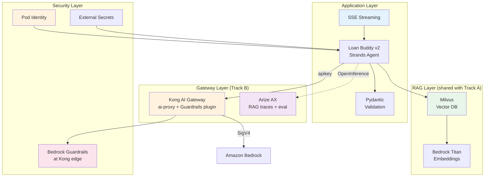

Your Strands Loan Buddy is evaluated, cost-attributed, and monitored from Module B4. Before the compliance team approves it for production, it needs three things: **document-aware decisions** (RAG with policy documents), **proper security** (no hardcoded secrets, least-privilege IAM, content guardrails), and **real-time responses** (streaming). This module addresses each — on the Kong + Arize SaaS stack.

::alert[**This is the SaaS-stack counterpart to [Track A's Module A4](/track-a-opensource/a4-production-ready/).** Much of production-hardening is **stack-independent** — RAG with Milvus, External Secrets, Pod Identity, and Ragas evaluation work the same regardless of gateway. Rather than duplicate that content, this module **cross-links Track A for the shared parts** and focuses on the genuine Track-B deltas: the **Strands** agent (not LangGraph), **Bedrock Guardrails enforced at the Kong gateway** (not the app), and **Arize** for RAG-trace evaluation.]{type="info"}

## 🎯 What You Will Learn

- ✅ Add a **RAG pipeline** (Milvus + Bedrock Titan Embeddings) to the Strands agent — *reuses Track A's Milvus setup*
- ✅ Harden security: **Pod Identity**, **External Secrets Operator** — *reuses Track A* — and **Bedrock Guardrails at the Kong edge** (Track-B delta)
- ✅ Implement **streaming responses** with the Strands SDK (Track-B delta)
- ✅ Validate outputs with **Pydantic** structured schemas
- ✅ Complete a **production readiness checklist** for the SaaS stack

## 🏗️ Production Architecture (Track B)

## 📚 Module Sections

#### 1. [Building a RAG Pipeline (Milvus + Strands)](./rag-pipeline/)
Reuse Track A's Milvus vector database and ingestion pipeline; wire retrieval into the **Strands** agent and evaluate RAG quality with Ragas + Arize.

#### 2. [Security Hardening for Production](./security-hardening/)
Reuse Track A's Pod Identity + External Secrets; then enforce **Bedrock Guardrails at the Kong gateway** — a Track-B advantage (gateway-enforced, not per-app).

#### 3. [Streaming Responses and Production Testing](./streaming-testing/)
Implement SSE streaming with the Strands SDK, add Pydantic validation, and complete the SaaS-stack production readiness checklist.

#### 4. [Infrastructure Monitoring and Auto-Scaling](./monitoring-scaling/)
Scrape Kong's AI Prometheus metrics into Amazon Managed Prometheus + Grafana, and auto-scale the agent/gateway with KEDA + EKS Auto Mode. The production-ops view of the Kong + Arize stack.

## 🔌 Building on Previous Modules

| From | What we reuse | What's different in Track B |
|---|---|---|
| Interacting with Models | vLLM + Bedrock, Titan Embeddings | same |
| **B2** | Kong AI Gateway + Arize | Guardrails plugin added to Kong |
| **B3** | Strands Loan Buddy + MCP servers | RAG retrieval + streaming added |
| **B4** | Arize eval + Kong cost metrics | Ragas RAG-quality metrics |

::alert[**Prerequisites**: Modules B1-B4 complete — the Strands Loan Buddy running, Kong `/loan-strands` route live, Arize receiving traces, and the AMP/Grafana stack from B4.]{type="warning"}

---

**[Next: Building a RAG Pipeline (Milvus + Strands) →](./rag-pipeline/)**
