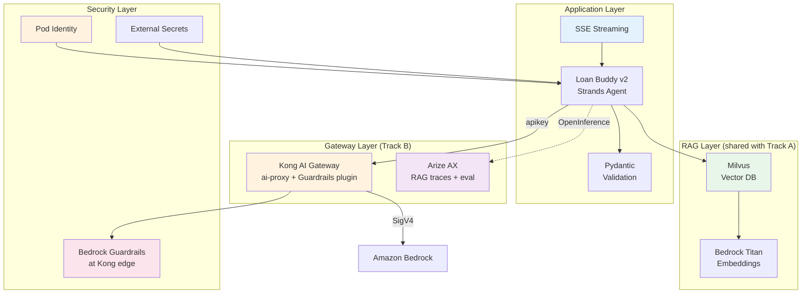

Strands Loan Buddy는 모듈 B4에서 평가되고, 비용이 어트리뷰션되고, 모니터링되었습니다. 컴플라이언스 팀이 프로덕션 승인을 하기 전에 세 가지가 필요합니다: **문서 인식 의사결정**(정책 문서를 활용한 RAG), **적절한 보안**(하드코딩된 시크릿 없음, 최소 권한 IAM, 콘텐츠 가드레일), 그리고 **실시간 응답**(스트리밍). 이 모듈은 Kong + Arize SaaS 스택에서 각각을 다룹니다.

::alert[**이것은 [Track A의 모듈 A4](/track-a-opensource/a4-production-ready/)에 대응하는 SaaS 스택 버전입니다.** 프로덕션 강화의 상당 부분은 **스택 독립적** 입니다 — Milvus를 활용한 RAG, External Secrets, Pod Identity, Ragas 평가는 게이트웨이에 관계없이 동일하게 작동합니다. 이 콘텐츠를 중복하기보다는, 이 모듈은 **공유 부분에 대해 Track A로 상호 링크** 하고 진정한 Track B 차이점에 집중합니다: **Strands** 에이전트(LangGraph가 아님), **Kong 게이트웨이에서 시행되는 Bedrock Guardrails**(앱이 아님), 그리고 RAG 트레이스 평가를 위한 **Arize**.]{type="info"}

## 🎯 학습할 내용

- ✅ Strands 에이전트에 **RAG 파이프라인**(Milvus + Bedrock Titan Embeddings) 추가 — *Track A의 Milvus 설정 재사용*
- ✅ 보안 강화: **Pod Identity**, **External Secrets Operator** — *Track A 재사용* — 그리고 **Kong 엣지에서의 Bedrock Guardrails**(Track B 차이점)
- ✅ Strands SDK로 **스트리밍 응답** 구현(Track B 차이점)
- ✅ **Pydantic** 구조화된 스키마로 출력 검증
- ✅ SaaS 스택을 위한 **프로덕션 준비 체크리스트** 완료

## 🏗️ 프로덕션 아키텍처 (Track B)

## 📚 모듈 섹션

#### 1. [RAG 파이프라인 구축 (Milvus + Strands)](./rag-pipeline/)
Track A의 Milvus 벡터 데이터베이스와 수집 파이프라인을 재사용하고, 검색을 **Strands** 에이전트에 연결하며, Ragas + Arize로 RAG 품질을 평가합니다.

#### 2. [프로덕션을 위한 보안 강화](./security-hardening/)
Track A의 Pod Identity + External Secrets를 재사용한 다음, **Kong 게이트웨이에서 Bedrock Guardrails를 시행** 합니다 — Track B의 장점(앱별이 아닌 게이트웨이 시행).

#### 3. [스트리밍 응답 및 프로덕션 테스트](./streaming-testing/)
Strands SDK로 SSE 스트리밍을 구현하고, Pydantic 검증을 추가하며, SaaS 스택 프로덕션 준비 체크리스트를 완료합니다.

## 🔌 이전 모듈 기반 구축

| 출처 | 재사용하는 것 | Track B에서 다른 점 |
|---|---|---|
| 모델과 상호작용하기 | vLLM + Bedrock, Titan Embeddings | 동일 |
| **B2** | Kong AI Gateway + Arize | Kong에 Guardrails plugin 추가 |
| **B3** | Strands Loan Buddy + MCP 서버 | RAG 검색 + 스트리밍 추가 |
| **B4** | Arize 평가 + Kong 비용 지표 | Ragas RAG 품질 지표 |

::alert[**사전 요구 사항**: 모듈 B1-B4 완료 — Strands Loan Buddy 실행 중, Kong `/loan-strands` 라우트 활성화, Arize가 트레이스 수신 중, 그리고 B4의 AMP/Grafana 스택.]{type="warning"}

---

**[다음: RAG 파이프라인 구축 (Milvus + Strands) →](./rag-pipeline/)**
