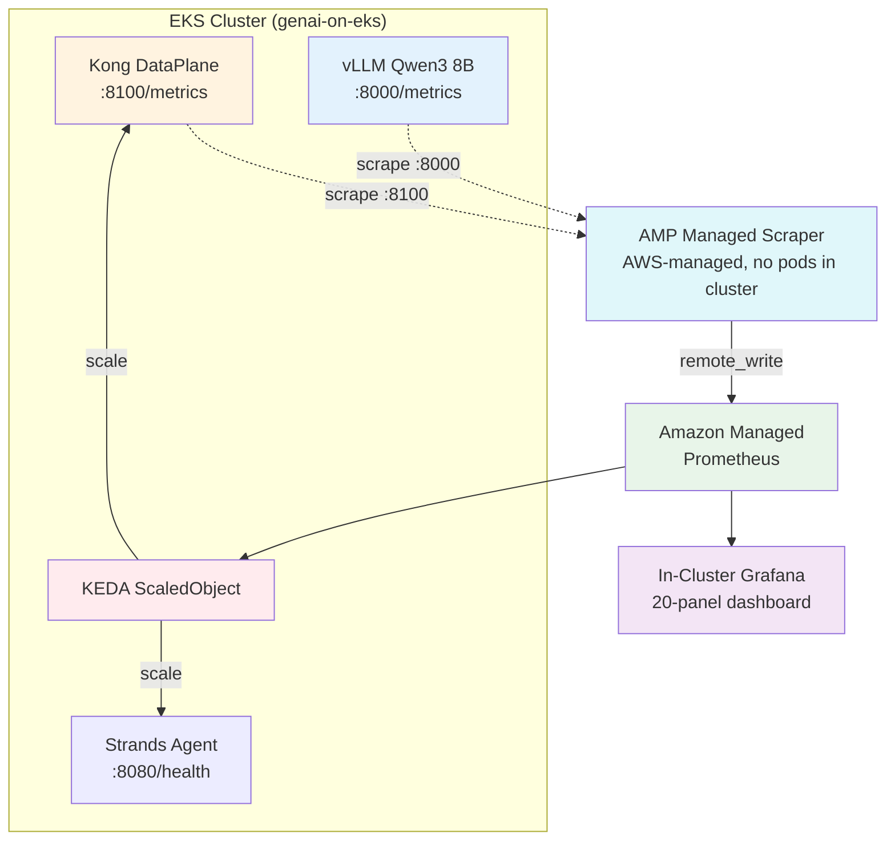

# 📊 Infrastructure Monitoring and Auto-Scaling

Arize AX shows what your *agent* is doing; Kong's Prometheus metrics show what the *gateway* is doing. But you also need the *infrastructure* view — is the Kong DataPlane saturated? Are agent pods scaling? Is the self-managed vLLM (Qwen) under pressure? This page adds production-grade monitoring with Amazon Managed Prometheus and Grafana, plus event-driven autoscaling with KEDA.

::alert[**Track B monitors different things than Track A.** Track A monitors vLLM + Neuron (self-hosted model serving). Track B monitors **Kong DataPlane** (gateway health) + **Kong AI metrics** (token throughput per model/consumer) + **Strands agent pods** (request handling) + optionally **vLLM** (if using self-managed models from Part 11 of token-cost-attribution). Bedrock is managed — AWS handles its scaling.]{type="info"}

## 🎯 What You Will Learn

- 📈 Discover infrastructure metrics on the Track B stack (Kong, agent, vLLM)
- 🏗️ Deploy Amazon Managed Prometheus + Grafana
- 📊 Build a GenAI Platform dashboard with Kong AI metrics
- ⚡ Configure KEDA event-driven autoscaling for the agent and gateway
- 🔄 Understand EKS Auto Mode / Karpenter node scaling

---

## 🛠️ Hands-On: Discover Your Infrastructure Metrics

### Step 1: Check Kong DataPlane Metrics

Kong exposes AI-specific and standard HTTP metrics via its Status API:

:::code{language=bash showCopyAction=true}
# Idempotent — start the Kong metrics port-forward only if 8100 isn't already forwarding
pgrep -f "port-forward.*8100:8100" >/dev/null || kubectl port-forward -n kong $(kubectl get pods -n kong -l app=dataplane -o name | head -1) 8100:8100 2>/dev/null &
sleep 3

echo "=== Kong AI metrics (token/cost/request/latency) ==="
curl -s localhost:8100/metrics | grep "kong_ai_llm" | grep -v "^#\|bucket" | head -10

echo ""
echo "=== Kong HTTP metrics (request rate, status codes) ==="
curl -s localhost:8100/metrics | grep "kong_http_requests_total" | grep -v "^#" | head -5
:::

**What you will see:**

:::code{language=text showCopyAction=false}
# Kong AI Metrics (from ai-proxy + prometheus plugins):
kong_ai_llm_tokens_total{ai_provider="bedrock",ai_model="global.anthropic.claude-sonnet-4-5-20250929-v1:0",...,consumer="loan-strands-agent"} 44401
kong_ai_llm_cost_total{...consumer="loan-strands-agent",request_mode="stream"} 0.077499
kong_ai_llm_requests_total{...consumer="loan-strands-agent",request_mode="stream"} 21

# Kong HTTP Metrics (standard gateway health):
kong_http_requests_total{service="loan-strands-bedrock",route="loan-strands-route",code="200",...} 471
:::

**Key metrics for the SaaS stack:**

| Category | Metrics | What they tell you |
|---|---|---|
| **Token throughput** | `kong_ai_llm_tokens_total` (rate) | How many tokens/sec flowing through the gateway |
| **Cost velocity** | `kong_ai_llm_cost_total` (rate) | Dollar spend rate — trigger alerts on unexpected spikes |
| **Request rate** | `kong_ai_llm_requests_total` (rate) | Request volume per model/consumer |
| **Latency** | `kong_ai_llm_provider_latency_ms`, `ttft`, `tpot` | Model responsiveness (Bedrock + vLLM) |
| **Gateway health** | `kong_http_requests_total`, `kong_bandwidth_bytes` | HTTP error rates, throughput |
| **Cache efficiency** | `kong_ai_cache_*` (hit/miss) | Semantic cache hit rate |

### Step 2: Check vLLM Metrics (if self-managed models deployed)

If you deployed the self-managed vLLM route (Part 11 of [token-cost-attribution](../../b4-scaling-evaluating/token-cost-attribution/)):

:::code{language=bash showCopyAction=true}
# Idempotent — start the model port-forward only if 8000 isn't already forwarding
pgrep -f "port-forward.*8000:8000" >/dev/null || kubectl port-forward -n vllm svc/qwen3-8b-neuron 8000:8000 2>/dev/null &
sleep 3

echo "=== vLLM performance metrics ==="
curl -s localhost:8000/metrics | grep -E "vllm:num_requests|vllm:generation_tokens|vllm:time_to_first_token|vllm:gpu_cache" | head -10
:::

**Expected:**

:::code{language=text showCopyAction=false}
vllm:num_requests_running 0.0
vllm:num_requests_waiting 0.0
vllm:gpu_cache_usage_perc 12.5
vllm:generation_tokens_total 1547.0
vllm:time_to_first_token_seconds_sum 45.2
:::

### Step 3: Check Agent Pod Metrics

The Strands agent exposes a `/api/health` endpoint. For autoscaling, monitor pod resource usage:

:::code{language=bash showCopyAction=true}
kubectl top pods -n strands-agents
:::

**Expected:**

:::code{language=text showCopyAction=false}
NAME                               CPU(cores)   MEMORY(bytes)
loan-buddy-agent-64bb6cd7f4-xxxxx  15m          256Mi
:::

---

## What is the Monitoring Stack?

The monitoring architecture for Track B:



| Component | Role |
|---|---|
| **AMP Managed Scraper** | AWS-managed collector — scrapes Kong + vLLM every 30s, writes to AMP (no pods in your cluster) |
| **Amazon Managed Prometheus** | Stores all metrics with 150-day retention |
| **In-Cluster Grafana** | Queries AMP via SigV4, displays 20-panel dashboard (declarative via ConfigMap) |
| **KEDA** | Queries AMP for request rate → scales agent/gateway pods |

---

## 🎯 Hands-On: Deploy Amazon Managed Prometheus & Grafana

### Step 1: Create the AMP Workspace

:::code{language=bash showCopyAction=true}
export AWS_REGION="us-east-1"
export CLUSTER_NAME="genai-on-eks"

# Create AMP workspace (idempotent: reuse the workspace with this alias if it already exists)
AMP_WS_ID=$(aws amp list-workspaces --alias "${CLUSTER_NAME}-monitoring" \
  --query 'workspaces[0].workspaceId' --output text --region $AWS_REGION 2>/dev/null)
if [ -n "$AMP_WS_ID" ] && [ "$AMP_WS_ID" != "None" ]; then
  echo "✅ AMP workspace ${CLUSTER_NAME}-monitoring already exists: $AMP_WS_ID"
else
  AMP_WS_ID=$(aws amp create-workspace --alias "${CLUSTER_NAME}-monitoring" \
    --query 'workspaceId' --output text --region $AWS_REGION)
fi
echo "AMP Workspace ID: $AMP_WS_ID"

# Get the remote write endpoint
AMP_ENDPOINT=$(aws amp describe-workspace --workspace-id $AMP_WS_ID \
  --query 'workspace.prometheusEndpoint' --output text --region $AWS_REGION)
echo "AMP Endpoint: ${AMP_ENDPOINT}api/v1/remote_write"
:::

### Step 2: Create AMP Managed Scraper (scrapes Kong + vLLM → AMP)

Use the **AMP Managed Collector** — AWS runs the scraper for you (no ADOT to deploy/manage). You just provide the scrape config:

:::code{language=bash showCopyAction=true}
# Create scrape config file
cat > /tmp/scraper-config.yaml << 'EOF'
global:
  scrape_interval: 30s
scrape_configs:
  - job_name: kong-ai-gateway
    kubernetes_sd_configs:
      - role: pod
        namespaces:
          names: [kong]
    relabel_configs:
      - source_labels: [__meta_kubernetes_pod_label_app]
        action: keep
        regex: dataplane
      - source_labels: [__meta_kubernetes_pod_ip]
        target_label: __address__
        replacement: "$1:8100"
    metrics_path: /metrics
  - job_name: vllm
    kubernetes_sd_configs:
      - role: pod
        namespaces:
          names: [vllm]
    relabel_configs:
      - source_labels: [__meta_kubernetes_pod_ip]
        target_label: __address__
        replacement: "$1:8000"
    metrics_path: /metrics
EOF

# Get cluster info
CLUSTER_ARN=$(aws eks describe-cluster --name $CLUSTER_NAME --region $AWS_REGION \
  --query 'cluster.arn' --output text)
SUBNETS=$(aws eks describe-cluster --name $CLUSTER_NAME --region $AWS_REGION \
  --query 'cluster.resourcesVpcConfig.subnetIds[:2]' --output text | tr '\t' ',')
SG=$(aws eks describe-cluster --name $CLUSTER_NAME --region $AWS_REGION \
  --query 'cluster.resourcesVpcConfig.clusterSecurityGroupId' --output text)

# Create the managed scraper (idempotent: skip if a scraper with this alias already exists)
AWS_ACCOUNT_ID=$(aws sts get-caller-identity --query Account --output text)
EXISTING_SCRAPER=$(aws amp list-scrapers --region $AWS_REGION \
  --query 'scrapers[?alias==`genai-kong-vllm`].scraperId' --output text)
if [ -n "$EXISTING_SCRAPER" ] && [ "$EXISTING_SCRAPER" != "None" ]; then
  echo "✅ AMP scraper genai-kong-vllm already exists: $EXISTING_SCRAPER — skipping create"
else
  aws amp create-scraper \
    --alias "genai-kong-vllm" \
    --source "eksConfiguration={clusterArn=$CLUSTER_ARN,subnetIds=[$SUBNETS],securityGroupIds=[$SG]}" \
    --destination "ampConfiguration={workspaceArn=arn:aws:aps:${AWS_REGION}:${AWS_ACCOUNT_ID}:workspace/${AMP_WS_ID}}" \
    --scrape-configuration "configurationBlob=$(base64 -i /tmp/scraper-config.yaml)" \
    --region $AWS_REGION
fi

# Wait for scraper to become ACTIVE (~5 minutes for first creation; returns immediately if already ACTIVE)
echo "Waiting for scraper to activate (takes ~5 min)..."
aws amp wait scraper-active --scraper-id $(aws amp list-scrapers --region $AWS_REGION \
  --query 'scrapers[?alias==`genai-kong-vllm`].scraperId' --output text) --region $AWS_REGION
echo "✅ Managed scraper ACTIVE"
:::

::alert[**AMP Managed Scraper vs ADOT:** The managed scraper runs in AWS infrastructure (no pods in your cluster). AWS handles the scraping, scaling, and HA. You just provide the scrape config YAML. No ServiceAccount, no IAM role setup, no ADOT deployment. Metrics appear in AMP within 30 seconds of the scraper becoming ACTIVE.]{type="info"}

### Step 3: Deploy In-Cluster Grafana with Declarative Dashboard (single apply)

Deploy Grafana with the AMP datasource + 20-panel dashboard provisioned from ConfigMaps — all in one `kubectl apply`. No patching, no manual UI clicks:

:::code{language=yaml showCopyAction=true}
cat <<'EOF' | kubectl apply -f -
apiVersion: v1
kind: Namespace
metadata:
  name: grafana
---
apiVersion: v1
kind: ServiceAccount
metadata:
  name: grafana
  namespace: grafana
---
apiVersion: v1
kind: ConfigMap
metadata:
  name: grafana-datasources
  namespace: grafana
data:
  datasources.yaml: |
    apiVersion: 1
    datasources:
      - name: Amazon Managed Prometheus
        type: prometheus
        access: proxy
        url: __AMP_ENDPOINT__
        isDefault: true
        jsonData:
          httpMethod: POST
          sigV4Auth: true
          sigV4AuthType: default
          sigV4Region: __REGION__
        editable: true
---
apiVersion: v1
kind: ConfigMap
metadata:
  name: grafana-dashboards-provider
  namespace: grafana
data:
  dashboards.yaml: |
    apiVersion: 1
    providers:
      - name: default
        orgId: 1
        type: file
        options:
          path: /var/lib/grafana/dashboards
---
apiVersion: v1
kind: ConfigMap
metadata:
  name: kong-ai-dashboard
  namespace: grafana
data:
  kong-ai-gateway.json: |
    {
      "title":"Kong AI Gateway - Token Economics","uid":"kong-ai-gateway","version":1,
      "panels":[
        {"id":1,"title":"Token Throughput (tok/s)","type":"timeseries","gridPos":{"h":7,"w":8,"x":0,"y":0},"targets":[{"expr":"sum(rate(kong_ai_llm_tokens_total{token_type=\"total_tokens\"}[5m]))","legendFormat":"total"}]},
        {"id":2,"title":"Token Rate by Model","type":"timeseries","gridPos":{"h":7,"w":8,"x":8,"y":0},"targets":[{"expr":"sum by (ai_model) (rate(kong_ai_llm_tokens_total{token_type=\"total_tokens\"}[5m]))","legendFormat":"{{ai_model}}"}]},
        {"id":3,"title":"Token Rate by Consumer","type":"timeseries","gridPos":{"h":7,"w":8,"x":16,"y":0},"targets":[{"expr":"sum by (consumer) (rate(kong_ai_llm_tokens_total{token_type=\"total_tokens\"}[5m]))","legendFormat":"{{consumer}}"}]},
        {"id":4,"title":"Prompt vs Completion","type":"timeseries","gridPos":{"h":7,"w":8,"x":0,"y":7},"targets":[{"expr":"sum by (token_type) (rate(kong_ai_llm_tokens_total[5m]))","legendFormat":"{{token_type}}"}]},
        {"id":5,"title":"Cost by Consumer ($/hr)","type":"barchart","gridPos":{"h":7,"w":8,"x":8,"y":7},"targets":[{"expr":"sum by (consumer) (increase(kong_ai_llm_cost_total[1h]))","legendFormat":"{{consumer}}"}]},
        {"id":6,"title":"Cost by Model ($/hr)","type":"barchart","gridPos":{"h":7,"w":8,"x":16,"y":7},"targets":[{"expr":"sum by (ai_model) (increase(kong_ai_llm_cost_total[1h]))","legendFormat":"{{ai_model}}"}]},
        {"id":7,"title":"Request Rate by Model","type":"timeseries","gridPos":{"h":7,"w":8,"x":0,"y":14},"targets":[{"expr":"sum by (ai_model) (rate(kong_ai_llm_requests_total[5m]))","legendFormat":"{{ai_model}}"}]},
        {"id":8,"title":"Request Rate by Consumer","type":"timeseries","gridPos":{"h":7,"w":8,"x":8,"y":14},"targets":[{"expr":"sum by (consumer) (rate(kong_ai_llm_requests_total[5m]))","legendFormat":"{{consumer}}"}]},
        {"id":9,"title":"Stream vs Oneshot","type":"timeseries","gridPos":{"h":7,"w":8,"x":16,"y":14},"targets":[{"expr":"sum by (request_mode) (rate(kong_ai_llm_requests_total[5m]))","legendFormat":"{{request_mode}}"}]},
        {"id":10,"title":"P95 Provider Latency","type":"gauge","gridPos":{"h":7,"w":6,"x":0,"y":21},"targets":[{"expr":"histogram_quantile(0.95, sum by (le) (rate(kong_ai_llm_provider_latency_ms_bucket[5m])))"}],"fieldConfig":{"defaults":{"unit":"ms"}}},
        {"id":11,"title":"P95 TTFT","type":"gauge","gridPos":{"h":7,"w":6,"x":6,"y":21},"targets":[{"expr":"histogram_quantile(0.95, sum by (le) (rate(kong_ai_llm_ttft_latency_ms_bucket[5m])))"}],"fieldConfig":{"defaults":{"unit":"ms"}}},
        {"id":12,"title":"P95 TPOT","type":"gauge","gridPos":{"h":7,"w":6,"x":12,"y":21},"targets":[{"expr":"histogram_quantile(0.95, sum by (le) (rate(kong_ai_llm_tpot_latency_ms_bucket[5m])))"}],"fieldConfig":{"defaults":{"unit":"ms"}}},
        {"id":13,"title":"Cache Hit %","type":"stat","gridPos":{"h":7,"w":6,"x":18,"y":21},"targets":[{"expr":"sum(kong_ai_llm_requests_total{cache_status=\"hit\"}) / (sum(kong_ai_llm_requests_total{cache_status=\"hit\"}) + sum(kong_ai_llm_requests_total{cache_status=\"miss\"})) * 100"}],"fieldConfig":{"defaults":{"unit":"percent"}}},
        {"id":14,"title":"Total Tokens","type":"stat","gridPos":{"h":4,"w":6,"x":0,"y":28},"targets":[{"expr":"sum(kong_ai_llm_tokens_total{token_type=\"total_tokens\"})"}]},
        {"id":15,"title":"Total Cost","type":"stat","gridPos":{"h":4,"w":6,"x":6,"y":28},"targets":[{"expr":"sum(kong_ai_llm_cost_total)"}],"fieldConfig":{"defaults":{"unit":"currencyUSD"}}},
        {"id":16,"title":"Total Requests","type":"stat","gridPos":{"h":4,"w":6,"x":12,"y":28},"targets":[{"expr":"sum(kong_ai_llm_requests_total)"}]},
        {"id":17,"title":"Active Providers","type":"stat","gridPos":{"h":4,"w":6,"x":18,"y":28},"targets":[{"expr":"count(count by (ai_provider) (kong_ai_llm_requests_total))"}]},
        {"id":18,"title":"Cost by Provider","type":"piechart","gridPos":{"h":7,"w":8,"x":0,"y":32},"targets":[{"expr":"sum by (ai_provider) (kong_ai_llm_cost_total)","legendFormat":"{{ai_provider}}"}]},
        {"id":19,"title":"vLLM Queue Depth","type":"timeseries","gridPos":{"h":7,"w":8,"x":8,"y":32},"targets":[{"expr":"vllm:num_requests_waiting","legendFormat":"waiting"},{"expr":"vllm:num_requests_running","legendFormat":"running"}]},
        {"id":20,"title":"vLLM GPU Cache %","type":"gauge","gridPos":{"h":7,"w":8,"x":16,"y":32},"targets":[{"expr":"vllm:gpu_cache_usage_perc"}],"fieldConfig":{"defaults":{"unit":"percent","max":100}}}
      ],
      "time":{"from":"now-1h","to":"now"},"refresh":"30s"
    }
---
apiVersion: apps/v1
kind: Deployment
metadata:
  name: grafana
  namespace: grafana
spec:
  replicas: 1
  selector:
    matchLabels: { app: grafana }
  template:
    metadata:
      labels: { app: grafana }
    spec:
      serviceAccountName: grafana
      containers:
        - name: grafana
          image: grafana/grafana:11.1.0
          ports: [{ containerPort: 3000 }]
          env:
            - { name: AWS_SDK_LOAD_CONFIG, value: "true" }
            - { name: GF_AUTH_SIGV4_AUTH_ENABLED, value: "true" }
            - { name: GF_SECURITY_ADMIN_USER, value: "admin" }
            - { name: GF_SECURITY_ADMIN_PASSWORD, value: "admin" }
          volumeMounts:
            - { name: datasources, mountPath: /etc/grafana/provisioning/datasources }
            - { name: dashboards-provider, mountPath: /etc/grafana/provisioning/dashboards }
            - { name: dashboards, mountPath: /var/lib/grafana/dashboards }
          resources:
            requests: { cpu: 100m, memory: 256Mi }
            limits: { memory: 512Mi }
      volumes:
        - { name: datasources, configMap: { name: grafana-datasources } }
        - { name: dashboards-provider, configMap: { name: grafana-dashboards-provider } }
        - { name: dashboards, configMap: { name: kong-ai-dashboard } }
---
apiVersion: v1
kind: Service
metadata:
  name: grafana
  namespace: grafana
spec:
  selector: { app: grafana }
  ports: [{ port: 3000, targetPort: 3000 }]
EOF
:::

Substitute the AMP endpoint and apply:

:::code{language=bash showCopyAction=true}
# Replace placeholders with actual values (run the cat command above first, then):
kubectl get configmap grafana-datasources -n grafana -o yaml | \
  sed -e "s#__AMP_ENDPOINT__#${AMP_ENDPOINT}#" -e "s#__REGION__#${AWS_REGION}#" | \
  kubectl apply -f -

kubectl rollout restart deployment/grafana -n grafana
kubectl rollout status deployment/grafana -n grafana --timeout=60s

# Create the IAM role Grafana assumes to query AMP (idempotent) — trust EKS Pod
# Identity (pods.eks.amazonaws.com) + attach AWS's managed AMP query policy.
if aws iam get-role --role-name genai-workshop-grafana-query-role >/dev/null 2>&1; then
  echo "✅ IAM role genai-workshop-grafana-query-role already exists"
else
  aws iam create-role --role-name genai-workshop-grafana-query-role \
    --assume-role-policy-document '{"Version":"2012-10-17","Statement":[{"Effect":"Allow","Principal":{"Service":"pods.eks.amazonaws.com"},"Action":["sts:AssumeRole","sts:TagSession"]}]}' >/dev/null
  echo "✅ Created IAM role genai-workshop-grafana-query-role"
fi
aws iam attach-role-policy --role-name genai-workshop-grafana-query-role \
  --policy-arn arn:aws:iam::aws:policy/AmazonPrometheusQueryAccess

# Create Pod Identity so Grafana can query AMP (idempotent)
if aws eks list-pod-identity-associations --cluster-name $CLUSTER_NAME --region $AWS_REGION \
     --namespace grafana --query "associations[?serviceAccount=='grafana'].associationId" \
     --output text | grep -q .; then
  echo "✅ Pod Identity association for grafana already exists — skipping"
else
  aws eks create-pod-identity-association \
    --cluster-name $CLUSTER_NAME --namespace grafana --service-account grafana \
    --role-arn $(aws iam get-role --role-name genai-workshop-grafana-query-role --query 'Role.Arn' --output text) \
    --region $AWS_REGION
fi

kubectl rollout restart deployment/grafana -n grafana
:::

Access Grafana:

:::code{language=bash showCopyAction=true}
# Idempotent — start the Grafana port-forward only if 3000 isn't already forwarding
pgrep -f "port-forward.*3000:3000" >/dev/null || kubectl port-forward -n grafana svc/grafana 3000:3000 >/tmp/grafana-pf.log 2>&1 &
echo "Grafana: http://localhost:3000 (admin/admin)"
echo "Dashboard: 'Kong AI Gateway - Token Economics' (20 panels, auto-provisioned)"
:::

::alert[**Everything is declarative** — Grafana, datasource, AND dashboard all deployed from a single YAML. No `kubectl patch`, no UI clicks. Store this YAML in Git for full GitOps lifecycle.]{type="info"}

### Step 4: Send Diverse Traffic to Populate Dashboard

Send requests across different consumers, models, and hosting types so the dashboard shows all dimensions:

:::code{language=bash showCopyAction=true}
export KONG_PROXY="http://$(kubectl get svc -n kong proxy1 -o jsonpath='{.status.loadBalancer.ingress[0].hostname}')"
export LOAN_IMAGE="/workshop/workshops/eks-genai-workshop/static/code/module3/credit-validation/example1.png"

echo "=== 1. loan-strands-agent → Claude (streaming via agent) ==="
curl -s --max-time 180 -X POST http://localhost:8890/api/process_credit_application_with_upload \
  -H "X-Consumer-ID: loan-strands-agent" -H "X-Consumer-ApiKey: loan-strands-key-123" \
  -F "image_file=@${LOAN_IMAGE}" -o /dev/null &

echo "=== 2. fraud-detection-team → Claude (streaming via agent) ==="
curl -s --max-time 180 -X POST http://localhost:8890/api/process_credit_application_with_upload \
  -H "X-Consumer-ID: fraud-detection-team" -H "X-Consumer-ApiKey: fraud-team-key-456" \
  -F "image_file=@${LOAN_IMAGE}" -o /dev/null &

echo "=== 3. loan-strands-agent → Claude (oneshot) ==="
curl -s --max-time 10 -o /dev/null -X POST "$KONG_PROXY/loan-strands/v1/chat/completions" \
  -H "Content-Type: application/json" -H "apikey: loan-strands-key-123" \
  -d '{"model":"global.anthropic.claude-sonnet-4-5-20250929-v1:0","messages":[{"role":"user","content":"Evaluate credit score 750"}],"max_tokens":50}'

echo "=== 4. fraud-detection-team → Claude (oneshot) ==="
curl -s --max-time 10 -o /dev/null -X POST "$KONG_PROXY/loan-strands/v1/chat/completions" \
  -H "Content-Type: application/json" -H "apikey: fraud-team-key-456" \
  -d '{"model":"global.anthropic.claude-sonnet-4-5-20250929-v1:0","messages":[{"role":"user","content":"Check fraud patterns"}],"max_tokens":50}'

echo "=== 5-6. Nova Micro (cheap model) ==="
curl -s --max-time 10 -o /dev/null -X POST "$KONG_PROXY/loan-strands-nova/v1/chat/completions" \
  -H "Content-Type: application/json" -d '{"model":"amazon.nova-micro-v1:0","messages":[{"role":"user","content":"What is 2+2?"}],"max_tokens":10}'
curl -s --max-time 10 -o /dev/null -X POST "$KONG_PROXY/loan-strands-nova/v1/chat/completions" \
  -H "Content-Type: application/json" -d '{"model":"amazon.nova-micro-v1:0","messages":[{"role":"user","content":"Hello"}],"max_tokens":10}'

echo "=== 7-8. Self-managed vLLM Qwen 3 8B (AWS Neuron) ==="
curl -s --max-time 30 -o /dev/null -X POST "$KONG_PROXY/loan-strands-vllm/v1/chat/completions" \
  -H "Content-Type: application/json" -H "apikey: loan-strands-key-123" \
  -d '{"model":"qwen3-8b-neuron","messages":[{"role":"user","content":"Evaluate this loan"}],"max_tokens":50}'
curl -s --max-time 30 -o /dev/null -X POST "$KONG_PROXY/loan-strands-vllm/v1/chat/completions" \
  -H "Content-Type: application/json" -H "apikey: loan-strands-key-123" \
  -d '{"model":"qwen3-8b-neuron","messages":[{"role":"user","content":"Risk factors?"}],"max_tokens":50}'

wait
echo "✅ All requests sent. Wait 30s for AMP scraper to collect, then refresh Grafana."
:::

After ~30 seconds, open the Grafana dashboard — all 20 panels should populate with data across consumers, models, providers, and request modes.

**Panel 1 (rows 1-3): Token throughput, cost, and request rates — broken down by model, consumer, and request mode:**


**Panel 2 (rows 4-5): Latency gauges, stat tiles, provider cost breakdown, and vLLM metrics:**


---

## 🚀 Hands-On: Build GenAI Platform Dashboard

The 20-panel dashboard was auto-provisioned in Step 3. Here are the panels and their PromQL queries for reference:

| # | Panel | PromQL | Visualization |
|---|---|---|---|
| 1 | **Token Throughput** | `sum(rate(kong_ai_llm_tokens_total{token_type="total_tokens"}[5m]))` | Time series |
| 2 | **Token Rate by Model** | `sum by (ai_model) (rate(kong_ai_llm_tokens_total{token_type="total_tokens"}[5m]))` | Stacked time series |
| 3 | **Cost Rate ($/min)** | `sum(rate(kong_ai_llm_cost_total[5m])) * 60` | Stat |
| 4 | **Cost by Consumer** | `sum by (consumer) (increase(kong_ai_llm_cost_total[1h]))` | Bar chart |
| 5 | **Request Rate** | `sum(rate(kong_ai_llm_requests_total[5m]))` | Time series |
| 6 | **P95 Provider Latency** | `histogram_quantile(0.95, sum by (le) (rate(kong_ai_llm_provider_latency_ms_bucket[5m])))` | Gauge |
| 7 | **TTFT (Time to First Token)** | `histogram_quantile(0.95, sum by (le) (rate(kong_ai_llm_ttft_latency_ms_bucket[5m])))` | Gauge |
| 8 | **Cache Hit Rate** | `sum(kong_ai_llm_requests_total{cache_status="hit"}) / sum(kong_ai_llm_requests_total) * 100` | Stat (%) |
| 9 | **vLLM Queue Depth** | `vllm:num_requests_waiting` | Time series |
| 10 | **vLLM GPU Cache Usage** | `vllm:gpu_cache_usage_perc` | Gauge |

::alert[**Import Kong's official AI Grafana dashboard** (ID `21162`) for a pre-built view, or build a custom one using the PromQL above. The official dashboard includes: AI Total Requests, Token Consumption (prompt/completion/total), Cost per request, and AI Request timeline.]{type="info"}

---

## 🎯 Hands-On: Configure Event-Driven Autoscaling with KEDA

### Step 1: Install KEDA

:::code{language=bash showCopyAction=true}
helm repo add kedacore https://kedacore.github.io/charts
helm repo update

# upgrade --install is idempotent: installs on first run, no-ops/updates on re-runs (no "already exists" error)
helm upgrade --install keda kedacore/keda \
  --namespace keda --create-namespace \
  --set serviceAccount.create=true

kubectl rollout status deployment/keda-operator -n keda --timeout=90s
:::

### Step 2: Create ScaledObject for the Strands Agent

KEDA creates an HPA that scales the agent deployment based on a trigger. For demonstration, we use a cron trigger that scales during working hours:

:::code{language=yaml showCopyAction=true}
cat <<'EOF' | kubectl apply -f -
apiVersion: keda.sh/v1alpha1
kind: ScaledObject
metadata:
  name: loan-buddy-agent-scaler
  namespace: strands-agents
spec:
  scaleTargetRef:
    name: loan-buddy-agent
  minReplicaCount: 1
  maxReplicaCount: 3
  triggers:
  - type: cron
    metadata:
      timezone: UTC
      start: "0 * * * *"
      end: "59 * * * *"
      desiredReplicas: "2"
EOF
:::

### Step 3: Verify Autoscaling

:::code{language=bash showCopyAction=true}
# Wait for KEDA to scale
sleep 20
kubectl get scaledobject -n strands-agents
kubectl get hpa -n strands-agents
kubectl get pods -n strands-agents -l app=loan-buddy-agent
:::

::::expand{header="Check Output — agent scaled from 1 → 2 pods"}

```text
NAME                      SCALETARGETKIND      SCALETARGETNAME    MIN   MAX   READY   ACTIVE   TRIGGERS   AGE
loan-buddy-agent-scaler   apps/v1.Deployment   loan-buddy-agent   1     3     True    True     cron       50s

NAME                               REFERENCE                     TARGETS     REPLICAS
keda-hpa-loan-buddy-agent-scaler   Deployment/loan-buddy-agent   1/1 (avg)   2

NAME                                READY   STATUS    AGE
loan-buddy-agent-65f5cf4cb6-6zdg8   1/1     Running   12m
loan-buddy-agent-65f5cf4cb6-qfx86   1/1     Running   36s
```

::::

KEDA scaled the agent from 1 to 2 replicas.

### Production: AMP-Based Scaling (Kong Request Rate)

For production, replace the cron trigger with a **prometheus trigger** that scales based on Kong's AI request rate from AMP:

:::code{language=yaml showCopyAction=false}
# Production ScaledObject (requires IRSA for KEDA → AMP SigV4 auth)
triggers:
- type: prometheus
  metadata:
    serverAddress: ${AMP_ENDPOINT}
    query: sum(rate(kong_ai_llm_requests_total[2m]))
    threshold: "5"
    awsRegion: us-east-1
  authenticationRef:
    name: amp-trigger-auth
:::

::alert[**AMP + KEDA SigV4 auth:** KEDA's prometheus scaler querying AMP requires IRSA (IAM Roles for Service Accounts) annotation on the KEDA operator ServiceAccount — NOT EKS Pod Identity. Follow [Track A's KEDA IRSA setup](/track-a-opensource/a3-scaling-evaluating/monitoring-scaling/) for the full IAM configuration. The cron trigger above proves KEDA works; the AMP trigger adds metric-driven intelligence.]{type="warning"}

---

## 🚀 Hands-On: Understanding EKS Auto Mode Node Scaling

EKS Auto Mode (or Karpenter) automatically provisions nodes when KEDA scales up pods that can't fit on existing nodes:

:::code{language=bash showCopyAction=true}
# Check current node capacity
kubectl get nodes -o custom-columns='NAME:.metadata.name,TYPE:.metadata.labels.node\.kubernetes\.io/instance-type,CPU:.status.capacity.cpu,MEM:.status.capacity.memory'
:::

When KEDA scales the agent from 1→5 pods, if the existing nodes can't fit 5 pods, EKS Auto Mode provisions new nodes automatically. No manual intervention needed.

---

## 📊 Hands-On: Add Scaling Alerts in Grafana

### Alert 1: High Token Cost Rate

:::code{language=text showCopyAction=false}
# Alert when cost rate exceeds $1/hour
sum(rate(kong_ai_llm_cost_total[5m])) * 3600 > 1
:::

### Alert 2: High Latency (P95 > 30s)

:::code{language=text showCopyAction=false}
histogram_quantile(0.95, sum by (le) (rate(kong_ai_llm_provider_latency_ms_bucket[5m]))) > 30000
:::

### Alert 3: Agent Pod Scaling Near Max

:::code{language=text showCopyAction=false}
# Alert when agent is at 80% of max replicas
kube_deployment_spec_replicas{deployment="loan-buddy-agent"} / 5 > 0.8
:::

---

## 📊 Arize Dashboards for Agent Traces

Grafana (above) shows the **infrastructure** view — gateway/vLLM/pod health. For the **agent** view, build custom dashboards in **Arize AX** over the OpenInference traces your Strands Loan Buddy emits. Navigate to **Dashboards** (left nav) → **+ New Dashboard**, then pick a template or start blank.

**LLM-focused dashboard templates:**
- **Tracing Project Overview** — trace volume/errors, latency (average + distribution), token count & cost per model, and eval-score trends
- **Token Tracking and Latency** — token counts, request volume, and latency

**Metrics you can chart:**
- **Latency** — P50 / P95 (add a custom metric with `APPROX_QUANTILE` for p95)
- **Token usage** — prompt / completion / total over time
- **Cost** — cost over time (when cost tracking is configured)
- **Trace / span counts** and request volume
- **Error rate** (as a custom-metric percentage)
- **Eval scores** — hallucination, relevance, QA-correctness trends (from the [evaluators you built](/track-b-saas/b4-scaling-evaluating/evaluation/))

**Breakdowns** — group any metric by **model**, **environment**, **metadata**, or **span attribute** (e.g. latency by `attributes.openinference.span.kind` to compare AGENT vs LLM vs TOOL span latency).

**Widget types:** Time Series, Distribution, Statistic, Pivot Table, Scatter Plot, Text, Experiment. For example, build a **Pivot Table** of average latency across Agent/LLM/Retriever/Tool span kinds, or a **Scatter Plot** correlating token count vs. latency.

**Build a latency-by-span-kind widget:**
1. **Dashboards → + New Dashboard →** name it `Loan Buddy Quality Monitoring`
2. **+ Add Widget → Pivot Table** (or Time Series)
3. **Metric:** Latency (Average) · **Group by:** `attributes.openinference.span.kind`
4. **Save** — you now see how AGENT, LLM, and TOOL spans compare

::alert[**Interactivity:** global filters + time range apply to all widgets (per-widget overrides allowed); click any data point to jump to the underlying filtered traces. Dashboards can be exported to PDF, widget data to CSV, shared by URL, or queried via the GraphQL API.]{type="success"}

---

## 📊 How It Maps to Track A

| | Track A | Track B |
|---|---|---|
| **Gateway metrics** | LiteLLM logs → Langfuse cost | **Kong Prometheus AI metrics** (real-time, per-consumer/model) |
| **Model-server metrics** | vLLM `/metrics` + Neuron DaemonSet | vLLM (if self-managed) — Bedrock is managed (no infra) |
| **Metric store** | Amazon Managed Prometheus | **same** |
| **Dashboards** | Amazon Managed Grafana | **same** |
| **Autoscaling trigger** | vLLM queue depth / request rate | **Kong request rate** per consumer (from AI metrics) |
| **Pod autoscaling** | KEDA ScaledObject | **same** |
| **Node autoscaling** | EKS Auto Mode / Karpenter | **same** |

## ✅ What You Accomplished

- ✅ Discovered Kong AI metrics (tokens, cost, latency, per consumer/model) as the primary monitoring source
- ✅ Deployed AMP + Grafana for centralized metrics and dashboards
- ✅ Built a GenAI Platform dashboard with 10 panels (token throughput, cost by consumer, latency, cache hit rate)
- ✅ Configured KEDA autoscaling: agent scales on Kong request rate, DataPlane scales on HTTP throughput
- ✅ Understood EKS Auto Mode node provisioning for scale-up scenarios
- ✅ Added production alerts (cost rate, latency, scaling limits)

## Track B Complete 🎉

You've taken the Kong + Arize SaaS stack all the way to production: gateway + observability (B1-B2), the Strands agent (B3), evaluation + per-tenant token/cost attribution + routing + semantic caching (B4), and RAG, security, streaming, and now infrastructure monitoring + auto-scaling (B5).

---

**[Next: Workshop Summary →](/summary/)**
