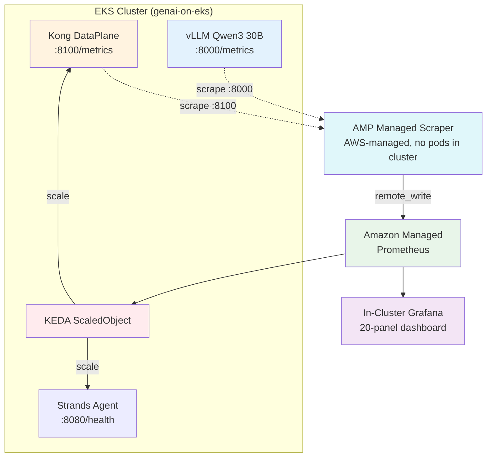

# 📊 인프라 모니터링 및 오토스케일링

Arize AX는 *에이전트* 가 무엇을 하는지 보여주고, Kong의 Prometheus 지표는 *게이트웨이* 가 무엇을 하는지 보여줍니다. 하지만 *인프라* 관점도 필요합니다 — Kong DataPlane이 포화 상태입니까? 에이전트 Pod가 스케일링되고 있습니까? 자체 관리 vLLM(Qwen)이 부하를 받고 있습니까? 이 페이지에서는 Amazon Managed Prometheus 및 Grafana로 프로덕션 등급 모니터링을 추가하고, KEDA로 이벤트 기반 오토스케일링을 추가합니다.

::alert[**Track B는 Track A와 다른 것을 모니터링합니다.** Track A는 vLLM + Neuron(자체 호스팅 모델 서빙)을 모니터링합니다. Track B는 **Kong DataPlane**(게이트웨이 상태) + **Kong AI 지표**(모델/consumer별 토큰 처리량) + **Strands 에이전트 Pod**(요청 처리) + 선택적으로 **vLLM**(token-cost-attribution의 Part 11에서 자체 관리 모델을 사용하는 경우)을 모니터링합니다. Bedrock은 관리형입니다 — AWS가 스케일링을 처리합니다.]{type="info"}

## 🎯 학습 내용

- 📈 Track B 스택(Kong, 에이전트, vLLM)에서 인프라 지표 확인
- 🏗️ Amazon Managed Prometheus + Grafana 배포
- 📊 Kong AI 지표로 GenAI 플랫폼 대시보드 구축
- ⚡ 에이전트 및 게이트웨이용 KEDA 이벤트 기반 오토스케일링 구성
- 🔄 EKS Auto Mode / Karpenter 노드 스케일링 이해

---

## 🛠️ 실습: 인프라 지표 확인하기

### 1단계: Kong DataPlane 지표 확인

Kong은 Status API를 통해 AI 전용 지표 및 표준 HTTP 지표를 노출합니다:

:::code{language=bash showCopyAction=true}
kubectl port-forward -n kong $(kubectl get pods -n kong -l app=dataplane -o name | head -1) 8100:8100 2>/dev/null &
sleep 3

echo "=== Kong AI metrics (token/cost/request/latency) ==="
curl -s localhost:8100/metrics | grep "kong_ai_llm" | grep -v "^#\|bucket" | head -10

echo ""
echo "=== Kong HTTP metrics (request rate, status codes) ==="
curl -s localhost:8100/metrics | grep "kong_http_requests_total" | grep -v "^#" | head -5
:::

**표시되는 내용:**

:::code{language=text showCopyAction=false}
# Kong AI Metrics (from ai-proxy + prometheus plugins):
kong_ai_llm_tokens_total{ai_provider="bedrock",ai_model="global.anthropic.claude-sonnet-4-5-20250929-v1:0",...,consumer="loan-strands-agent"} 44401
kong_ai_llm_cost_total{...consumer="loan-strands-agent",request_mode="stream"} 0.077499
kong_ai_llm_requests_total{...consumer="loan-strands-agent",request_mode="stream"} 21

# Kong HTTP Metrics (standard gateway health):
kong_http_requests_total{service="loan-strands-bedrock",route="loan-strands-route",code="200",...} 471
:::

**SaaS 스택의 핵심 지표:**

| 카테고리 | 지표 | 알려주는 내용 |
|---|---|---|
| **토큰 처리량** | `kong_ai_llm_tokens_total` (rate) | 게이트웨이를 통해 흐르는 초당 토큰 수 |
| **비용 속도** | `kong_ai_llm_cost_total` (rate) | 달러 지출 속도 — 예상치 못한 급증 시 알림 트리거 |
| **요청 속도** | `kong_ai_llm_requests_total` (rate) | 모델/consumer별 요청 볼륨 |
| **지연시간** | `kong_ai_llm_provider_latency_ms`, `ttft`, `tpot` | 모델 응답성(Bedrock + vLLM) |
| **게이트웨이 상태** | `kong_http_requests_total`, `kong_bandwidth_bytes` | HTTP 오류율, 처리량 |
| **캐시 효율성** | `kong_ai_cache_*` (hit/miss) | 시맨틱 캐시 적중률 |

### 2단계: vLLM 지표 확인 (자체 관리 모델을 배포한 경우)

자체 관리 vLLM 라우트([token-cost-attribution](../token-cost-attribution/)의 Part 11)를 배포했다면:

:::code{language=bash showCopyAction=true}
kubectl port-forward -n vllm svc/qwen3-30b-instruct-fp8 8000:8000 2>/dev/null &
sleep 3

echo "=== vLLM performance metrics ==="
curl -s localhost:8000/metrics | grep -E "vllm:num_requests|vllm:generation_tokens|vllm:time_to_first_token|vllm:gpu_cache" | head -10
:::

**예상 출력:**

:::code{language=text showCopyAction=false}
vllm:num_requests_running 0.0
vllm:num_requests_waiting 0.0
vllm:gpu_cache_usage_perc 12.5
vllm:generation_tokens_total 1547.0
vllm:time_to_first_token_seconds_sum 45.2
:::

### 3단계: 에이전트 Pod 지표 확인

Strands 에이전트는 `/api/health` 엔드포인트를 노출합니다. 오토스케일링을 위해 Pod 리소스 사용량을 모니터링합니다:

:::code{language=bash showCopyAction=true}
kubectl top pods -n strands-agents
:::

**예상 출력:**

:::code{language=text showCopyAction=false}
NAME                               CPU(cores)   MEMORY(bytes)
loan-buddy-agent-64bb6cd7f4-xxxxx  15m          256Mi
:::

---

## 모니터링 스택이란?

Track B의 모니터링 아키텍처:

| 구성요소 | 역할 |
|---|---|
| **AMP Managed Scraper** | AWS 관리형 수집기 — Kong + vLLM을 30초마다 스크레이프하여 AMP에 기록(클러스터 내 Pod 없음) |
| **Amazon Managed Prometheus** | 150일 보존 기간으로 모든 지표 저장 |
| **In-Cluster Grafana** | SigV4를 통해 AMP를 쿼리, 20패널 대시보드 표시(ConfigMap을 통한 선언적 방식) |
| **KEDA** | 요청 속도를 위해 AMP를 쿼리 → 에이전트/게이트웨이 Pod 스케일링 |

---

## 🎯 실습: Amazon Managed Prometheus & Grafana 배포

### 1단계: AMP 워크스페이스 생성

:::code{language=bash showCopyAction=true}
export AWS_REGION="us-east-1"
export CLUSTER_NAME="genai-on-eks"

# Create AMP workspace
AMP_WS_ID=$(aws amp create-workspace --alias "${CLUSTER_NAME}-monitoring" \
  --query 'workspaceId' --output text --region $AWS_REGION)
echo "AMP Workspace ID: $AMP_WS_ID"

# Get the remote write endpoint
AMP_ENDPOINT=$(aws amp describe-workspace --workspace-id $AMP_WS_ID \
  --query 'workspace.prometheusEndpoint' --output text --region $AWS_REGION)
echo "AMP Endpoint: ${AMP_ENDPOINT}api/v1/remote_write"
:::

### 2단계: AMP Managed Scraper 생성 (Kong + vLLM 스크레이프 → AMP)

**AMP Managed Collector** 를 사용합니다 — AWS가 여러분을 위해 스크레이퍼를 실행합니다(배포/관리할 ADOT 없음). 여러분은 스크레이프 설정만 제공하면 됩니다:

:::code{language=bash showCopyAction=true}
# Create scrape config file
cat > /tmp/scraper-config.yaml << 'EOF'
global:
  scrape_interval: 30s
scrape_configs:
  - job_name: kong-ai-gateway
    kubernetes_sd_configs:
      - role: pod
        namespaces:
          names: [kong]
    relabel_configs:
      - source_labels: [__meta_kubernetes_pod_label_app]
        action: keep
        regex: dataplane
      - source_labels: [__meta_kubernetes_pod_ip]
        target_label: __address__
        replacement: "$1:8100"
    metrics_path: /metrics
  - job_name: vllm
    kubernetes_sd_configs:
      - role: pod
        namespaces:
          names: [vllm]
    relabel_configs:
      - source_labels: [__meta_kubernetes_pod_ip]
        target_label: __address__
        replacement: "$1:8000"
    metrics_path: /metrics
EOF

# Get cluster info
CLUSTER_ARN=$(aws eks describe-cluster --name $CLUSTER_NAME --region $AWS_REGION \
  --query 'cluster.arn' --output text)
SUBNETS=$(aws eks describe-cluster --name $CLUSTER_NAME --region $AWS_REGION \
  --query 'cluster.resourcesVpcConfig.subnetIds[:2]' --output text | tr '\t' ',')
SG=$(aws eks describe-cluster --name $CLUSTER_NAME --region $AWS_REGION \
  --query 'cluster.resourcesVpcConfig.clusterSecurityGroupId' --output text)

# Create the managed scraper
aws amp create-scraper \
  --alias "genai-kong-vllm" \
  --source "eksConfiguration={clusterArn=$CLUSTER_ARN,subnetIds=[$SUBNETS],securityGroupIds=[$SG]}" \
  --destination "ampConfiguration={workspaceArn=arn:aws:aps:${AWS_REGION}:${AWS_ACCOUNT_ID}:workspace/${AMP_WORKSPACE_ID}}" \
  --scrape-configuration "configurationBlob=$(base64 -i /tmp/scraper-config.yaml)" \
  --region $AWS_REGION

# Wait for scraper to become ACTIVE (~5 minutes for first creation)
echo "Waiting for scraper to activate (takes ~5 min)..."
aws amp wait scraper-active --scraper-id $(aws amp list-scrapers --region $AWS_REGION \
  --query 'scrapers[?alias==`genai-kong-vllm`].scraperId' --output text) --region $AWS_REGION
echo "✅ Managed scraper ACTIVE"
:::

::alert[**AMP Managed Scraper vs ADOT:** 관리형 스크레이퍼는 AWS 인프라에서 실행됩니다(클러스터 내 Pod 없음). AWS가 스크레이핑, 스케일링, HA를 처리합니다. 여러분은 스크레이프 설정 YAML만 제공하면 됩니다. ServiceAccount 없음, IAM 역할 설정 없음, ADOT 배포 없음. 스크레이퍼가 ACTIVE 상태가 된 후 30초 이내에 지표가 AMP에 나타납니다.]{type="info"}

### 3단계: 선언적 대시보드를 포함한 In-Cluster Grafana 배포 (단일 apply)

AMP 데이터소스 + ConfigMap에서 프로비저닝된 20패널 대시보드를 포함한 Grafana를 배포합니다 — 모두 하나의 `kubectl apply`로. 패칭 없음, 수동 UI 클릭 없음:

:::code{language=yaml showCopyAction=true}
cat <<'EOF' | kubectl apply -f -
apiVersion: v1
kind: Namespace
metadata:
  name: grafana
---
apiVersion: v1
kind: ServiceAccount
metadata:
  name: grafana
  namespace: grafana
---
apiVersion: v1
kind: ConfigMap
metadata:
  name: grafana-datasources
  namespace: grafana
data:
  datasources.yaml: |
    apiVersion: 1
    datasources:
      - name: Amazon Managed Prometheus
        type: prometheus
        access: proxy
        url: __AMP_ENDPOINT__
        isDefault: true
        jsonData:
          httpMethod: POST
          sigV4Auth: true
          sigV4AuthType: default
          sigV4Region: __REGION__
        editable: true
---
apiVersion: v1
kind: ConfigMap
metadata:
  name: grafana-dashboards-provider
  namespace: grafana
data:
  dashboards.yaml: |
    apiVersion: 1
    providers:
      - name: default
        orgId: 1
        type: file
        options:
          path: /var/lib/grafana/dashboards
---
apiVersion: v1
kind: ConfigMap
metadata:
  name: kong-ai-dashboard
  namespace: grafana
data:
  kong-ai-gateway.json: |
    {
      "title":"Kong AI Gateway - Token Economics","uid":"kong-ai-gateway","version":1,
      "panels":[
        {"id":1,"title":"Token Throughput (tok/s)","type":"timeseries","gridPos":{"h":7,"w":8,"x":0,"y":0},"targets":[{"expr":"sum(rate(kong_ai_llm_tokens_total{token_type=\"total_tokens\"}[5m]))","legendFormat":"total"}]},
        {"id":2,"title":"Token Rate by Model","type":"timeseries","gridPos":{"h":7,"w":8,"x":8,"y":0},"targets":[{"expr":"sum by (ai_model) (rate(kong_ai_llm_tokens_total{token_type=\"total_tokens\"}[5m]))","legendFormat":"{{ai_model}}"}]},
        {"id":3,"title":"Token Rate by Consumer","type":"timeseries","gridPos":{"h":7,"w":8,"x":16,"y":0},"targets":[{"expr":"sum by (consumer) (rate(kong_ai_llm_tokens_total{token_type=\"total_tokens\"}[5m]))","legendFormat":"{{consumer}}"}]},
        {"id":4,"title":"Prompt vs Completion","type":"timeseries","gridPos":{"h":7,"w":8,"x":0,"y":7},"targets":[{"expr":"sum by (token_type) (rate(kong_ai_llm_tokens_total[5m]))","legendFormat":"{{token_type}}"}]},
        {"id":5,"title":"Cost by Consumer ($/hr)","type":"barchart","gridPos":{"h":7,"w":8,"x":8,"y":7},"targets":[{"expr":"sum by (consumer) (increase(kong_ai_llm_cost_total[1h]))","legendFormat":"{{consumer}}"}]},
        {"id":6,"title":"Cost by Model ($/hr)","type":"barchart","gridPos":{"h":7,"w":8,"x":16,"y":7},"targets":[{"expr":"sum by (ai_model) (increase(kong_ai_llm_cost_total[1h]))","legendFormat":"{{ai_model}}"}]},
        {"id":7,"title":"Request Rate by Model","type":"timeseries","gridPos":{"h":7,"w":8,"x":0,"y":14},"targets":[{"expr":"sum by (ai_model) (rate(kong_ai_llm_requests_total[5m]))","legendFormat":"{{ai_model}}"}]},
        {"id":8,"title":"Request Rate by Consumer","type":"timeseries","gridPos":{"h":7,"w":8,"x":8,"y":14},"targets":[{"expr":"sum by (consumer) (rate(kong_ai_llm_requests_total[5m]))","legendFormat":"{{consumer}}"}]},
        {"id":9,"title":"Stream vs Oneshot","type":"timeseries","gridPos":{"h":7,"w":8,"x":16,"y":14},"targets":[{"expr":"sum by (request_mode) (rate(kong_ai_llm_requests_total[5m]))","legendFormat":"{{request_mode}}"}]},
        {"id":10,"title":"P95 Provider Latency","type":"gauge","gridPos":{"h":7,"w":6,"x":0,"y":21},"targets":[{"expr":"histogram_quantile(0.95, sum by (le) (rate(kong_ai_llm_provider_latency_ms_bucket[5m])))"}],"fieldConfig":{"defaults":{"unit":"ms"}}},
        {"id":11,"title":"P95 TTFT","type":"gauge","gridPos":{"h":7,"w":6,"x":6,"y":21},"targets":[{"expr":"histogram_quantile(0.95, sum by (le) (rate(kong_ai_llm_ttft_latency_ms_bucket[5m])))"}],"fieldConfig":{"defaults":{"unit":"ms"}}},
        {"id":12,"title":"P95 TPOT","type":"gauge","gridPos":{"h":7,"w":6,"x":12,"y":21},"targets":[{"expr":"histogram_quantile(0.95, sum by (le) (rate(kong_ai_llm_tpot_latency_ms_bucket[5m])))"}],"fieldConfig":{"defaults":{"unit":"ms"}}},
        {"id":13,"title":"Cache Hit %","type":"stat","gridPos":{"h":7,"w":6,"x":18,"y":21},"targets":[{"expr":"sum(kong_ai_llm_requests_total{cache_status=\"hit\"}) / (sum(kong_ai_llm_requests_total{cache_status=\"hit\"}) + sum(kong_ai_llm_requests_total{cache_status=\"miss\"})) * 100"}],"fieldConfig":{"defaults":{"unit":"percent"}}},
        {"id":14,"title":"Total Tokens","type":"stat","gridPos":{"h":4,"w":6,"x":0,"y":28},"targets":[{"expr":"sum(kong_ai_llm_tokens_total{token_type=\"total_tokens\"})"}]},
        {"id":15,"title":"Total Cost","type":"stat","gridPos":{"h":4,"w":6,"x":6,"y":28},"targets":[{"expr":"sum(kong_ai_llm_cost_total)"}],"fieldConfig":{"defaults":{"unit":"currencyUSD"}}},
        {"id":16,"title":"Total Requests","type":"stat","gridPos":{"h":4,"w":6,"x":12,"y":28},"targets":[{"expr":"sum(kong_ai_llm_requests_total)"}]},
        {"id":17,"title":"Active Providers","type":"stat","gridPos":{"h":4,"w":6,"x":18,"y":28},"targets":[{"expr":"count(count by (ai_provider) (kong_ai_llm_requests_total))"}]},
        {"id":18,"title":"Cost by Provider","type":"piechart","gridPos":{"h":7,"w":8,"x":0,"y":32},"targets":[{"expr":"sum by (ai_provider) (kong_ai_llm_cost_total)","legendFormat":"{{ai_provider}}"}]},
        {"id":19,"title":"vLLM Queue Depth","type":"timeseries","gridPos":{"h":7,"w":8,"x":8,"y":32},"targets":[{"expr":"vllm:num_requests_waiting","legendFormat":"waiting"},{"expr":"vllm:num_requests_running","legendFormat":"running"}]},
        {"id":20,"title":"vLLM GPU Cache %","type":"gauge","gridPos":{"h":7,"w":8,"x":16,"y":32},"targets":[{"expr":"vllm:gpu_cache_usage_perc"}],"fieldConfig":{"defaults":{"unit":"percent","max":100}}}
      ],
      "time":{"from":"now-1h","to":"now"},"refresh":"30s"
    }
---
apiVersion: apps/v1
kind: Deployment
metadata:
  name: grafana
  namespace: grafana
spec:
  replicas: 1
  selector:
    matchLabels: { app: grafana }
  template:
    metadata:
      labels: { app: grafana }
    spec:
      serviceAccountName: grafana
      containers:
        - name: grafana
          image: grafana/grafana:11.1.0
          ports: [{ containerPort: 3000 }]
          env:
            - { name: AWS_SDK_LOAD_CONFIG, value: "true" }
            - { name: GF_AUTH_SIGV4_AUTH_ENABLED, value: "true" }
            - { name: GF_SECURITY_ADMIN_USER, value: "admin" }
            - { name: GF_SECURITY_ADMIN_PASSWORD, value: "admin" }
          volumeMounts:
            - { name: datasources, mountPath: /etc/grafana/provisioning/datasources }
            - { name: dashboards-provider, mountPath: /etc/grafana/provisioning/dashboards }
            - { name: dashboards, mountPath: /var/lib/grafana/dashboards }
          resources:
            requests: { cpu: 100m, memory: 256Mi }
            limits: { memory: 512Mi }
      volumes:
        - { name: datasources, configMap: { name: grafana-datasources } }
        - { name: dashboards-provider, configMap: { name: grafana-dashboards-provider } }
        - { name: dashboards, configMap: { name: kong-ai-dashboard } }
---
apiVersion: v1
kind: Service
metadata:
  name: grafana
  namespace: grafana
spec:
  selector: { app: grafana }
  ports: [{ port: 3000, targetPort: 3000 }]
EOF
:::

AMP 엔드포인트를 치환하고 적용합니다:

:::code{language=bash showCopyAction=true}
# Replace placeholders with actual values (run the cat command above first, then):
kubectl get configmap grafana-datasources -n grafana -o yaml | \
  sed -e "s#__AMP_ENDPOINT__#${AMP_ENDPOINT}#" -e "s#__REGION__#${AWS_REGION}#" | \
  kubectl apply -f -

kubectl rollout restart deployment/grafana -n grafana
kubectl rollout status deployment/grafana -n grafana --timeout=60s

# Create Pod Identity so Grafana can query AMP
aws eks create-pod-identity-association \
  --cluster-name $CLUSTER_NAME --namespace grafana --service-account grafana \
  --role-arn $(aws iam get-role --role-name genai-workshop-grafana-query-role --query 'Role.Arn' --output text) \
  --region $AWS_REGION 2>/dev/null

kubectl rollout restart deployment/grafana -n grafana
:::

Grafana 액세스:

:::code{language=bash showCopyAction=true}
kubectl port-forward -n grafana svc/grafana 3000:3000 &
echo "Grafana: http://localhost:3000 (admin/admin)"
echo "Dashboard: 'Kong AI Gateway - Token Economics' (20 panels, auto-provisioned)"
:::

::alert[**모든 것이 선언적입니다** — Grafana, 데이터소스, 대시보드 모두 단일 YAML에서 배포됩니다. `kubectl patch` 없음, UI 클릭 없음. 완전한 GitOps 라이프사이클을 위해 이 YAML을 Git에 저장하십시오.]{type="info"}

### 5단계: 대시보드를 채우기 위한 다양한 트래픽 전송

대시보드가 모든 차원을 표시하도록 서로 다른 consumer, 모델, 호스팅 유형에 걸쳐 요청을 전송합니다:

:::code{language=bash showCopyAction=true}
export KONG_PROXY="http://$(kubectl get svc -n kong proxy1 -o jsonpath='{.status.loadBalancer.ingress[0].hostname}')"
export LOAN_IMAGE="/workshop/static/images/shared/example1.png"

echo "=== 1. loan-strands-agent → Claude (streaming via agent) ==="
curl -s --max-time 180 -X POST http://localhost:8890/api/process_credit_application_with_upload \
  -H "X-Consumer-ID: loan-strands-agent" -H "X-Consumer-ApiKey: loan-strands-key-123" \
  -F "image_file=@${LOAN_IMAGE}" -o /dev/null &

echo "=== 2. fraud-detection-team → Claude (streaming via agent) ==="
curl -s --max-time 180 -X POST http://localhost:8890/api/process_credit_application_with_upload \
  -H "X-Consumer-ID: fraud-detection-team" -H "X-Consumer-ApiKey: fraud-team-key-456" \
  -F "image_file=@${LOAN_IMAGE}" -o /dev/null &

echo "=== 3. loan-strands-agent → Claude (oneshot) ==="
curl -s --max-time 10 -o /dev/null -X POST "$KONG_PROXY/loan-strands/v1/chat/completions" \
  -H "Content-Type: application/json" -H "apikey: loan-strands-key-123" \
  -d '{"model":"global.anthropic.claude-sonnet-4-5-20250929-v1:0","messages":[{"role":"user","content":"Evaluate credit score 750"}],"max_tokens":50}'

echo "=== 4. fraud-detection-team → Claude (oneshot) ==="
curl -s --max-time 10 -o /dev/null -X POST "$KONG_PROXY/loan-strands/v1/chat/completions" \
  -H "Content-Type: application/json" -H "apikey: fraud-team-key-456" \
  -d '{"model":"global.anthropic.claude-sonnet-4-5-20250929-v1:0","messages":[{"role":"user","content":"Check fraud patterns"}],"max_tokens":50}'

echo "=== 5-6. Nova Micro (cheap model) ==="
curl -s --max-time 10 -o /dev/null -X POST "$KONG_PROXY/loan-strands-nova/v1/chat/completions" \
  -H "Content-Type: application/json" -d '{"model":"amazon.nova-micro-v1:0","messages":[{"role":"user","content":"What is 2+2?"}],"max_tokens":10}'
curl -s --max-time 10 -o /dev/null -X POST "$KONG_PROXY/loan-strands-nova/v1/chat/completions" \
  -H "Content-Type: application/json" -d '{"model":"amazon.nova-micro-v1:0","messages":[{"role":"user","content":"Hello"}],"max_tokens":10}'

echo "=== 7-8. Self-managed vLLM Qwen 3 30B ==="
curl -s --max-time 30 -o /dev/null -X POST "$KONG_PROXY/loan-strands-vllm/v1/chat/completions" \
  -H "Content-Type: application/json" -H "apikey: loan-strands-key-123" \
  -d '{"model":"qwen3-30b-instruct-fp8","messages":[{"role":"user","content":"Evaluate this loan"}],"max_tokens":50}'
curl -s --max-time 30 -o /dev/null -X POST "$KONG_PROXY/loan-strands-vllm/v1/chat/completions" \
  -H "Content-Type: application/json" -H "apikey: loan-strands-key-123" \
  -d '{"model":"qwen3-30b-instruct-fp8","messages":[{"role":"user","content":"Risk factors?"}],"max_tokens":50}'

wait
echo "✅ All requests sent. Wait 30s for AMP scraper to collect, then refresh Grafana."
:::

약 30초 후 Grafana 대시보드를 엽니다 — 20개 패널 모두 consumer, 모델, 프로바이더, 요청 모드에 걸친 데이터로 채워져야 합니다.

**패널 1 (1-3행): 토큰 처리량, 비용, 요청 속도 — 모델, consumer, 요청 모드별로 세분화:**

**패널 2 (4-5행): 지연시간 게이지, 통계 타일, 프로바이더별 비용 분석, vLLM 지표:**

---

## 🚀 실습: GenAI 플랫폼 대시보드 구축

20패널 대시보드는 4단계에서 자동으로 프로비저닝되었습니다. 참고를 위한 패널과 해당 PromQL 쿼리는 다음과 같습니다:

| # | 패널 | PromQL | 시각화 |
|---|---|---|---|
| 1 | **Token Throughput** | `sum(rate(kong_ai_llm_tokens_total{token_type="total_tokens"}[5m]))` | 시계열 |
| 2 | **Token Rate by Model** | `sum by (ai_model) (rate(kong_ai_llm_tokens_total{token_type="total_tokens"}[5m]))` | 누적 시계열 |
| 3 | **Cost Rate ($/min)** | `sum(rate(kong_ai_llm_cost_total[5m])) * 60` | Stat |
| 4 | **Cost by Consumer** | `sum by (consumer) (increase(kong_ai_llm_cost_total[1h]))` | 막대 차트 |
| 5 | **Request Rate** | `sum(rate(kong_ai_llm_requests_total[5m]))` | 시계열 |
| 6 | **P95 Provider Latency** | `histogram_quantile(0.95, sum by (le) (rate(kong_ai_llm_provider_latency_ms_bucket[5m])))` | 게이지 |
| 7 | **TTFT (Time to First Token)** | `histogram_quantile(0.95, sum by (le) (rate(kong_ai_llm_ttft_latency_ms_bucket[5m])))` | 게이지 |
| 8 | **Cache Hit Rate** | `sum(kong_ai_llm_requests_total{cache_status="hit"}) / sum(kong_ai_llm_requests_total) * 100` | Stat (%) |
| 9 | **vLLM Queue Depth** | `vllm:num_requests_waiting` | 시계열 |
| 10 | **vLLM GPU Cache Usage** | `vllm:gpu_cache_usage_perc` | 게이지 |

::alert[**Kong의 공식 AI Grafana 대시보드**(ID `21162`)를 임포트하여 사전 구축된 뷰를 사용하거나 위의 PromQL을 사용하여 커스텀 대시보드를 구축하십시오. 공식 대시보드에는 다음이 포함됩니다: AI Total Requests, Token Consumption(prompt/completion/total), 요청당 비용, AI Request 타임라인.]{type="info"}

---

## 🎯 실습: KEDA로 이벤트 기반 오토스케일링 구성

### 1단계: KEDA 설치

:::code{language=bash showCopyAction=true}
helm repo add kedacore https://kedacore.github.io/charts
helm repo update

helm install keda kedacore/keda \
  --namespace keda --create-namespace \
  --set serviceAccount.create=true

kubectl rollout status deployment/keda-operator -n keda --timeout=90s
:::

### 2단계: Strands 에이전트용 ScaledObject 생성

KEDA는 트리거를 기반으로 에이전트 디플로이먼트를 스케일링하는 HPA를 생성합니다. 시연을 위해 업무 시간 동안 스케일링하는 cron 트리거를 사용합니다:

:::code{language=yaml showCopyAction=true}
cat <<'EOF' | kubectl apply -f -
apiVersion: keda.sh/v1alpha1
kind: ScaledObject
metadata:
  name: loan-buddy-agent-scaler
  namespace: strands-agents
spec:
  scaleTargetRef:
    name: loan-buddy-agent
  minReplicaCount: 1
  maxReplicaCount: 3
  triggers:
  - type: cron
    metadata:
      timezone: UTC
      start: "0 * * * *"
      end: "59 * * * *"
      desiredReplicas: "2"
EOF
:::

### 3단계: 오토스케일링 확인

:::code{language=bash showCopyAction=true}
# Wait for KEDA to scale
sleep 20
kubectl get scaledobject -n strands-agents
kubectl get hpa -n strands-agents
kubectl get pods -n strands-agents -l app=loan-buddy-agent
:::

**예상 출력 (에이전트가 1 → 2 Pod로 스케일링됨):**

:::code{language=text showCopyAction=false}
NAME                      SCALETARGETKIND      SCALETARGETNAME    MIN   MAX   READY   ACTIVE   TRIGGERS   AGE
loan-buddy-agent-scaler   apps/v1.Deployment   loan-buddy-agent   1     3     True    True     cron       50s

NAME                               REFERENCE                     TARGETS     REPLICAS
keda-hpa-loan-buddy-agent-scaler   Deployment/loan-buddy-agent   1/1 (avg)   2

NAME                                READY   STATUS    AGE
loan-buddy-agent-65f5cf4cb6-6zdg8   1/1     Running   12m
loan-buddy-agent-65f5cf4cb6-qfx86   1/1     Running   36s
:::

KEDA가 에이전트를 1개에서 2개 레플리카로 스케일링했습니다.

### 프로덕션: AMP 기반 스케일링 (Kong 요청 속도)

프로덕션에서는 cron 트리거를 AMP의 Kong AI 요청 속도를 기반으로 스케일링하는 **prometheus 트리거** 로 교체합니다:

:::code{language=yaml showCopyAction=false}
# Production ScaledObject (requires IRSA for KEDA → AMP SigV4 auth)
triggers:
- type: prometheus
  metadata:
    serverAddress: ${AMP_ENDPOINT}
    query: sum(rate(kong_ai_llm_requests_total[2m]))
    threshold: "5"
    awsRegion: us-east-1
  authenticationRef:
    name: amp-trigger-auth
:::

::alert[**AMP + KEDA SigV4 인증:** AMP를 쿼리하는 KEDA의 prometheus 스케일러에는 KEDA operator ServiceAccount에 대한 IRSA(IAM Roles for Service Accounts) 어노테이션이 필요합니다 — EKS Pod Identity가 아닙니다. 전체 IAM 구성은 [Track A의 KEDA IRSA 설정](/track-a-opensource/a3-scaling-evaluating/monitoring-scaling/)을 따르십시오. 위의 cron 트리거는 KEDA가 작동함을 증명하고, AMP 트리거는 지표 기반 지능을 추가합니다.]{type="warning"}

---

## 🚀 실습: EKS Auto Mode 노드 스케일링 이해

EKS Auto Mode(또는 Karpenter)는 KEDA가 기존 노드에 배치할 수 없는 Pod를 스케일업할 때 자동으로 노드를 프로비저닝합니다:

:::code{language=bash showCopyAction=true}
# Check current node capacity
kubectl get nodes -o custom-columns='NAME:.metadata.name,TYPE:.metadata.labels.node\.kubernetes\.io/instance-type,CPU:.status.capacity.cpu,MEM:.status.capacity.memory'
:::

KEDA가 에이전트를 1→5 Pod로 스케일링할 때 기존 노드가 5개 Pod를 수용할 수 없으면 EKS Auto Mode가 자동으로 새 노드를 프로비저닝합니다. 수동 개입이 필요하지 않습니다.

---

## 📊 실습: Grafana에 스케일링 알림 추가

### 알림 1: 높은 토큰 비용 속도

:::code{language=text showCopyAction=false}
# Alert when cost rate exceeds $1/hour
sum(rate(kong_ai_llm_cost_total[5m])) * 3600 > 1
:::

### 알림 2: 높은 지연시간 (P95 > 30s)

:::code{language=text showCopyAction=false}
histogram_quantile(0.95, sum by (le) (rate(kong_ai_llm_provider_latency_ms_bucket[5m]))) > 30000
:::

### 알림 3: 최대치에 근접한 에이전트 Pod 스케일링

:::code{language=text showCopyAction=false}
# Alert when agent is at 80% of max replicas
kube_deployment_spec_replicas{deployment="loan-buddy-agent"} / 5 > 0.8
:::

---

## 📊 Track A와의 매핑

| | Track A | Track B |
|---|---|---|
| **게이트웨이 지표** | LiteLLM 로그 → Langfuse 비용 | **Kong Prometheus AI 지표**(실시간, consumer/모델별) |
| **모델 서버 지표** | vLLM `/metrics` + Neuron DaemonSet | vLLM(자체 관리 시) — Bedrock은 관리형(인프라 없음) |
| **지표 저장소** | Amazon Managed Prometheus | **동일** |
| **대시보드** | Amazon Managed Grafana | **동일** |
| **오토스케일링 트리거** | vLLM 큐 깊이 / 요청 속도 | consumer별 **Kong 요청 속도**(AI 지표에서) |
| **Pod 오토스케일링** | KEDA ScaledObject | **동일** |
| **노드 오토스케일링** | EKS Auto Mode / Karpenter | **동일** |

## ✅ 완료한 작업

- ✅ 기본 모니터링 소스로서 Kong AI 지표(토큰, 비용, 지연시간, consumer/모델별) 확인
- ✅ 중앙 집중식 지표 및 대시보드를 위한 AMP + Grafana 배포
- ✅ 10개 패널(토큰 처리량, consumer별 비용, 지연시간, 캐시 적중률)로 GenAI 플랫폼 대시보드 구축
- ✅ KEDA 오토스케일링 구성: 에이전트는 Kong 요청 속도로, DataPlane은 HTTP 처리량으로 스케일링
- ✅ 스케일업 시나리오를 위한 EKS Auto Mode 노드 프로비저닝 이해
- ✅ 프로덕션 알림 추가(비용 속도, 지연시간, 스케일링 한계)

## 모듈 B4 완료 🎉

평가, 테넌트별 토큰/비용 어트리뷰션 + 시행, 비용 인식 라우팅, 인프라 모니터링을 추가했습니다 — Kong + Arize 스택에서의 완전한 스케일링 및 평가 스토리입니다.

---

**[다음: 모듈 B5 — 프로덕션 준비 애플리케이션 →](/track-b-saas/b5-production-ready/)**
