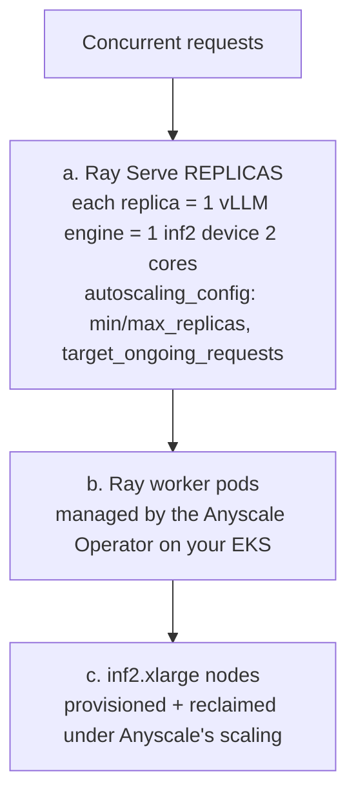

Earlier in B5 you added RAG, guardrails, streaming, and infrastructure monitoring to the Strands Loan Buddy. This section closes the operations story with the piece that controls **Neuron spend under changing load**: **autoscaling the self-hosted vLLM model with Ray Serve — on the managed [Anyscale](https://www.anyscale.com/) control plane** (the SaaS-track counterpart to Track A's self-managed KubeRay).

The workshop's self-hosted model (`qwen3-8b-neuron`) runs today as a **fixed single-replica vLLM Deployment** — it holds an Inferentia2 device (2 NeuronCores) whether it serves one request or none. This section deploys the **same model** as a **Ray Serve application managed by Anyscale**, which **scales replicas up and down on live request load** and provisions/reclaims **inf2** capacity underneath — so capacity follows demand, without you operating the Ray control plane.

::alert[**Track A vs Track B — same capability, two control planes.** Track A ([A4 → Ray Serve Autoscaling on KubeRay](/track-a-opensource/a4-production-ready/ray-serve-autoscaling/)) runs the **open-source, self-managed** KubeRay operator. This Track B module does the **same autoscaling of the same model (`qwen3-8b` on inf2, same container image)** but on **Anyscale's managed control plane** — the SaaS pattern that matches the rest of Track B (Kong Konnect, Arize AX). Pick the one that matches how you want to operate Ray.]{type="info"}

## 🎯 What You Will Learn

- ✅ How **Anyscale** manages Ray Serve autoscaling on your **own EKS** cluster (no self-managed operator)
- ✅ Register your EKS cluster as an **Anyscale cloud** (the Anyscale Operator, side-by-side with your workloads)
- ✅ Deploy the **same `qwen3-8b` vLLM-on-Neuron image** as an **Anyscale Service**
- ✅ Watch replicas scale on request load, with inf2 capacity managed by Anyscale
- ✅ Register the autoscaled model **side-by-side** and compare against the fixed deployment
- ✅ Observe it in the **Anyscale console** alongside Arize AX

## 🧠 Concept: three levels of autoscaling (Anyscale-managed)

The chain is the same as the KubeRay version — the difference is **who runs the control plane**:



- **(a) Ray Serve replicas** — the primary control, from the deployment's `autoscaling_config` (`min/max_replicas`, `target_ongoing_requests`). Each replica takes **2 NeuronCores** → one replica per `inf2.xlarge`.
- **(b)/(c)** — instead of KubeRay's in-tree autoscaler + your Karpenter config, the **Anyscale Operator** (installed in Part 1) manages the Ray worker pods and their inf2 nodes on your cluster.

::alert[**Scaling metric is request load, not accelerator utilization** — Ray Serve scales on `target_ongoing_requests`. A single Open WebUI chat never crosses it; Part 5 drives concurrent load.]{type="warning"}

## How Anyscale differs from the KubeRay path (Track A)

| | Track A — **KubeRay** (OSS) | Track B — **Anyscale** (SaaS) |
|---|---|---|
| Control plane | self-managed `kuberay-operator` in your cluster | **Anyscale** (console.anyscale.com) + the Anyscale Operator on your EKS |
| Workload API | `RayService` CRD (`kubectl apply`) | **Anyscale Service** (`anyscale service deploy`) |
| Autoscaling / nodes | Ray in-tree autoscaler + your Karpenter | **Anyscale-managed** |
| Observability | you wire AMP/Grafana + Ray dashboard | **Anyscale console** (hosted) + Arize AX |
| Ray Serve app code | identical (`vllm_serve.py`) | **identical** — same `import_path`, same image |

The **application code and container image are the same** as Track A — only the packaging (an Anyscale Service instead of a `RayService` CR) and the control plane differ.

## ✅ Prerequisites

- The Track B stack is deployed and the **`qwen3-8b-neuron`** model has run at least once (inf2 nodepool known-good).
- An **Anyscale account** (free sign-up) with an **API key** — you'll authenticate the CLI non-interactively with it (no browser login). Steps to create both are in Part 1.
- The serving image (same one Track A uses): `public.ecr.aws/agentic-ai-platforms-on-k8s/ray-vllm-neuron:latest` (built FROM the workshop's inf2 vLLM image + `ray[serve]` — see [Track A → Appendix](/track-a-opensource/a4-production-ready/ray-serve-autoscaling/#appendix--the-image)).
- AWS permissions to create a **CloudFormation stack, S3 bucket, and IAM role** in `us-east-1`.

## Part 1 — Register your EKS cluster as an Anyscale cloud

This installs the **Anyscale Operator** into its own namespace and registers the cluster as an Anyscale "cloud", so Anyscale can run Ray workloads on your EKS. It deploys a CloudFormation stack (S3 bucket + IRSA IAM role scoped to the cluster OIDC).

::alert[**This does not disturb anything else.** The Anyscale Operator installs into its **own namespace (`anyscale-operator`)** with its **own IAM role + S3 bucket** and manages **only its own Ray clusters** — it does not touch your vLLM deployments, Kong, or Arize. Point the setup at a dedicated namespace, never at `vllm`/`kong`.]{type="warning"}

**1a. Create an Anyscale account + API key.** In a browser:

1. Go to **[console.anyscale.com](https://console.anyscale.com)** and **sign up** (free — Google/GitHub/email). This creates your Anyscale **organization**.
2. Open **[console.anyscale.com/api-keys](https://console.anyscale.com/api-keys)** (top-right avatar → **API Keys**) and click **Create**. Copy the key — it is shown only once.

**1b. Install the Anyscale CLI.** The Code Editor's system Python is externally managed (PEP 668), so `pip install` fails with `externally-managed-environment`. Install with **pipx** (isolated venv, puts `anyscale` on PATH):

:::code{language=bash showCopyAction=true}
# pipx is pre-installed on the Code Editor; if it's missing: sudo apt-get update && sudo apt-get install -y pipx
pipx install anyscale || pipx upgrade anyscale
pipx ensurepath        # ensures ~/.local/bin is on PATH — if `anyscale` isn't found, open a new terminal
:::

**1c. Authenticate with your API key (no browser).** The `ANYSCALE_CLI_TOKEN` env var authenticates the CLI non-interactively:

::alert[**Do NOT run `anyscale login`** — that is the interactive **browser (OTP)** flow and it **ignores** this token. The env var alone authenticates the CLI; `anyscale login`/`logout` only manage a separate credentials *file* you don't need here.]{type="warning"}

:::code{language=bash showCopyAction=true}
# Paste the key you created in step 1a
export ANYSCALE_CLI_TOKEN="PASTE_YOUR_API_KEY"
anyscale cloud list    # verify auth works — NO browser (empty list is fine on a new account)
:::

::::expand{header="Check Output"}

```text
Listing clouds with:
• name            = <any>
• id              = <any>
• mode            = interactive

View your Clouds in the UI at https://console.anyscale.com/clouds

┏━━━━━━━━━━━━━━━━━━━━┳━━━━━━━━━━━━━━━━━━━━━━━━━━━━━━━━┳━━━━━━━━━━┳━━━━━━━━━━━┳━━━━━━━━━┓
┃ NAME               ┃ ID                             ┃ PROVIDER ┃ REGION    ┃ DEFAULT ┃
┡━━━━━━━━━━━━━━━━━━━━╇━━━━━━━━━━━━━━━━━━━━━━━━━━━━━━━━╇━━━━━━━━━━╇━━━━━━━━━━━╇━━━━━━━━━┩
│ genai-on-eks       │ cld_...                        │ AWS      │ us-east-1 │ True    │
│ anyscale_default…  │ cld_...                        │ GENERIC  │           │ False   │
└────────────────────┴────────────────────────────────┴──────────┴───────────┴─────────┘

Fetched 2 clouds.
```

(On a brand-new account this list is empty — that's expected; the `cloud setup` below creates your first cloud.)

::::

**1d. Register the EKS cluster as an Anyscale cloud.** This deploys the CloudFormation stack, registers the cloud, and installs the operator via Helm (~2-3 min). When asked about `ingress-nginx`, accept the default:

:::code{language=bash showCopyAction=true}
# You are already connected to the workshop cluster (genai-on-eks); refresh the kubeconfig to be safe
aws eks update-kubeconfig --region us-east-1 --name genai-on-eks

anyscale cloud setup --provider aws --region us-east-1 --name genai-on-eks \
  --stack k8s --cluster-name genai-on-eks --namespace anyscale-operator -y
:::

::::expand{header="Check Output"}

```text
Required CLI tools are installed (kubectl, helm, aws)
Using namespace: anyscale-operator
Discovering AWS cluster: genai-on-eks
(anyscale) Configuring kubeconfig for EKS cluster: genai-on-eks
(anyscale) Kubeconfig verification successful
Cluster discovered: arn:aws:eks:us-east-1:<account>:cluster/genai-on-eks
Setting up AWS infrastructure...
  Creating CloudFormation stack (this may take a few minutes)...
  Creating CloudFormation stack: k8s-genai-on-eks-9ecb7c29
  CloudFormation stack k8s-genai-on-eks-9ecb7c29 completed successfully
CloudFormation stack created
Registering cloud with Anyscale...
Cloud registered with ID: cld_...
Installing Anyscale operator...
  Executing: helm upgrade anyscale-operator anyscale/anyscale-operator ... --namespace anyscale-operator --create-namespace --wait -i
  Helm installation completed successfully

Kubernetes cloud 'genai-on-eks' setup completed successfully!
```

::::

Verify the cloud and operator:

:::code{language=bash showCopyAction=true}
anyscale cloud list
kubectl get pods -n anyscale-operator
:::

::::expand{header="Check Output"}

```text
# anyscale cloud list  — the newly-registered genai-on-eks cloud appears (DEFAULT=True)
NAME                     ID                                PROVIDER  REGION      DEFAULT
genai-on-eks             cld_f4vmcjbsivkq86kymcrcjk5m51    AWS       us-east-1   True
anyscale_default_cloud   cld_1lmre2e3xxv9w485ur8iaf1z1y    GENERIC               False

Fetched clouds.

# kubectl get pods -n anyscale-operator  — operator + its ingress-nginx controller, both Ready
NAME                                                          READY   STATUS    RESTARTS   AGE
anyscale-operator-5d964bc557-7hj5f                            2/2     Running   0          4m6s
anyscale-operator-ingress-nginx-controller-79b47869f9-rkrcj   1/1     Running   0          4m6s
```

::::

## Part 2 — The serving image

Anyscale runs a **bring-your-own container image**, so the Service uses the **exact same image as Track A** — `ray[serve]` (in an isolated venv) layered on the workshop's inf2 vLLM image, plus the `vllm_serve.py` Ray Serve proxy that launches the workshop's `vllm serve` subprocess. You do not rebuild anything:

```text
public.ecr.aws/agentic-ai-platforms-on-k8s/ray-vllm-neuron:latest
```

The `vllm_serve.py` deployment already declares its `autoscaling_config` (`min_replicas: 1`, `max_replicas: 2`, `target_ongoing_requests: 2`) and requests `neuron_cores: 2` per replica — Anyscale honors these exactly as KubeRay does.

## Part 3 — Deploy the Ray Serve app as an Anyscale Service

Define the Service. It reuses the same `import_path` (`vllm_serve:app`) and image; the **compute config** targets your registered cloud and pins workers to **inf2** with the `neuron_cores` resource:

:::code{language=bash showCopyAction=true}
cat > /workshop/qwen3-neuron-service.yaml <<'EOF'
name: qwen3-neuron-anyscale
image_uri: public.ecr.aws/agentic-ai-platforms-on-k8s/ray-vllm-neuron:latest
cloud: genai-on-eks
applications:
  - name: qwen3-neuron
    import_path: vllm_serve:app
    runtime_env:
      env_vars:
        PYTHONPATH: /home/ray
        NEURON_RT_NUM_CORES: "2"
        NEURON_RT_VISIBLE_CORES: "0,1"
EOF

anyscale service deploy -f /workshop/qwen3-neuron-service.yaml
:::

::alert[**inf2/Neuron scheduling on an Anyscale k8s cloud** is the one piece to confirm on your cloud: the worker group must land on `inf2.xlarge` and advertise the `neuron_cores` resource (via the Anyscale compute config / the operator's node config), the same requirement as the KubeRay worker in Track A. If replicas stay pending, align the compute config's instance type + custom resource to inf2 (2 NeuronCores), mirroring Track A's worker spec.]{type="warning"}

## Part 4 — Verify the model is serving

:::code{language=bash showCopyAction=true}
anyscale service status --name qwen3-neuron-anyscale
:::

Get the Service's query URL + auth token from the status output (or the Anyscale console), then hit the OpenAI-compatible endpoint:

:::code{language=bash showCopyAction=true}
curl -s "$SERVICE_URL/v1/chat/completions" \
  -H "Authorization: Bearer $SERVICE_TOKEN" \
  -H 'Content-Type: application/json' \
  -d '{"model":"qwen3-8b-neuron-ray","messages":[{"role":"user","content":"Reply with exactly: ray neuron online"}],"max_tokens":20}'
:::

The `qwen3-neuron` deployment reports `RUNNING`/`HEALTHY` in `anyscale service status` and in the Anyscale console once the vLLM subprocess has loaded qwen3-8b on the NeuronCores.

## Part 5 — Register side-by-side + drive autoscaling

Register the Anyscale-served model alongside the fixed one (through Kong/LiteLLM exactly as in B2 — point the route at the Anyscale Service URL with its bearer token), then drive **sustained concurrent load** and watch the deployment scale **1 → 2** in `anyscale service status` and the Anyscale console (a second inf2 replica joins; it drops back after the load stops). This is the same load-driven behavior as the KubeRay path — Anyscale just manages the cluster for you.

## Part 6 — Observe it (Anyscale console + Arize AX)

- **Anyscale console** (`https://console.anyscale.com`) — the Service, its replicas, request rate, latency, and autoscaling events, plus Ray/vLLM metrics, all hosted (no AMP/Grafana to run).
- **Arize AX** — the model's request traces/cost continue to flow through your Track B observability, unchanged.

## Cleanup

:::code{language=bash showCopyAction=true}
anyscale service terminate --name qwen3-neuron-anyscale
:::

To fully remove the Anyscale integration (optional): `helm uninstall anyscale-operator -n anyscale-operator`, `kubectl delete namespace anyscale-operator`, `anyscale cloud delete --name genai-on-eks`, then delete the CloudFormation stack it created (removes the S3 bucket + IAM role). **None of this affects your `qwen3-8b-neuron` deployment, Kong, or Arize.**

---

**Track B complete.** You now run the self-hosted Neuron model with **demand-driven autoscaling on the managed Anyscale control plane** — the SaaS counterpart to Track A's self-managed KubeRay, using the same model and image.
