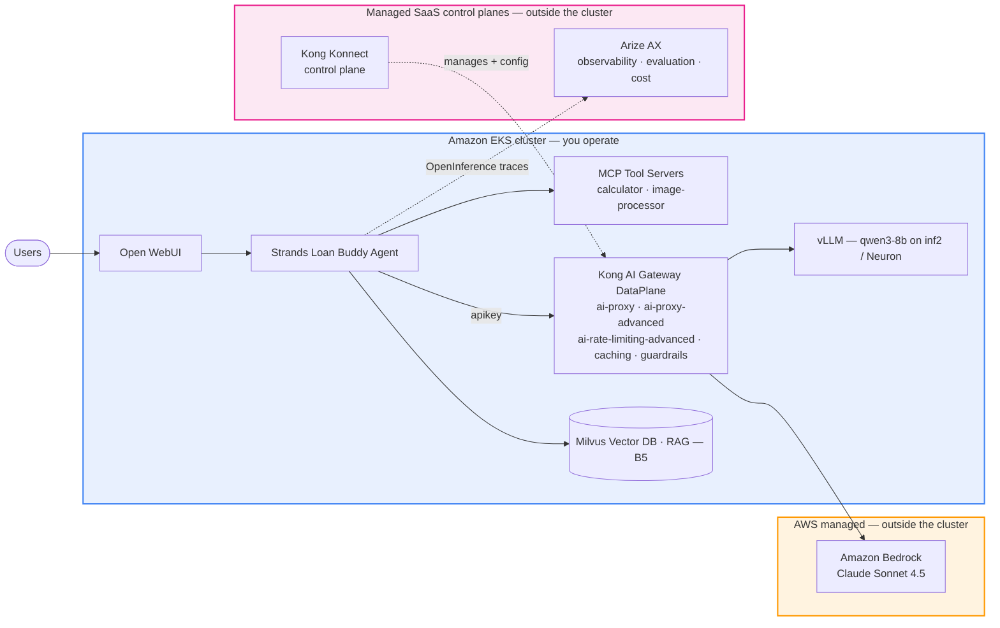

# Track B — SaaS Stack

This track builds the same Agentic AI platform using **managed SaaS** control planes and AWS's own agent SDK:

- **AI Gateway** — [Kong AI Gateway](https://developer.konghq.com/) via **Kong Konnect** (SaaS control plane) + an in-cluster DataPlane managed by **Kong Operator 2.x**, configured with native Kubernetes CRDs
- **Observability** — [Arize AX](https://arize.com/docs/ax) (SaaS) for OpenInference/OpenTelemetry traces
- **Agent framework** — [Strands Agents SDK](https://github.com/strands-agents/sdk-python), AWS's model-first agent framework

You will set up the SaaS platforms (Module B1), configure the AI gateway and observability (B2), build the credit-underwriting agent with Strands (B3), scale and evaluate it (B4), and harden it for production (B5).

::alert[**Choosing a track:** Track B uses managed SaaS control planes — you run only a stateless gateway DataPlane in-cluster and export traces to Arize AX, with nothing else to operate. To self-host the gateway and observability with open-source tooling instead, see [Track A — Open-Source Stack](../track-a-opensource/). The gateway and observability layers are independent between tracks — choose the one that matches how you want to operate the platform.]{type="info"}

## Prerequisites

Complete the **[Introduction](../introduction/) setup first** — the workshop's CloudFormation stack provisions the shared GenAI foundation and, importantly for Track B, the **shared EKS cluster**, **Amazon Bedrock** access, and a **pre-provisioned S3 bucket**. Track B then adds its own SaaS control planes on top. Here "Introduction setup" means **only the CloudFormation stack deployment** (which stands up the cluster, Bedrock access, and S3 bucket) — **not** the LiteLLM walkthrough pages under it. You do **not** need the **[Interacting with Models](../module-interacting-with-models/)** module, the **[Virtual Key Shortcut](../introduction/virtual-key-shortcut/)** (a LiteLLM/Track-A shortcut — Track B uses no LiteLLM Virtual Keys), or any **Track A module (A1–A5)** — those are optional learning / other-track content, and none of them create Track B's dependencies. Track B is **fully Kong-native**: every AI call (both the agent's reasoning and the document-image vision call) goes through **Kong → Bedrock**, so it does **not** depend on LiteLLM. It relies only on these pieces of the shared foundation:

| Dependency | Provided by | Why Track B needs it |
|---|---|---|
| Shared **EKS cluster** + **Amazon Bedrock** access | Introduction / CloudFormation | Runs everything; the Kong DataPlane signs all Bedrock calls (agent reasoning **and** document vision) |
| Pre-provisioned **S3 bucket** (`genai-on-eks-bucket-langfuse-…`) | Introduction / CloudFormation | The image-processor MCP stores the uploaded document image |
| **Kong Konnect** account + Personal Access Token | You create in **B1** | SaaS control plane for the AI Gateway DataPlane |
| **Arize AX** account + Space | You create in **B1** | SaaS observability (OpenInference traces) |

::alert[**Track B is fully Kong-native — LiteLLM is not used.** The Strands agent's reasoning routes through **Kong → Bedrock** (the `/loan-strands` route), and the document-image **vision** call routes through **Kong → Bedrock Converse** (the native `llm_format: bedrock` `/vision` route that B3 deploys). The Track A shared foundation may still run a LiteLLM gateway, but Track B does **not** call it and does **not** need the `litellm-masterkey` Secret — B3 builds a Kong-native image-processor MCP that talks to Bedrock through Kong directly.]{type="success"}

Confirm the shared foundation is up **before** you start Module B1 — both must exist:

:::code{language=bash showCopyAction=true}
kubectl get nodes                                  # shared EKS cluster reachable (nodes Ready)
aws s3 ls | grep genai-on-eks-bucket-langfuse      # pre-provisioned image bucket
:::

::::expand{header="Check Output"}

```text
NAME                          STATUS   ROLES    AGE   VERSION
ip-10-x-x-x.ec2.internal      Ready    <none>   *     v1.3x.x
ip-10-x-x-x.ec2.internal      Ready    <none>   *     v1.3x.x

2026-xx-xx xx:xx:xx genai-on-eks-bucket-langfuse-xxxxxxxxxxxxxxxxxxxxx
```

::::

::alert[If the cluster is unreachable or the S3 bucket is missing, the shared foundation is not ready — re-check the **[Introduction](../introduction/)** setup (the CloudFormation stack provisions them). Bedrock model access is verified end-to-end in B2 when you test the Kong route.]{type="info"}

::alert[**Why a `…-langfuse` bucket in Track B?** This S3 bucket is part of the **shared foundation** provisioned by the Introduction CloudFormation — its name is historical (it predates the track split) and is **not** renamed per track. Track B **reuses it as-is** for the image-processor MCP; the name does **not** mean Langfuse is used here (Track B observability is **Arize AX**). More broadly, Track B **reuses shared-foundation assets** — the EKS cluster, Amazon Bedrock access, the S3 bucket, and the **MCP tool servers** — and only rebuilds the pieces that must be Kong-native (for example, B3's Kong-native image-processor MCP).]{type="info"}

## What's in this track

| Module | Focus |
|---|---|
| **B1: Platform Setup — Kong Konnect & Arize AX** | Register the Kong Konnect control plane + DataPlane; create the Arize AX Space and credentials |
| **B2: AI Gateway & Observability (Kong + Arize)** | The `ai-proxy` Bedrock route as KongService/KongRoute/KongPlugin CRDs; wire Arize AX tracing |
| **B3: Building Agentic Applications with Strands** | The Strands credit-underwriting agent via Kong → Bedrock, traced in Arize AX |
| **B4: Tokenomics & Evaluation** | Token & cost attribution + per-tenant budget enforcement, model routing, semantic caching, and LLM evaluation |
| **B5: Production Readiness & Operations** | RAG, security hardening, streaming, and infrastructure monitoring + auto-scaling for a production-grade Strands agent |

## Track B Architecture

Track B's defining trait is **where each component runs**. You operate only the **in-cluster data plane** (the agent, the Kong gateway *DataPlane*, model serving, and the vector DB) inside your **Amazon EKS** cluster; the **control planes are managed SaaS** — **Kong Konnect** (configures/manages the DataPlane) and **Arize AX** (observability + evaluation) — and live **outside** your cluster. **Amazon Bedrock** is a managed AWS service, also outside the cluster.



- **Inside EKS (you run it):** Open WebUI, the Strands agent + MCP tool servers, the **Kong DataPlane** (the actual proxy — ai-proxy, routing, rate-limiting, caching, guardrails), self-hosted **vLLM** (qwen3-8b on inf2), and **Milvus** for RAG.
- **Managed SaaS (outside, egress-only):** **Kong Konnect** manages/configures the DataPlane; **Arize AX** receives OpenInference traces for evaluation and cost — nothing to operate, no state in your cluster.
- **AWS managed (outside):** **Amazon Bedrock** (Claude Sonnet 4.5) serves the agent's reasoning and vision calls through Kong.

## Track comparison

| | [Track A](../track-a-opensource/) | Track B (this track) |
|---|---|---|
| AI Gateway | LiteLLM (self-hosted) | **Kong AI Gateway** — Konnect (SaaS) |
| Observability | Langfuse (self-hosted) | **Arize AX** (SaaS) |
| Agent framework | LangChain / LangGraph | **Strands Agents SDK** |
| Model access IAM | app holds Bedrock + gateway key | **app holds S3 only; Bedrock via gateway** |
| Operating model | you run the control planes | **managed SaaS control planes** |

---

## Why SaaS Over Open Source for Production

Open-source tooling is a good place to start. It gets traces out of your application and answers the first question every team has: *what did my agent actually do?*

Production raises a second set of questions: Can this handle our volume? Can we prove to security that it is safe? Can we improve the system every week — and who is accountable when it breaks? With open source, all of that is yours to build, staff, and attest to. The SaaS stack (Kong Konnect + Arize AX) is built for that second set.

### Why Arize AX for Enterprise Observability

#### Open Standards with a Clean Exit

Arize created **OpenInference**, the open standard that extends OpenTelemetry to GenAI and agent tracing, and donated its auto-instrumenters to OpenTelemetry (donation [accepted](https://github.com/open-telemetry/community/issues/3467) into official OTel GenAI conventions). Your traces in AX are never held in a closed schema — **Data Fabric** syncs telemetry, evals, and annotations into your own warehouse. Migration is a routine export.

#### A Closed Improvement Loop

- **Signal** continuously reviews every production run, catching recurring failures and proposing fixes
- **Alyx** (in-platform copilot) carries 30+ skills across prompt optimization, evaluator authoring, dashboard building, and anomaly detection
- **Agent Experimentation**, **Fleet Observability**, **Agent-as-a-Judge**, and **Agent Console** turn findings into tested changes

#### Evaluation That Holds Up Under Scrutiny

- **Session-level evals** (not just per-span) — grades the full agent trajectory, catching failures where every individual step looks green but the end-to-end outcome fails
- **Explainable scores** — see the reasoning behind every judgment (critical for risk committees)
- **Remote Evaluators** — register your own scoring endpoint for proprietary or compliance-constrained logic
- Maintained evaluator library: hallucination, groundedness, tool selection, PII/PHI, jailbreak detection, SQL/code correctness. **Evals are unmetered.**

#### Enterprise Scale (ADB Engine)

**ADB** is Arize's OLAP engine for high-cardinality agent data: millions of spans per second ingest, sub-second queries on wide nested schemas. Native monitors, alerting, and SLOs cover performance, drift (PSI, KL, KS, JS), data quality, and custom metrics — routed to Slack, PagerDuty, Teams, or webhook.

### What Security and Procurement Ask For

| Capability | Open source (Langfuse, Phoenix) | Arize AX (SaaS) |
|---|---|---|
| Tracing, evals, datasets, playground | ✓ | ✓ |
| Session-level and trajectory-aware evals | ✗ | ✓ |
| Native monitors, alerting, SLOs | ✗ | ✓ |
| Production ingest + configurable retention (ADB) | ✗ | ✓ (operated by Arize) |
| Enterprise SSO (Okta, Entra ID) | ✗ | ✓ |
| RBAC: space-level roles, custom roles, audit logs | ✗ | ✓ |
| SOC 2 Type II, HIPAA-capable | ✗ | ✓ |
| Multi-region data residency | ✗ | ✓ |
| VPC / on-prem deployment (AWS, Azure, GCP) | Self-managed | ✓ (deployed + supported by Arize) |
| Signal with Managed Agents | ✗ | ✓ |
| Data Fabric sync to your warehouse | ✗ | ✓ |
| Dedicated support, SLA, named team | ✗ | ✓ |

### The Economics

Self-hosting at production volume means provisioning and tuning the datastore, adding reporting, building alerting, then patching, scaling, upgrading, and staffing on-call — all for supporting infrastructure. Two or three engineers of sustained effort typically dwarfs the licence cost. AX consolidates tracing, evals, experimentation, monitoring, annotation, guardrails, and the improvement loop into one platform with one bill.

### Enterprise Adoption

Enterprises across regulated financial services and consumer tech — including publicly referenced Arize customers — run AX as their primary AI observability layer. (See Arize's public customer case studies: https://arize.com/customers/)

---

## Four Questions Worth Asking Before You Scale

1. After ingestion, what schema is my telemetry stored in — and can anything other than your platform read it?
2. Can I see **why** an eval scored what it did?
3. When it fails at 3am, does the platform page me, can I trace the failure to the span that caused it, and who owns the fix?
4. Are my security, compliance, and data-residency requirements met contractually — or mine to satisfy indefinitely?

---

**[Start with Module B1: Platform Setup →](b1-platform-setup/)**
